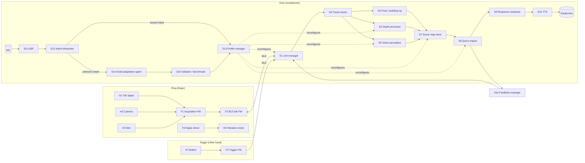

# Ring Sensor: Architecture as Black-Box Functions

A ring worn on the pointing finger. When the user presses a button on the
other hand, the system scans whatever the finger points at and speaks a
description. Spoken requests ("just tell me the distance") reconfigure the
pipeline. Droid (Factory.ai) handles requests the system can't already serve
by building new pipeline configurations or modules.

Every block below is a **black box**: a name, inputs, outputs, a performance
contract, and an owner. A team can build its block on its own as long as it
keeps the input/output contract. The shared data types are defined in
[`interfaces/contracts.py`](interfaces/contracts.py), and that file is the
single source of truth for them.

---

## 0. System overview



**Key architectural decision: two speeds of adaptation.**

| Path | Trigger | Latency | Mechanism |
|---|---|---|---|
| **Fast path** | Request matches a known capability ("only distance", "more detail", "find the door") | < 300 ms | S12 maps speech to a **Profile**, and S13 hot-swaps the pipeline (turns off the camera, skips the map, changes resolution, and so on). No code changes. |
| **Slow path** | Request isn't covered ("warn me about anything below knee height") | seconds to minutes | S14 calls Droid, which writes a new Profile or a new plugin module. S15 checks it in a sandbox before S13 loads it. The user hears "Working on it…" while this runs. |

Droid is a software engineering agent. Putting it in the per-scan loop
would make every request take seconds, so it only runs on the slow path. Once
Droid has built a profile, that profile goes into the registry and runs on the
fast path from then on.

---

## 1. Hardware blocks

| ID | Block | Input | Output | Contract / key specs | Suggested part (starting point) |
|---|---|---|---|---|---|
| **H1** | Depth sensor | 1.8 V/3.3 V power, I²C config (zone count, rate) | Multizone range frame, 8×8 zones, mm + confidence | 2 cm–4 m range, ≥15 Hz, ~45–65° FoV, < 50 mW active | ST VL53L8CX (multizone ToF) |
| **H2** | Camera | Power, capture command, resolution setting | One JPEG still per trigger (QVGA–VGA) | Aligned with H1's axis (≤ 2° boresight error), wakes in < 100 ms, can be fully powered off | Himax HM0360 / OV2640-class module |
| **H3** | IMU | Power, I²C/SPI config | Orientation quaternion + accel + gyro + mag | ≥ 100 Hz, heading drift < 2°/min with mag fusion | Bosch BMI270 + BMM350 or BNO085 (on-chip fusion) |
| **H4** | Ring MCU + radio | Sensor buses, battery | BLE 5 link to host | BLE 2M PHY, hardware JPEG/DMA capability, < 5 mA average | Nordic nRF5340 / ESP32-S3-PICO |
| **H5** | Power subsystem | USB/wireless charging input | Regulated rails, battery state of charge | ≥ 8 h mixed use, charge in < 1 h, protection IC | ~80–120 mAh curved LiPo, charger + fuel gauge |
| **H6** | Haptic actuator (ring) | Pattern ID from F3 | Vibration | Different patterns the user can tell apart by feel (ack, error, proximity pulse) | ERM / LRA micro-motor |
| **H7** | Trigger unit (other hand) | Thumb press | Press events over BLE | Single, double, and long press; 6+ months on a coin cell | Small BLE clicker ring/wristband (nRF52) |
| **H8** | Ring mechanics | Finger size, PCB stack | Wearable enclosure | Sensor window faces along the finger, sizes S/M/L, splash resistant, < 12 g | Resin/SLA prototype, flex PCB |
| **H9** | Host + audio I/O | — | Mic input, audio output | Bone-conduction or open earphones so environmental sound isn't blocked | Smartphone + bone-conduction headset |

**Hardware ↔ software boundary:** the only hardware output the software team
needs is the BLE packet stream defined in `contracts.py` (`SensorPacket`,
`TriggerEvent`). The **simulator (S0)** produces the same stream, so software
work doesn't have to wait for hardware.

---

## 2. Firmware blocks (run on ring / trigger)

| ID | Function | Input | Output | Contract |
|---|---|---|---|---|
| **F1** | `acquire()` | Raw H1/H2/H3 data; `SensorConfig` from host | Timestamped `DepthFrame`, `ImageFrame`, `ImuSample` | Uses one clock for all sensors (µs). Each sensor can be switched on/off at runtime through `SensorConfig`. |
| **F2** | `ble_link()` | Frames from F1; commands from host | `SensorPacket` stream; applies `SensorConfig` | Fragments and reassembles JPEGs. Frames are prioritized IMU > depth > image. Reports drops with sequence numbers. |
| **F3** | `haptic(pattern_id)` | `HapticCommand` | Drives H6 | Starts < 20 ms after the command arrives |
| **F4** | `trigger_fw()` | Button GPIO | `TriggerEvent` (single/double/long) | Debounced, < 30 ms press-to-air, bonded and paired with the ring's host |
| **F5** | `power_mgr()` | Activity, battery state | Sleep states, `BatteryStatus` | Idle current < 50 µA, wakes on host command or motion |

---

## 3. Host software blocks

Each block is a pure function, or a small stateful service with a narrow API.
Owner tags: **[LINK]** connectivity, **[PERC]** perception, **[MAP]** data
structures, **[VOICE]** speech, **[ADAPT]** Droid/adaptation, **[INT]**
integration.

| ID | Function | Input → Output | Contract | Owner |
|---|---|---|---|---|
| **S0** | `simulate(scene, trajectory)` | 3D test scene + finger path → `SensorPacket`s, `TriggerEvent`s | Byte-identical to real hardware packets. Lets the software be built without hardware. | INT |
| **S1** | `link_manager` | BLE bytes ↔ `SensorPacket` / `TriggerEvent`; sends `SensorConfig`, `HapticCommand` | Auto-reconnects. Exposes link health. | LINK |
| **S2** | `fuse(packets) → FusedFrame` | Raw packets → time-aligned bundle of depth + image + IMU at the trigger instant | Alignment error < 10 ms. Image may be absent if the camera is off. | LINK |
| **S3** | `estimate_pose(imu_stream) → PointingRay` | IMU samples → ray (origin, unit direction) in world frame | Direction error < 3°. Origin is a body-relative estimate (see open question Q1). | PERC |
| **S4** | `process_depth(DepthFrame, PointingRay, roi) → DepthResult` | Depth zones → nearest distance in the ROI + 3D point set | < 10 ms. ROI comes from the active Profile (for example, center 2×2 zones only). | PERC |
| **S5** | `perceive(ImageFrame, roi, task) → list[Detection]` | Image → labelled objects with bbox, confidence, optional OCR text | `task` ∈ {detect, describe, ocr, find:<label>}. On-device model ≤ 300 ms, cloud VLM ≤ 1.5 s. | PERC |
| **S6** | `describe(FusedFrame, detections, depth) → SceneDescription` | Perception + depth → structured description (objects, spatial relations, distances) | Model-agnostic: swap in a local or cloud VLM behind the same signature | PERC |
| **S7** | `SceneMap` (store) | `insert(observation)`, `query_ray(ray, max_dist)`, `nearest(ray)`, `objects_in_cone(ray, angle)`, `prune(policy)` | **Representation is set by the Profile** (see §4). All queries return in < 5 ms. | MAP |
| **S8** | `answer(Query, SceneMap, FusedFrame) → Answer` | Trigger + active Profile → computed answer | Runs only the stages the Profile enables | INT |
| **S9** | `compose(Answer, Verbosity) → str` | Structured answer → short spoken text | Units/locale aware. "Chair, 1.2 meters, slightly left." Puts the most important information first. | VOICE |
| **S10** | `tts(text) → audio` | Text → audio stream | First audio < 150 ms, can be interrupted (a new trigger cuts off speech) | VOICE |
| **S11** | `asr(audio) → Transcript` | Mic audio → text + confidence | Push-to-talk = long press on H7. On-device when possible. | VOICE |
| **S12** | `interpret(Transcript, ProfileRegistry) → Intent` | Text → structured `Intent` | Either `ChangeProfile`, `OneShotQuery`, `AdjustParameter`, or `Unsupported(reason)`. LLM with a constrained JSON schema. | ADAPT |
| **S13** | `apply_profile(Profile) → PipelineState` | Profile → reconfigured pipeline + `SensorConfig` sent to ring | Swap takes < 100 ms. Any frames in flight finish under the old profile. Spoken confirmation. | INT |
| **S14** | `adapt(Intent.Unsupported, codebase, telemetry) → Candidate` | Unmet request → new `Profile` JSON and/or plugin module (via Droid headless run) | Runs asynchronously. May only touch the `plugins/` and `profiles/` directories. Returns a diff + tests. | ADAPT |
| **S15** | `validate(Candidate) → ValidationReport` | Candidate → pass/fail, latency, power, and accuracy on S0 replay set | Sandboxed. A failure means the candidate is never loaded. Each pass is versioned and can be rolled back. | ADAPT |
| **S16** | `feedback(event) → HapticCommand / earcon` | System events → haptic/audio cue | Ack within 50 ms of the trigger so the user knows the press registered | VOICE |
| **S17** | `telemetry` | All blocks → logs, latency traces, replay recordings | Recordings feed S0 replay and S15 benchmarks. Privacy: images are opt-in only. | INT |

---

## 4. The adaptive data structure (S7 + Profiles)

The **Profile** is the object that the voice commands change. It states which
pipeline stages run and how the scene is stored.

```text
Profile
├── sensors:      which of depth / camera / IMU are on, rates, resolution
├── roi:          which part of the field of view matters (center zones, full FoV)
├── stages:       which of S4 / S5 / S6 run on a trigger
├── map:          representation + resolution + retention
│     none          → no persistence (stateless, fastest)
│     ray_cache     → last N (ray, distance) hits in a ring buffer
│     object_list   → list of objects with world position + label + last seen
│     voxel_hash    → sparse voxel grid (e.g. 5 cm) with occupancy + label
│     octree        → multi-resolution, for room-scale mapping
├── answer:       what fields to report (distance, label, direction, text)
├── verbosity:    terse | normal | detailed
└── continuous:   off | haptic proximity | periodic speech
```

### Built-in profiles (fast path)

| Profile | Spoken example | Sensors on | Stages | Map | Expected latency* | Why it's faster |
|---|---|---|---|---|---|---|
| `NEAREST_DISTANCE` | "Only tell me the distance" | Depth + IMU | S4 (center ROI) | `none` | ~100 ms | Camera off: no image transfer, no vision model, no map writes, and less power use |
| `DESCRIBE` (default) | "What's there?" | All | S4, S5, S6 | `object_list` | ~1–2 s | — |
| `FIND <label>` | "Where is the door?" | All | S5 `find:door` | `object_list` lookup first | ~50 ms if cached, ~800 ms otherwise | Answers from the map when the object was seen recently, and the detector looks for one class only |
| `READ_TEXT` | "Read this sign" | Camera + IMU | S5 `ocr` | `none` | ~1 s | Skips depth and scene description |
| `PROXIMITY_HAPTIC` | "Vibrate when something is close" | Depth | S4, continuous 10 Hz | `ray_cache` | Continuous | No speech at all; output is vibration intensity |
| `ROOM_MAP` | "Remember this room" | All | S4, S5 | `voxel_hash` | ~1–2 s/scan | Later queries ("where did I leave the cup?") become map lookups |

*Rough estimates for planning. Measure each one with S15.

### Intent examples (S12 output)

```json
{"type": "ChangeProfile", "profile": "NEAREST_DISTANCE"}
{"type": "AdjustParameter", "path": "verbosity", "value": "terse"}
{"type": "OneShotQuery", "profile": "FIND", "args": {"label": "door"}}
{"type": "Unsupported", "request": "warn me about anything below knee height",
 "hint": "needs height filter on depth points"}
```

When S12 returns `Unsupported`, S14 (Droid) gets the request, the Profile
schema, the plugin API, and the S0 replay set. For example, Droid might
write a `plugins/low_obstacle_filter.py` that implements `DepthStage` and a
`profiles/LOW_OBSTACLE.json` that uses it. S15 validates both, and after that
the profile is available on the fast path.

---

## 5. End-to-end flows

**A. Scan (trigger press)**
`H7 → F4 → S1 → S16 (ack buzz) → S2 → [S3, S4, S5, S6 as Profile allows] → S7.insert → S8 → S9 → S10 → audio`

**B. Spoken command (long press, speak)**
`H7 long press → S11 → S12 → (known) S13 → "Distance only mode"`
` → (unknown) S14 → S15 → S13 → "New mode ready: low obstacles"`

**C. Cheapest path (NEAREST_DISTANCE)**
`trigger → S2 (depth only) → S4 (center 2×2 zones, min) → S9 "1.4 meters" → S10`

---

## 6. Work packages

| Package | Blocks | Can start with | Done when |
|---|---|---|---|
| WP1 Sensing HW | H1, H2, H3, H4 | Dev boards on a breadboard | All three sensors stream over BLE on a dev kit |
| WP2 Power & Mech | H5, H6, H8 | Size/weight budget | Wearable prototype runs ≥ 8 h |
| WP3 Trigger | H7, F4 | Off-the-shelf nRF52 dev kit | Paired and sending events |
| WP4 Firmware | F1, F2, F3, F5 | `contracts.py` packet spec | Packets pass S1's parser |
| WP5 Link & Sim | S0, S1, S2, S17 | `contracts.py` | Simulator replays and live hardware are interchangeable |
| WP6 Perception | S3, S4, S5, S6 | S0 output | Meets the accuracy/latency contracts on the replay set |
| WP7 Map | S7 | `contracts.py` | All representations pass the same query test suite |
| WP8 Voice | S9, S10, S11, S16 | Text fixtures | Speech round-trip under 1 s |
| WP9 Adaptation | S12, S13, S14, S15 | Profile schema | A request outside the built-in profiles becomes a validated, loaded profile |

**Integration milestones**
1. **M1 (sim-only):** S0 → … → S10 works end to end with `NEAREST_DISTANCE` and `DESCRIBE`.
2. **M2 (dev-kit HW):** S0 replaced by real F2 packets.
3. **M3 (voice control):** fast-path profile switching by speech.
4. **M4 (Droid loop):** slow-path adaptation with validation and rollback.
5. **M5 (wearable):** H8 enclosure, user testing with blind participants.

---

## 7. Open questions (decide early)

- **Q1 Position tracking.** The ring IMU gives the pointing *direction*
  but not the finger's *position*. For `none` / `ray_cache` maps that's fine.
  `object_list` / `voxel_hash` maps that persist across scans need a position
  estimate. Options: assume the user stands still between scans, carry the
  phone on a chest lanyard and use ARCore/ARKit for body pose, or add visual
  odometry from H2.
- **Q2 Compute location.** Should the vision model run on the phone or in the
  cloud? This is a trade-off between latency/privacy and quality. S5 and S6
  have a model-agnostic signature so either works.
- **Q3 Droid invocation.** Confirm how Droid will run unattended in the
  product (for example, Factory's headless `droid exec` mode), along with its
  cost per adaptation, and whether adaptation happens on a server or a dev
  machine. Adaptations should probably also be checked offline before they
  reach other users.
- **Q4 Safety.** This is an assistive device. Silence must never be read as
  "the way is clear". Define what happens on sensor failure, low confidence,
  or a lost link. The proposed rule is to always say so out loud, plus a
  distinct haptic error pattern.
