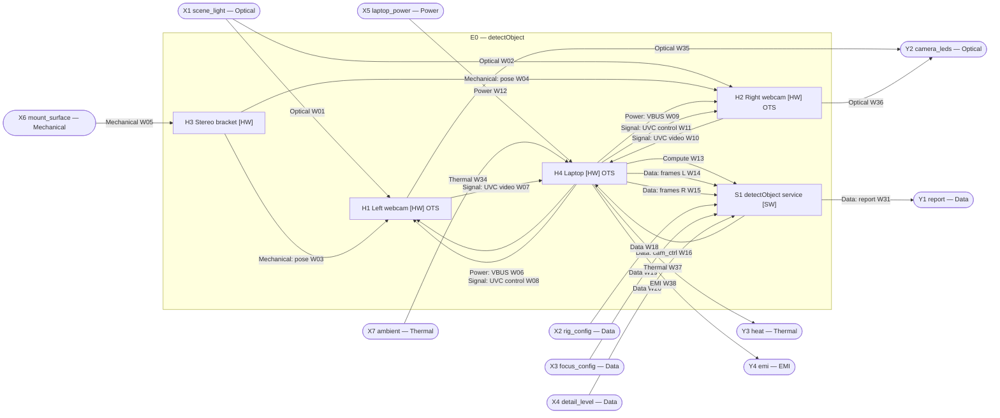
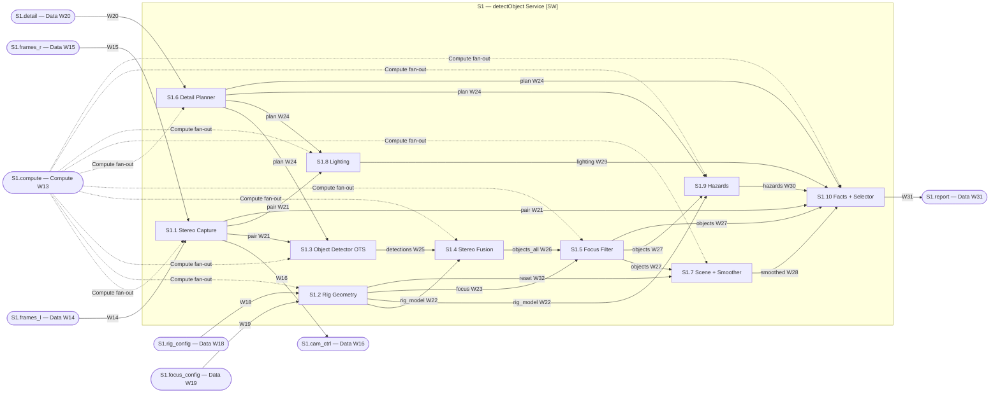

# Black-Box Design: detectObject

> Idea (from `detectObject_algo.txt`): *"Two webcams connected via USB to a laptop. The inputs are the constant data stream of the two cameras plus rig variables (angle between the webcams, distance between them, …). Using all inputs, focus a convenient region (a parameter that can be changed later) and detect which objects are in that window. A detail parameter controls how much detail is processed (lowest: "conference room"; middle: "conference room, 60 seats, one projector"; highest: "…, daylight, two speakers, one trip hazard at the front"). The detail parameter must be a clean mathematical model with clear input and output, because other algorithms will connect to it."*
>
> Produced by following `BLACKBOX_DESIGN_PROMPT.md`. Code: `detect_object/`. Tests: `tests/test_detect_object.py`. Inputs/outputs rationale: `docs/detectObject_IO.pdf`. Assumptions are `A#` (§10).

**ID scheme:** `E0` explanatory box; `H*` hardware; `S*` software; `S1.n` children of `S1`. External inputs `X#`, external outputs `Y#`, wires `W##`.

---

## 1. E0: Explanatory box

### E0 — Stereo Webcam Object Detector "detectObject" (orientation only; not built)

**Description.** Two off-the-shelf USB webcams (`H1`, `H2`) sit on a rigid bracket (`H3`) at a known baseline and angle and stream video to a laptop (`H4`). The detectObject service (`S1`) runs on the laptop. It pairs the two streams in time, detects objects in each image, fuses the two views into physical objects with bearing and (where both cameras see them) distance, and keeps only the objects inside a configurable **focus region**. It then builds a set of candidate *facts* about the region (scene type, object counts, hazards, lighting, object locations) and reports the subset chosen by a **detail level** λ ∈ [0, 1]. Each processed frame pair produces one `DetectionReport`, which is the input for downstream algorithms.

**External ports**

| ID | Dir | Name | Type | Parameters |
|---|---|---|---|---|
| X1 | in | `scene_light` | Optical | Visible light 400–700 nm reflected from the scene; illuminance 10–100 000 lux; objects 0.3–10 m from the rig; fan-out to both cameras' fields of view. |
| X2 | in | `rig_config` | Data | `StereoRig` (see W18): baseline, convergence angle, pitch, height above floor, per-camera resolution + HFOV or calibration. JSON file or in-process call. On change only. |
| X3 | in | `focus_config` | Data | `FocusRegion` (see W19): yaw/pitch window (deg), near/far band (m), clip-to-overlap flag, stereo-only flag. On change only. |
| X4 | in | `detail_level` | Data | λ ∈ [0, 1] float, or preset `low`=0, `medium`=0.5, `high`=1; optional `DetailModel` parameters (see W20). Any time; applies to the next frame pair. |
| X5 | in | `laptop_power` | Power | Laptop charger (e.g. USB-C PD 20 V, ≤ 65 W) or internal battery; whatever the laptop vendor specifies. |
| X6 | in | `mount_surface` | Mechanical | Tripod with 1/4"-20 UNC screw, or a flat surface; holds ≥ 0.5 kg without moving; vibration ≤ 0.1 g. |
| X7 | in | `ambient` | Thermal | Indoor air 0–35 °C. |
| Y1 | out | `report` | Data | `DetectionReport` stream (see W31) → downstream algorithms. ≤ camera frame rate; latency 60–400 ms at 640×480 on a laptop CPU (see S1 contract). |
| Y2 | out | `camera_leds` | Optical | Each webcam's activity LED (if fitted), on while streaming. **Privacy indicator** for people in the room. |
| Y3 | out | `heat` | Thermal | Aggregate of all boxes: laptop ≤ 45 W while inferring on CPU (vendor TDP), webcams ≤ 2.5 W each. |
| Y4 | out | `emi` | EMI | Aggregate, unintentional. All parts are OTS consumer devices certified to FCC Part 15 B / CE EN 55032 Class B; the rig adds no emitters. |

**Data leaving the system:** only Y1. No image leaves the laptop and the service makes no network calls at run time (model weights are fetched once at install; A9). This is the privacy guarantee (R12).

**Goals**
- G1. Report the objects inside the focus region at ≥ 2 reports/s at λ = 0.5 on a mid-range laptop CPU (measured: ~180 ms per pair, ≈ 5 Hz, at 640×480 on an 8-core x86 laptop).
- G2. Distance to objects seen by both cameras within ±(6 % + 1 px-disparity error) up to 5 m (error model: δZ ≈ Z²·δθ / b).
- G3. Nested output: for one frame pair, the facts at λ₁ are a prefix of the facts at λ₂ whenever λ₁ ≤ λ₂ (proved in §3, S1.10; tested).
- G4. Runs unchanged on Linux and macOS (Intel or Apple Silicon).

**Constraints**
- Cost: two webcams ≤ US$100 total; bracket ≤ US$10; existing laptop.
- Platform: Python ≥ 3.10, OpenCV, numpy, Ultralytics YOLO; no OS-specific code outside `capture.default_api()`.
- Safety: this is a perception aid, not a safety device. A missing hazard fact never means "no hazard"; low confidence is always reported in `warnings`.
- Privacy: images stay in memory on the laptop; nothing is stored to disk.

**Children (level 1):** H1, H2, H3, H4, S1.

---

## 2. Level-1 graph

Mermaid cannot place nodes on a subgraph border, so external ports are drawn as stadium nodes just outside `E0`.



---

## 3. Box specifications

### 3.1 Level 1 (Parent: E0)

```
### H1 — Left Webcam                                  [HW]  [OTS: Logitech C270/C920 or any USB UVC 1.1 camera]
Parent:        E0
Purpose:       Turn the light from the left viewpoint into a UVC video stream.
Inputs:
  - scene_light : Optical { 400–700 nm, 10–100 000 lux, fixed-focus or AF, HFOV 60–90° (declared in X2) } ← external (X1, W01)
  - mount       : Mechanical { see W03 }                                                     ← H3.left_mount
  - vbus        : Power  { 5 V ±5 %, ≤ 500 mA, USB-A/C captive cable ≤ 2 m }               ← H4.usb_vbus_l (W06)
  - uvc_ctrl    : Signal { USB 2.0 control transfers, UVC 1.1: format, frame size, fps, exposure } ← H4.usb_ctrl_l (W08)
Outputs:
  - uvc_video   : Signal { USB 2.0 HS 480 Mb/s isochronous/bulk, UVC 1.1, MJPEG 640×480 @ 30 fps (YUYV fallback) } → H4.usb_in_l (W07)
  - led         : Optical { activity LED, on while streaming }                               → external (Y2, W35)
Physical:      ≤ 170 g, 1/4"-20 socket or clip, 0–40 °C
Internal state:auto-exposure / auto-white-balance loop (inside the OTS firmware; not visible)
Contract:      30 fps ±10 % at 640×480 MJPEG; frame period jitter ≤ 5 ms; no hardware sync with H2 (A3)
Failure modes: unplugged → no frames (S1.1 raises after 30 failed reads); low light → noisy, darker frames; AWB shifts colour (S1.8 confidence capped)
Isolation test:Plug into a laptop alone; `python -m detect_object --list` lists it; 300 frames read in 10 ± 1 s at 640×480
Owner:         HW-Rig
Children:      leaf (OTS)

### H2 — Right Webcam                                 [HW]  [OTS: same model as H1]
Parent:        E0
Purpose:       Turn the light from the right viewpoint into a UVC video stream.
Inputs / Outputs / Physical / Contract / Failure modes / Isolation test: identical to H1, with wires W02, W04, W09, W11 in and W10, W36 out.
Owner:         HW-Rig
Children:      leaf (OTS)

### H3 — Stereo Bracket                               [HW]
Parent:        E0
Purpose:       Hold both webcams at the declared baseline and angles.
Inputs:
  - base        : Mechanical { see W05 }                                                     ← external (X6)
Outputs:
  - left_mount  : Mechanical { camera centre at x = −b/2; yaw +θ/2; pitch φ; tolerance ±1 mm, ±0.5° } → H1.mount (W03)
  - right_mount : Mechanical { camera centre at x = +b/2; yaw −θ/2; pitch φ; tolerance ±1 mm, ±0.5° } → H2.mount (W04)
Physical:      aluminium bar or 3D-printed PETG; 0.08–0.30 m long; ≤ 150 g; two 1/4"-20 screws or clips; 1/4"-20 socket underneath
Internal state:none
Contract:      b, θ, φ stay within tolerance under handling (no re-calibration between sessions); the values written on the bracket are the values entered in X2
Failure modes: knocked out of alignment → S1.4 match rate drops and distances drift (detectable: rays miss by more than the match tolerance)
Isolation test:Measure lens-to-lens distance with calipers (±1 mm) and axis angle with a protractor or by imaging a far wall (±0.5°), before and after 10 pick-up/put-down cycles
Owner:         HW-Rig
Children:      leaf

### H4 — Laptop                                        [HW]  [OTS: any x86-64 or Apple Silicon laptop, ≥ 8 GB RAM, 2 USB ports]
Parent:        E0
Purpose:       Host both webcams and run S1.
Inputs:
  - power       : Power   { see W12 }                                                        ← external (X5)
  - ambient     : Thermal { see W34 }                                                        ← external (X7)
  - usb_in_l    : Signal  { see W07 }  ← H1.uvc_video          - usb_in_r : Signal { see W10 } ← H2.uvc_video
  - camera_api_ctrl : Data { see W16 }                                                       ← S1.cam_ctrl
Outputs:
  - usb_vbus_l / usb_vbus_r : Power  { see W06 / W09 }  → H1.vbus / H2.vbus
  - usb_ctrl_l / usb_ctrl_r : Signal { see W08 / W11 }  → H1.uvc_ctrl / H2.uvc_ctrl
  - compute     : Compute { see W13 }                                                        → S1.compute
  - frames_l / frames_r : Data { see W14 / W15 }                                              → S1.frames_l / S1.frames_r
  - heat        : Thermal { see W37 }  → external (Y3)        - emi : EMI { see W38 } → external (Y4)
Physical:      vendor laptop; 0–35 °C
Internal state:OS camera driver queues (V4L2 / AVFoundation), ≤ 4 frames per camera
Contract:      both webcams stream 640×480 MJPEG @ 30 fps at the same time. Two cameras on one USB 2.0 root hub need MJPEG; YUYV 640×480@30 (147 Mb/s each) may not fit.
               One-shot configure-then-read (R5): S1.1 sets FOURCC/size/fps through W16 once when it opens a camera.
Failure modes: USB bandwidth exceeded → second camera fails to open or delivers 0 fps (S1.1 raises a clear error); thermal throttling → higher S1 latency
Isolation test:Two webcams plugged in; `python -m detect_object --list` shows two indices; both open together and each reads 300 frames in 10 ± 1 s
Owner:         INT
Children:      leaf (OTS)

### S1 — detectObject Service                          [SW]
Parent:        E0
Purpose:       Turn two camera streams into reports of the objects inside the focus region at the requested detail.
Inputs:
  - compute     : Compute { see W13 }                ← H4.compute
  - frames_l    : Data    { see W14 }                ← H4.frames_l
  - frames_r    : Data    { see W15 }                ← H4.frames_r
  - rig_config  : Data    { see W18 }                ← external (X2)
  - focus_config: Data    { see W19 }                ← external (X3)
  - detail      : Data    { see W20 }                ← external (X4)
Outputs:
  - cam_ctrl    : Data    { see W16 }                → H4.camera_api_ctrl
  - report      : Data    { see W31 }                → external (Y1)
Compute host:  H4.compute
Internal state:see children (S1.1 frame slots, S1.3 weights, S1.7 smoothing window)
Contract:      one DetectionReport per processed pair; per-pair latency (640×480, yolo11n, 8-core x86 CPU, measured):
               λ=0 ≈ 60 ms, λ=0.5 ≈ 180 ms, λ=1 ≈ 380 ms; facts are nested in λ (G3); config changes take effect on the next pair
Failure modes: see children; never silent: a report is always produced for every processed pair, with `warnings` when inputs are degraded
Isolation test:`pytest tests/` (simulated stereo scenes through the whole pipeline, no cameras)
Owner:         SW-Perception
Children:      S1.1 … S1.10
```

### 3.2 Level 2 (Parent: S1)

All children run on `H4.compute` through a fan-out of `S1.compute` (W13). All in-process wires are Python calls with frozen dataclasses from `detect_object/types.py`.

```
### S1.1 — Stereo Capture                              [SW]
Parent:        S1
Purpose:       Deliver time-paired frames from the two cameras.
Inputs:
  - compute     : Compute { see W13 }                                   ← H4.compute (fan-out)
  - frames_l    : Data { see W14 }                                      ← H4.frames_l
  - frames_r    : Data { see W15 }                                      ← H4.frames_r
Outputs:
  - cam_ctrl    : Data { see W16 }                                      → H4.camera_api_ctrl
  - pair        : Data { see W21 }                                      → S1.3.images, S1.8.pair, S1.10.pair_meta
Compute host:  H4.compute
Internal state:latest Frame per camera (2 × 921 600 B at 640×480), sequence numbers; reset on close
Contract:      returns a pair whose frames are both newer than the previous pair; if skew > max_skew_ms (40 ms) it waits once for
               the lagging camera; pair rate = min(camera fps, consumer rate) (frames in between are dropped, latest wins)
Failure modes: camera fails to open → RuntimeError naming the side (+ macOS permission hint); 30 consecutive failed reads → RuntimeError;
               no new frame in 2 s → TimeoutError; video files end → iteration stops (EOFError internally)
Isolation test:two MJPG .avi files written by OpenCV → 5 pairs, skew < 1 ms (test_file_streams_pair); on hardware: 2 webcams, 300 pairs, skew ≤ 40 ms for ≥ 95 %
Owner:         SW-Capture
Candidate implementation (non-binding): capture.py — one reader thread per camera; V4L2 on Linux, AVFoundation on macOS
Children:      leaf (R9 b)

### S1.2 — Rig Geometry                                [SW]
Parent:        S1
Purpose:       Derive camera poses, ray functions and the effective focus region from the rig and focus configuration.
Inputs:
  - compute     : Compute { see W13 }   ← H4.compute (fan-out)
  - rig_config  : Data { see W18 }      ← external (X2)
  - focus_config: Data { see W19 }      ← external (X3)
Outputs:
  - rig_model   : Data { see W22 }      → S1.4.rig_model, S1.9.rig_model
  - focus       : Data { see W23 }      → S1.5.focus
  - reset       : Data { see W32 }      → S1.7.reset
Compute host:  H4.compute
Internal state:the derived RigGeometry (two poses, 2 × 3×3 matrices); replaced on every rig_config change
Contract:      triangulation of exact projections recovers the 3D point to ≤ 1 µm; overlap bearings of a parallel rig with HFOV h are ±h/2;
               overlap starts at z = b / (tan(h_L/2 + ψ_L) + tan(h_R/2 − ψ_R)); recompute ≤ 1 ms
Failure modes: baseline ≤ 0 or |convergence| ≥ 90° → ValueError at config time; focus outside the overlap (with clip) → ValueError
Isolation test:test_triangulation_recovers_points, test_overlap_parallel_rig, test_effective_focus_is_clipped_and_rejects_empty
Owner:         SW-Geometry
Candidate implementation (non-binding): geometry.py (pure numpy; OpenCV undistortPoints only if a calibration is given)
Children:      leaf (R9 b, c)

### S1.3 — Object Detector                              [SW]  [OTS: ultralytics YOLO11n (COCO-80); YOLO-World v2 for an open vocabulary]
Parent:        S1
Purpose:       Find labelled bounding boxes in each image.
Inputs:
  - compute     : Compute { see W13 }   ← H4.compute (fan-out)
  - images      : Data { see W21 }      ← S1.1.pair
  - plan        : Data { see W24 }      ← S1.6.plan   (uses imgsz)
Outputs:
  - detections  : Data { see W25 }      → S1.4.detections
Compute host:  H4.compute (CUDA / Apple MPS / CPU, picked automatically)
Internal state:model weights, 5.4 MB (yolo11n.pt), read-only, loaded once
Contract:      COCO mAP50-95 39.5 (vendor figure, 640 px); two images per call; CPU time ≈ 30 / 90 / 190 ms per image at imgsz 320 / 640 / 960
Failure modes: weights missing → error at start-up (fetched once at install, A9); no objects → empty lists (never an exception)
Isolation test:vendor benchmark on COCO val; in-repo the StaticDetector stub stands in for it
Owner:         SW-Perception
Children:      leaf (OTS)

### S1.4 — Stereo Fusion                                [SW]
Parent:        S1
Purpose:       Merge the two cameras' detections into physical objects with bearing and distance.
Inputs:
  - compute     : Compute { see W13 }   ← H4.compute (fan-out)
  - detections  : Data { see W25 }      ← S1.3.detections
  - rig_model   : Data { see W22 }      ← S1.2.rig_model
Outputs:
  - objects_all : Data { see W26 }      → S1.5.objects_all
Compute host:  H4.compute
Internal state:none (per pair)
Contract:      pairs (one left, one right) are matched by a minimum-cost assignment per label; a pair is admissible only if
               rays converge in front, miss ≤ 0.10 m + 8 % of range, |Δpitch| ≤ 4°, box-height ratio ≤ 1.6;
               leaving a detection unmatched costs 2.0; unmatched detections become monocular objects (distance = None);
               distance error ≤ max(6 %, Z²·(1 px / f) / b) for synthetic boxes up to 5 m
Failure modes: empty input → empty output; bad rig calibration → fewer matches, more monocular objects (counts may double, A7)
Isolation test:test_fusion_matches_and_ranges (3 rigs), test_fusion_keeps_monocular_objects, test_assignment_prefers_consistent_matches
Owner:         SW-Geometry
Children:      leaf (R9 b, c)

### S1.5 — Focus Filter                                 [SW]
Parent:        S1
Purpose:       Keep only the objects inside the effective focus region.
Inputs:
  - compute     : Compute { see W13 }   ← H4.compute (fan-out)
  - objects_all : Data { see W26 }      ← S1.4.objects_all
  - focus       : Data { see W23 }      ← S1.2.focus
Outputs:
  - objects     : Data { see W27 }      → S1.7.objects, S1.9.objects, S1.10.objects
Compute host:  H4.compute
Internal state:none
Contract:      object kept ⇔ yaw ∈ [yaw_min, yaw_max] ∧ pitch ∈ [pitch_min, pitch_max] ∧ (distance unknown ∨ distance ∈ [near, far])
               ∧ (seen_by = both ∨ ¬require_stereo); O(n)
Failure modes: none beyond empty output
Isolation test:test_focus_region_filters_objects
Owner:         SW-Geometry
Children:      leaf (R9 c). Kept separate from S1.4 because downstream teams may swap the region shape (e.g. a polygon) without touching fusion.

### S1.6 — Detail Planner                               [SW]
Parent:        S1
Purpose:       Map the detail level λ to a processing plan.
Inputs:
  - compute     : Compute { see W13 }   ← H4.compute (fan-out)
  - detail      : Data { see W20 }      ← external (X4)
Outputs:
  - plan        : Data { see W24 }      → S1.3.plan, S1.8.plan, S1.9.plan, S1.10.plan
Compute host:  H4.compute
Internal state:current λ and DetailModel; changed only by W20
Contract:      imgsz(λ) = 32·round((320 + 640·λ)/32); run_hazards ⇔ λ ≥ 0.60; run_lighting ⇔ λ ≥ 0.65; run_locations ⇔ λ ≥ 0.85;
               every field is monotone non-decreasing in λ
Failure modes: λ outside [0, 1], NaN or an unknown preset → ValueError; the previous λ stays active
Isolation test:test_plan_is_monotone, test_parse_level
Owner:         SW-Detail
Children:      leaf (R9 c)

### S1.7 — Scene Classifier + Temporal Smoother         [SW]
Parent:        S1
Purpose:       Name the scene and stabilise per-class counts over recent frames.
Inputs:
  - compute     : Compute { see W13 }   ← H4.compute (fan-out)
  - objects     : Data { see W27 }      ← S1.5.objects
  - reset       : Data { see W32 }      ← S1.2.reset
Outputs:
  - smoothed    : Data { see W28 }      → S1.10.smoothed
Compute host:  H4.compute
Internal state:last K = 5 per-pair (counts, scene) tuples, ≤ 5 × ~1 KB; cleared by `reset`
Contract:      score(s) = Σ_c w[s][c]·ln(1 + n_c); scene = argmax if max score ≥ 0.6 else "unidentified scene";
               confidence = softmax_s(score)·min(1, top/2); smoothed count = round(median over window); smoothed scene = mode over window
Failure modes: no objects → "unidentified scene", confidence 0 (and S1.10 adds a low-confidence warning)
Isolation test:test_scene_classifier
Owner:         SW-Perception
Candidate implementation (non-binding): rule table in scene.py; a CLIP zero-shot classifier fits the same signature
Children:      leaf (R9 b). Classifier and smoother stay in one box: the smoother's only input is the classifier's output, so a split adds an interface nobody tests separately.

### S1.8 — Lighting Analyzer                            [SW]
Parent:        S1
Purpose:       Estimate the light level and the colour temperature of the scene.
Inputs:
  - compute     : Compute { see W13 }   ← H4.compute (fan-out)
  - pair        : Data { see W21 }      ← S1.1.pair
  - plan        : Data { see W24 }      ← S1.6.plan   (uses run_lighting)
Outputs:
  - lighting    : Data { see W29 }      → S1.10.lighting
Compute host:  H4.compute
Internal state:none
Contract:      gray-world mean of both images (1/16 subsample), sRGB → linear → XYZ → (x, y) → McCamy CCT;
               level: Y < 0.02 dark, < 0.08 dim, < 0.35 normal, else bright; source: CCT ≥ 5000 K daylight-like, ≥ 4000 K neutral, else warm;
               confidence ≤ 0.5 (webcam AWB biases CCT); ≤ 3 ms
Failure modes: not run (plan) → None; black frames → "dark", CCT 0
Isolation test:test_lighting (flat bluish / orange / black images)
Owner:         SW-Perception
Children:      leaf (R9 c)

### S1.9 — Hazard Analyzer                              [SW]
Parent:        S1
Purpose:       Flag low objects resting on the floor in front of the rig as possible trip hazards.
Inputs:
  - compute     : Compute { see W13 }   ← H4.compute (fan-out)
  - objects     : Data { see W27 }      ← S1.5.objects
  - rig_model   : Data { see W22 }      ← S1.2.rig_model (uses height_m)
  - plan        : Data { see W24 }      ← S1.6.plan (uses run_hazards)
Outputs:
  - hazards     : Data { see W30 }      → S1.10.hazards
Compute host:  H4.compute
Internal state:none
Contract:      with height_m: hazard ⇔ label ∉ NOT_HAZARD ∧ floor distance ≤ 4 m ∧ object height ≤ 0.45 m (floor plane at y = height_m);
               without height_m: box bottom in the lowest 15 % of the image ∧ label ∈ FLOOR_ITEMS (confidence halved)
Failure modes: not run (plan) → []; detector never sees the object (cables, holes) → no hazard (limitation, A8)
Isolation test:test_pipeline_levels_on_conference_room (backpack on the floor at 3.3 m is flagged; seats and tables are not)
Owner:         SW-Perception
Children:      leaf (R9 c)

### S1.10 — Fact Builder + Detail Selector              [SW]
Parent:        S1
Purpose:       Build the ranked candidate facts and emit the subset selected by λ as a DetectionReport.
Inputs:
  - compute     : Compute { see W13 }   ← H4.compute (fan-out)
  - objects     : Data { see W27 }      ← S1.5.objects
  - smoothed    : Data { see W28 }      ← S1.7.smoothed
  - lighting    : Data { see W29 }      ← S1.8.lighting
  - hazards     : Data { see W30 }      ← S1.9.hazards
  - plan        : Data { see W24 }      ← S1.6.plan (λ and run_locations)
  - pair_meta   : Data { see W21 }      ← S1.1.pair (t_ns, skew, frame size)
Outputs:
  - report      : Data { see W31 }      → external (Y1)
Compute host:  H4.compute
Internal state:none
Contract (the detail model):
  Candidate facts F, each with rank r ∈ [0,1], salience s ∈ [0,1], confidence c ∈ [0,1]:
    scene                r = 0
    count of class c     s_c = 0.35·min(1, ln(1+n)/ln 21) + 0.25·min(1, √A_c) + 0.40·I(c);   r = 0.05 + 0.70·(1 − s_c)
    hazard               r = 0.60          lighting   r = 0.65
    location of object   s_o = 0.5·√A_o + 0.25·I + 0.25/(1+d);  r = 0.85 + 0.15·(1 − s_o)   (≤ 3 per class)
  Selection:  D(λ) = first N(λ) of sort_(r, −s, subject) { f ∈ F : r(f) ≤ λ ∧ (c(f) ≥ 0.30 ∨ f is scene) },
              N(λ) = ⌊1 + 39·λ⌋
  Nesting:   λ₁ ≤ λ₂ ⇒ D(λ₁) is a prefix of D(λ₂)  (sort key starts with r, the filter set grows with λ, N is non-decreasing)
  Report:    objects = only those referenced by a selected fact; summary = sentences in fact order
Failure modes: scene confidence < 0.3 → warning "low scene confidence"; frame size ≠ rig resolution → warning; skew > 40 ms → warning
Isolation test:test_detail_selection_is_nested (200 random fact sets), test_detail_lowest_level_is_scene_only, test_count_phrase,
               test_pipeline_levels_on_conference_room (end-to-end prefix property)
Owner:         SW-Detail
Children:      leaf (R9 b). Builder and selector stay together: the rank formula and the selection rule are one model and are tested as one.
```

---

## 4. Decomposition graphs

### 4.1 S1 opened



**R6 port map for S1:** compute → fan-out to S1.1–S1.10; frames_l, frames_r → S1.1; cam_ctrl ← S1.1; rig_config, focus_config → S1.2; detail → S1.6; report ← S1.10. No ports added or removed.

---

## 5. Wire table

All `Data` wires inside S1 are in-process Python calls (synchronous, same thread unless stated), carrying frozen dataclasses defined in `detect_object/types.py`.

| Wire | From | To | Type | Parameters |
|---|---|---|---|---|
| W01 | X1 | H1.scene_light | Optical | 400–700 nm, 10–100 000 lux, scene 0.3–10 m, within H1 HFOV |
| W02 | X1 | H2.scene_light | Optical | as W01, within H2 HFOV |
| W03 | H3.left_mount | H1.mount | Mechanical | 1/4"-20 screw or clip; centre at (−b/2, 0, 0); yaw +θ/2; pitch φ; ±1 mm, ±0.5°; camera mass ≤ 170 g |
| W04 | H3.right_mount | H2.mount | Mechanical | as W03 at (+b/2, 0, 0), yaw −θ/2 |
| W05 | X6 | H3.base | Mechanical | 1/4"-20 tripod screw or flat surface; ≥ 0.5 kg capacity; vibration ≤ 0.1 g |
| W06 | H4.usb_vbus_l | H1.vbus | Power | USB VBUS 5 V ±5 %, ≤ 500 mA (USB 2.0) / ≤ 900 mA (USB 3), USB-A or C |
| W07 | H1.uvc_video | H4.usb_in_l | Signal | USB 2.0 HS, UVC 1.1, MJPEG 640×480 @ 30 fps (≈ 10–25 Mb/s); YUYV fallback 147 Mb/s |
| W08 | H4.usb_ctrl_l | H1.uvc_ctrl | Signal | USB control transfers per UVC 1.1: SET_CUR format/frame/interval, exposure, WB; at open only |
| W09 | H4.usb_vbus_r | H2.vbus | Power | as W06 |
| W10 | H2.uvc_video | H4.usb_in_r | Signal | as W07 |
| W11 | H4.usb_ctrl_r | H2.uvc_ctrl | Signal | as W08 |
| W12 | X5 | H4.power | Power | laptop vendor adapter (e.g. USB-C PD 20 V, ≤ 3.25 A) or internal battery |
| W13 | H4.compute | S1.compute (fan-out to S1.1–S1.10) | Compute | x86-64 or arm64 (Apple Silicon), ≥ 4 cores ≥ 2 GHz, ≥ 8 GB RAM, ≥ 2 GB free disk; Linux (glibc ≥ 2.31) or macOS ≥ 12; Python ≥ 3.10; OpenCV ≥ 4.8, numpy ≥ 1.26, ultralytics ≥ 8.3 (+ PyTorch); optional CUDA or MPS |
| W14 | H4.frames_l | S1.1.frames_l | Data | OS camera API via `cv2.VideoCapture(index, CAP_V4L2 \| CAP_AVFOUNDATION)`.read(): HxWx3 uint8 BGR, 640×480, ≤ 30 Hz, ≤ 921 600 B, latency ≤ 1 frame period + driver queue (≤ 4 frames, BUFFERSIZE=1 requested) |
| W15 | H4.frames_r | S1.1.frames_r | Data | as W14, right camera |
| W16 | S1.1.cam_ctrl | H4.camera_api_ctrl | Data | OS camera API `VideoCapture.set`: FOURCC=MJPG, FRAME_WIDTH, FRAME_HEIGHT, FPS, BUFFERSIZE=1; once per camera at open |
| W18 | X2 | S1.2.rig_config | Data | `StereoRig{left,right: CameraIntrinsics{width_px:int, height_px:int, hfov_deg: 30–120, K: 9×float \| None, dist: 4–5×float \| None}, baseline_m: > 0 (typ. 0.08–0.30), convergence_deg: (−90, 90) (+ = toed in), pitch_deg: −45–45 (+ = down), height_m: 0.2–3 \| None}`; JSON or call; on change |
| W19 | X3 | S1.2.focus_config | Data | `FocusRegion{yaw_min_deg, yaw_max_deg: −90–90; pitch_min_deg, pitch_max_deg: −90–90; near_m ≥ 0; far_m > near_m; clip_to_overlap: bool; require_stereo: bool}`; default (−30, 30, −25, 25, 0.3, 10, True, False); on change |
| W20 | X4 | S1.6.detail | Data | λ: float ∈ [0, 1] or "low" \| "medium" \| "high" (0, 0.5, 1); optional `DetailModel{r_count_lo/hi, r_hazard, r_lighting, r_loc_lo/hi, n_lo/hi, c_min, imgsz_lo/hi}`; any time, applied next pair |
| W21 | S1.1.pair | S1.3.images, S1.8.pair, S1.10.pair_meta | Data | `FramePair{left, right: Frame{camera, seq:int, t_ns:int (monotonic), image: HxWx3 uint8 BGR}}`, ≤ 30 Hz, 2 × 921 600 B; skew_ms = \|t_L − t_R\|/1e6 |
| W22 | S1.2.rig_model | S1.4.rig_model, S1.9.rig_model | Data | `RigGeometry{left, right: CameraPose{center_m: 3×float, R: 3×3, yaw_deg, pixel_ray(u,v)→unit 3-vector, project(p)→(u,v)}, triangulate, floor_point}`; on rig change |
| W23 | S1.2.focus | S1.5.focus | Data | effective `FocusRegion` (clipped to overlap, near_m ≥ overlap start); on rig or focus change |
| W24 | S1.6.plan | S1.3, S1.8, S1.9, S1.10 | Data | `ProcessingPlan{detail: λ, imgsz: 320–960 step 32, run_lighting, run_hazards, run_locations: bool}`; per pair |
| W25 | S1.3.detections | S1.4.detections | Data | `(list[Detection2D], list[Detection2D])` left/right; `Detection2D{label: str (COCO-80 or vocabulary), confidence: 0.25–1, bbox_px: (x0,y0,x1,y1) float px}`; ≤ 300 per image; per pair |
| W26 | S1.4.objects_all | S1.5.objects_all | Data | `list[SceneObject{id, label, confidence: 0–1, yaw_deg, pitch_deg, distance_m: float \| None, position_m: 3×float \| None, width_m, height_m: float \| None, seen_by: both\|left\|right, bbox_left, bbox_right, area_frac: 0–1}]`; per pair |
| W27 | S1.5.objects | S1.7, S1.9, S1.10 | Data | as W26, subset inside the focus region |
| W28 | S1.7.smoothed | S1.10.smoothed | Data | `(counts: dict[label → int ≥ 1], scene: (name: str, confidence: 0–1))`; per pair |
| W29 | S1.8.lighting | S1.10.lighting | Data | `Lighting{level: dark\|dim\|normal\|bright, source: daylight-like\|neutral white\|warm artificial, luminance: 0–1, cct_k: 1000–25000, confidence: 0–1} \| None`; per pair |
| W30 | S1.9.hazards | S1.10.hazards | Data | `list[Hazard{object_id, label, distance_m \| None, yaw_deg, confidence}]`; per pair |
| W31 | S1.10.report | Y1 | Data | `DetectionReport{t_ns, detail, scene, scene_confidence, facts: [Fact{kind: scene\|count\|attribute\|hazard\|location, subject, value, unit, text, rank, salience, confidence, object_ids}], objects, summary: str, plan, latency_ms, skew_ms, warnings}`; one per pair; `to_dict()` → JSON (≤ ~20 KB); in-process iterator or JSON lines on stdout |
| W32 | S1.2.reset | S1.7.reset | Data | event (no payload), on rig or focus change |
| W34 | X7 | H4.ambient | Thermal | 0–35 °C still air |
| W35 | H1.led | Y2 | Optical | activity LED (model dependent), on while streaming |
| W36 | H2.led | Y2 | Optical | as W35 |
| W37 | H4.heat | Y3 | Thermal | aggregate ≤ 45 W laptop + 2 × ≤ 2.5 W webcams |
| W38 | H4.emi | Y4 | EMI | aggregate, FCC Part 15 B / EN 55032 Class B certified OTS parts |

(W17 and W33 are unused IDs, kept so existing references stay valid.)

---

## 6. Hardware ↔ software crossings

| Wire | HW box | SW box | Why it is risky | Mitigation |
|---|---|---|---|---|
| W13 Compute | H4 | S1 (all children) | Latency depends on the CPU/GPU; MPS on macOS sometimes lacks ops | `pick_device()` falls back to CPU; latency is reported per report |
| W14 / W15 frames | H4 (driver) | S1.1 | Device indices differ between Linux and macOS and between boots; USB bandwidth for two cameras | `--list` probe; MJPG requested; clear errors on open; skew measured per pair |
| W16 cam_ctrl | S1.1 | H4 (driver) | Not every camera honours FOURCC/size/fps; macOS ignores FOURCC | S1.10 warns when the delivered frame size ≠ rig resolution (geometry would be wrong) |

---

## 7. State and loop register

**State (R4)**

| Box | What | Size | Lifetime | Changed by |
|---|---|---|---|---|
| H1, H2 | auto-exposure / AWB state (inside OTS firmware) | n/a | while powered | scene light |
| H4 | OS camera queues | ≤ 4 frames per camera | while open | W07, W10 |
| S1.1 | latest frame per camera + sequence numbers | 2 × 921 600 B | while open | W14, W15 |
| S1.2 | derived RigGeometry, effective focus | < 1 KB | until next config | W18, W19 |
| S1.3 | model weights | 5.4 MB (yolo11n) | process lifetime | none (read-only) |
| S1.6 | λ, DetailModel | < 1 KB | until next W20 | W20 |
| S1.7 | last K=5 (counts, scene) | ≤ 5 KB | until reset | W27, W32 |

**Feedback loops (R5).** There are none in the data path: the graph inside E0 is feed-forward, and the system does not act on the world, so no loop closes through it. Not counted as loops: the one-shot camera configuration at open (W16 then W14/W15), recorded under H4; and the webcams' internal auto-exposure loops, which are inside OTS parts.

---

## 8. Work packages

| Package | Boxes | Depends on interfaces | Stubs to start now | Definition of done |
|---|---|---|---|---|
| WP1 Rig hardware | H1, H2, H3, H4 | W03–W16 | none | Bracket built; b and θ measured; both cameras stream together (H4 isolation test) |
| WP2 Capture | S1.1 | W14–W16, W21 | two video files (FileStream) | 300 live pairs, skew ≤ 40 ms for ≥ 95 %, on Linux and macOS |
| WP3 Geometry & fusion | S1.2, S1.4, S1.5 | W18, W19, W22, W23, W25–W27 | `sim.render` ground truth | Geometry, fusion and focus tests pass; live: a target at 1/2/3 m measured within G2 |
| WP4 Perception | S1.3, S1.7, S1.8, S1.9 | W21, W24, W25, W27–W30 | StaticDetector, flat-colour frames | Analyzer tests pass; scene classifier ≥ 80 % correct on a 50-image set from the target rooms |
| WP5 Detail & report | S1.6, S1.10 | W20, W24, W27–W31 | random facts (test generator) | Nesting test passes; the report JSON schema is frozen and documented in the PDF |

---

## 9. Integration order

1. **M1 sim-only:** `sim.render` → S1.4 … S1.10 with StaticDetector (done: `pytest tests/`, 22 tests pass).
2. **M2 real detector:** S1.3 YOLO on recorded stereo video files (FileStream) → reports at λ = 0, 0.5, 1.
3. **M3 live capture:** S1.1 with the two webcams on H3/H4 on Linux; check skew, frame size, latency.
4. **M4 metric check:** place targets at measured distances; tune `FusionParams` if the match rate is below 90 %.
5. **M5 macOS:** same steps on a Mac (AVFoundation indices, camera permission, MPS device).
6. **M6 downstream hook-up:** connect a consumer of `DetectionReport.to_dict()`.

---

## 10. Assumptions and open questions

**Assumptions**
- A1. Webcams are UVC 1.1 devices delivering 640×480 MJPEG at 30 fps, HFOV 60–90°. Default HFOV 70° until the real model is known.
- A2. The bracket is rigid; b, θ, φ are measured once (±1 mm, ±0.5°). Without a checkerboard calibration, intrinsics come from the HFOV and lens distortion is ignored (≤ 2–3 % radial error at the image edge for typical webcams, which is one reason the default focus window stays inside the edges).
- A3. The cameras are not hardware-synchronised; software pairing keeps skew ≤ 40 ms. Fast-moving objects can mismatch.
- A4. Defaults: baseline 0.12 m, convergence 0°, pitch 0°, height unknown (hazards fall back to the image-bottom rule).
- A5. COCO-80 vocabulary by default. It has no "projector" or "speaker" class; a projector screen or TV is reported as "screen". For the user's full example vocabulary, use a YOLO-World model with `vocabulary=[…, "projector", "speaker", "whiteboard"]`.
- A6. Scene categories come from a rule table over object counts (10 categories). A learned scene model can replace S1.7 behind the same signature.
- A7. There is no tracking across frames: counts are per pair, median-smoothed over 5 pairs. Objects that only one camera matched can be counted twice in the stereo overlap.
- A8. "Trip hazard" means a detected, low object on the floor. Holes, cables and steps that the detector cannot label are not found.
- A9. Model weights are downloaded once at install; after that the service runs offline.

**Open questions (decisions for you)**
- Q1. Which webcam model? (Sets HFOV, resolution, and whether autofocus must be locked.)
- Q2. Actual baseline and angle between the cameras? A wider baseline (0.2–0.3 m) halves the distance error at 5 m.
- Q3. Mounting height and tilt, if fixed? Setting `height_m` enables the geometric trip-hazard check.
- Q4. Is an open vocabulary needed (projector, speaker, whiteboard)? It costs ~3× detector time.
- Q5. Required report rate for the downstream algorithm? It decides CPU vs GPU and the usable λ range.

---

## 11. Validation report (§5 self-check)

| Check | Result | Notes |
|---|---|---|
| Exactly one explanatory box; every other box is a system box | Pass | E0 only |
| Every system box is HW or SW; no mixing; children match parent | Pass | H1–H4 HW leaves; S1 and S1.1–S1.10 all SW |
| Every SW box has exactly one Compute input from a HW box | Pass | S1 ← H4 via W13; children via the fan-out of W13 |
| OTS parts with firmware tagged; shared physical medium is a box | Pass | H1, H2, H4 `[OTS]`; bracket H3 is its own box with W03/W04 |
| FW↔chip crossings are MMIO/OS-API Data wires; two-way links bidirectional | Pass | W14–W16 are OS-API Data wires; no bidirectional physical links (USB split into W06/W07/W08 per direction) |
| Every wire has one type with all parameters | Pass | §5 |
| No dangling ports; ends match | Pass | Every input has one source; Y1–Y4 external; W17/W33 are unused IDs, not wires |
| Opened boxes keep their ports | Pass | §4.1 port map |
| No coupling outside wires; configuration is wired | Pass | Rig/focus/detail via W18–W20; smoother reset via W32; plan via W24 |
| All state and loops declared | Pass | §7; no loops |
| Every leaf meets R9 and has an isolation test | Pass | OTS: H1, H2, H4, S1.3; others R9 b/c with tests named in their specs |
| Every user/environment-facing effect is a declared output | Pass | Y1 data, Y2 LEDs (privacy), Y3 heat, Y4 EMI; no other data leaves the laptop |
