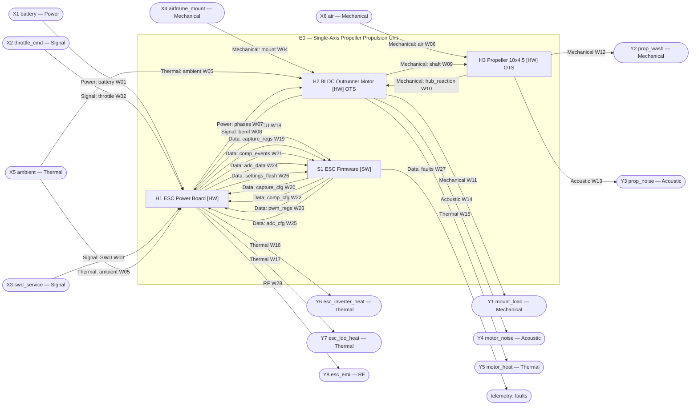
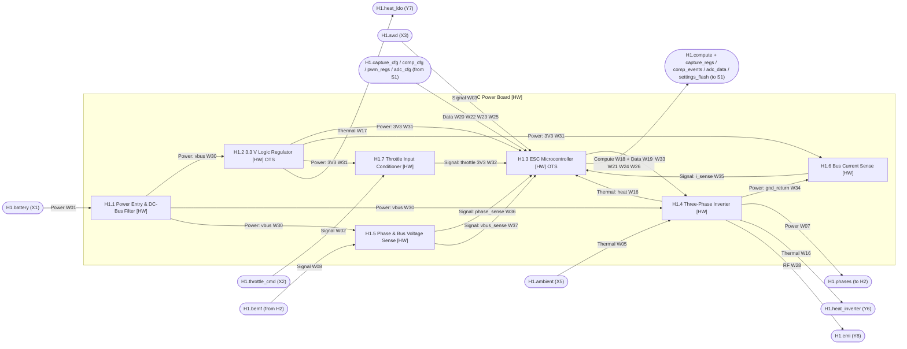
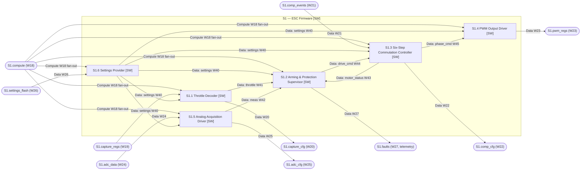

# Black-Box Design: ESC-Driven Propeller

> Idea: *"A simple propeller that spins at different velocities depending on the current sent by an ESC (electronic speed controller). The ESC receives a throttle command and drives the motor that turns the propeller."*
>
> Produced by following the black-box design prompt. Assumptions are labelled `A#` and listed in §10.

**ID scheme:** `E0` is the explanatory box. `H*` boxes are hardware and `S*` boxes are software. A dotted suffix (for example `H1.4`) means a child of that box. External inputs are `X#`, external outputs are `Y#`, and wires are `W##`.

---

## 1. E0: Explanatory box

### E0 — Single-Axis Propeller Propulsion Unit (orientation only; not built)

**Description.** A 3S-LiPo-powered propulsion unit. A throttle command comes in as standard RC servo PWM. A custom sensorless brushless ESC (power board `H1` plus firmware `S1`) turns that command into a commanded PWM duty cycle on a three-phase inverter. The inverter drives an off-the-shelf outrunner BLDC motor (`H2`), and the motor turns an off-the-shelf 10×4.5 in propeller (`H3`). Propeller speed follows the throttle monotonically. The ESC sets the *average phase voltage* (duty × V_bus). Speed follows that voltage, and the phase *current* follows from the propeller's load torque (A2). The ESC caps the current at a configurable limit.

**External ports**

| ID | Direction | Name | Type | Parameters |
|---|---|---|---|---|
| X1 | in | `battery` | Power | 3S LiPo, 9.0–12.6 V (nominal 11.1 V), source can deliver ≥ 40 A, internal resistance ≤ 30 mΩ, XT60 connector (ESC side male), 14 AWG leads. Includes the negative return (A4). |
| X2 | in | `throttle_cmd` | Signal | RC servo PWM, active-high pulse 1000–2000 µs (1000 = stop, 2000 = full), frame rate 50–490 Hz, logic high 3.0–5.5 V, logic low ≤ 0.8 V, ground referenced to X1 negative, 3-pin 2.54 mm servo plug (signal / NC / GND). The source is a flight controller, RC receiver or servo tester. |
| X3 | in | `swd_service` | Signal | ARM SWD, 3.3 V logic, SWDIO/SWCLK/NRST/GND on 1.27 mm test pads, SWCLK ≤ 4 MHz. Used only during manufacturing and service to load firmware and settings. |
| X4 | in | `airframe_mount` | Mechanical | Flat mounting plate ≥ 2 mm aluminium or ≥ 3 mm carbon, cross-mount holes for 4 × M3 on 16 mm / 19 mm patterns, must take ≥ 15 N axial and ≥ 0.3 N·m torque without visible deflection, ≥ 1 propeller diameter of free space in front of and behind the disc. |
| X5 | in | `ambient` | Thermal | Ambient air 0–40 °C, still air (the worst case; propwash cooling is a bonus). |
| X6 | in | `air` | Mechanical | Air density 1.00–1.25 kg/m³, static (no freestream; bench or hover use), unobstructed inflow over the propeller disc. |
| Y1 | out | `mount_load` | Mechanical | Axial thrust 0–8 N plus reaction torque 0–0.13 N·m plus vibration ≤ 1 g at 1× rev (≤ 210 Hz), carried through the 4 × M3 cross-mount into X4. |
| Y2 | out | `prop_wash` | Mechanical | Accelerated airflow, induced velocity ≤ 15 m/s, swept disc Ø 254 mm, tip speed ≤ 168 m/s at 12 600 rpm no-load (≤ 106 m/s at the 8000 rpm loaded maximum). **Hazard zone: the swept disc.** |
| Y3 | out | `prop_noise` | Acoustic | Blade-pass tone 2 × rpm/60 ≤ 420 Hz plus broadband noise, ≤ 90 dB SPL at 1 m on-axis in air. |
| Y4 | out | `motor_noise` | Acoustic | PWM and commutation whine 0.5–10 kHz (PWM fundamental 24 kHz is ultrasonic), ≤ 70 dB SPL at 1 m in air. |
| Y5 | out | `motor_heat` | Thermal | ≤ 25 W at a 13 A phase current. Stator ≤ 120 °C, magnets ≤ 80 °C (the supplier rating is assumed). |
| Y6 | out | `esc_inverter_heat` | Thermal | ≤ 4 W at the 15 A default current limit (≤ 12 W at the 30 A board rating). MOSFET case ≤ 100 °C. |
| Y7 | out | `esc_ldo_heat` | Thermal | ≤ 0.4 W. Junction ≤ 125 °C. |
| Y8 | out | `esc_emi` | RF | Unintentional emission, no protocol. Switching harmonics of 24 kHz up to about 100 MHz from phase leads and the DC bus. Target: conducted and radiated levels per CISPR 32 Class B (A10). |

**Goals**
- G1. Propeller speed is a monotonic function of throttle. At a fixed V_bus, steady-state rpm repeats within ±3 % for the same throttle.
- G2. Step response from 10 % to 90 % of commanded speed in ≤ 300 ms (with the propeller fitted).
- G3. Start from standstill with the propeller fitted ≥ 99 times in 100, within 500 ms of a non-zero throttle.

**Constraints**
- Cost: ESC BOM ≤ US$15 at qty 100. Motor plus propeller ≤ US$15.
- Size and mass: ESC PCB ≤ 25 × 45 mm, ESC ≤ 25 g including leads.
- Power: 3S LiPo only (A3). The ESC board is rated 30 A continuous. The default current limit of 15 A protects the motor.
- Safety: the motor never starts on power-up, even with throttle high (arming interlock). On throttle-signal loss the motor stops within 150 ms. Phase current is limited. The swept disc is a declared hazard zone (Y2). LiPo handling follows the supplier's rules.
- Regulations: hobby or bench component. RoHS. EMC targets are only targets (A10).

**Children (level 1):** H1, S1, H2, H3.

---

## 2. Level-1 graph

Mermaid cannot place nodes *on* a subgraph border, so the external ports (`X*`, `Y*`) are drawn as stadium nodes just outside the `E0` boundary.



---

## 3. Box specifications

### 3.1 Level 1 (Parent: E0)

```
### H1 — ESC Power Board                                [HW]
Parent:        E0
Purpose:       Convert battery power into three-phase motor power under logic-level control from the on-board processor.
Inputs:
  - battery        : Power      { 9.0–12.6 V, ≤ 40 A, XT60, incl. return }                         ← external X1   (maps to H1.1.battery_in)
  - throttle_cmd   : Signal     { servo PWM 1000–2000 µs, 50–490 Hz, 3.0–5.5 V high }              ← external X2   (maps to H1.7.pwm_in)
  - swd            : Signal     { SWD 3.3 V, ≤ 4 MHz, test pads }                                  ← external X3   (maps to H1.3.swd)
  - ambient        : Thermal    { 0–40 °C still air }                                              ← external X5   (maps to H1.4.ambient)
  - bemf           : Signal     { 3 × analog 0–12.6 V, ZC at V_bus/2, ≤ 1.5 kHz elec., ~1 V/1000 rpm } ← H2.bemf (maps to H1.5.bemf_in)
  - capture_cfg    : Data       { TIM3 init register writes }                                      ← S1.capture_cfg (maps to H1.3.capture_cfg)
  - comp_cfg       : Data       { COMP mux/polarity writes, ≤ 10 kHz }                             ← S1.comp_cfg (maps to H1.3.comp_cfg)
  - pwm_regs       : Data       { TIM1 ARR/CCRx/CCER/BDTR writes, ≤ 10 kHz }                       ← S1.pwm_regs (maps to H1.3.pwm_regs)
  - adc_cfg        : Data       { ADC/DMA init register writes }                                   ← S1.adc_cfg (maps to H1.3.adc_cfg)
Outputs:
  - phases         : Power      { 3-phase six-step, 0/V_bus PWM 24 kHz or floating, ≤ 30 A }       → H2.phases          (from H1.4.phase_out)
  - compute        : Compute    { Cortex-M4F 120 MHz, 16 KB SRAM, 64 KB flash, bare-metal }        → S1.compute         (from H1.3.compute)
  - capture_regs   : Data       { TIM3 CCR1/CCR2 uint16 @ 1 MHz + IRQ }                            → S1.capture_regs    (from H1.3.capture_regs)
  - comp_events    : Data       { COMP output bit + IRQ + TIM14 count }                            → S1.comp_events     (from H1.3.comp_events)
  - adc_data       : Data       { DMA buffer 3 × uint16, 24 kHz }                                  → S1.adc_data        (from H1.3.adc_data)
  - settings_flash : Data       { 64-byte page @ 0x0800FC00 }                                      → S1.settings_flash  (from H1.3.settings_flash)
  - heat_inverter  : Thermal    { ≤ 4 W @ 15 A; ≤ 12 W @ 30 A }                                    → external Y6        (from H1.4.heat)
  - heat_ldo       : Thermal    { ≤ 0.4 W }                                                        → external Y7        (from H1.2.heat)
  - emi            : RF         { unintentional, 24 kHz harmonics to 100 MHz }                     → external Y8        (from H1.4.emi)
Compute host:  n/a (HW)
Internal state:none at this level (see children)
Contract:      Full parameters per wire table W01–W28. Board rated 30 A continuous, 40 A for 10 s, at 40 °C still air. Quiescent draw ≤ 50 mA from the battery.
Failure modes: See children. With no firmware running, all gate_logic lines are pulled low, so all MOSFETs are off and the phases float.
Isolation test:Union of the children's tests, plus a board-level test: bench PSU on battery, function generator on throttle_cmd, test firmware via SWD, resistive-inductive star load on phases; verify each external port against the wire table.
Owner:         HW-Power
Candidate implementation (non-binding): 4-layer 2 oz PCB, 25 × 45 mm.
Children:      H1.1, H1.2, H1.3, H1.4, H1.5, H1.6, H1.7
```

```
### S1 — ESC Firmware                                   [SW]
Parent:        E0
Purpose:       Turn a throttle command into commutated, current-limited inverter switching commands.
Inputs:
  - compute        : Compute    { see W18 }                       ← H1.compute         (fans out to S1.1–S1.6)
  - capture_regs   : Data       { see W19 }                       ← H1.capture_regs    (maps to S1.1.capture_regs)
  - comp_events    : Data       { see W21 }                       ← H1.comp_events     (maps to S1.3.comp_events)
  - adc_data       : Data       { see W24 }                       ← H1.adc_data        (maps to S1.5.adc_data)
  - settings_flash : Data       { see W26 }                       ← H1.settings_flash  (maps to S1.6.settings_flash)
Outputs:
  - capture_cfg    : Data       { see W20 }                       → H1.capture_cfg     (from S1.1)
  - comp_cfg       : Data       { see W22 }                       → H1.comp_cfg        (from S1.3)
  - pwm_regs       : Data       { see W23 }                       → H1.pwm_regs        (from S1.4)
  - adc_cfg        : Data       { see W25 }                       → H1.adc_cfg         (from S1.5)
  - faults         : Data       { see W27 }                       → telemetry          (from S1.2)
Compute host:  H1.compute (= H1.3.compute)
Internal state:see children
Contract:      Throttle-to-duty mapping applied within 2 ms of a valid pulse. Arming interlock. Stops within 150 ms of signal loss. Phase current regulated to ≤ i_limit (default 15 A) within 20 ms. Total RAM ≤ 14 KB, flash ≤ 60 KB, CPU ≤ 60 % at 10 kHz commutation.
Failure modes: see children. Watchdog (IWDG, 50 ms) resets the MCU on firmware hang. After reset, gate_logic is low and the arming interlock applies again.
Isolation test:Host-PC build of S1 with a register-level mock of H1.3 and a BLDC plant model (7 pole pairs, KV 1000, R = 0.09 Ω, J = 2.5e-5 kg·m², propeller load k·ω²); scripted throttle sequences; checks G1–G3 and the safety contracts.
Owner:         FW-Motor
Children:      S1.1, S1.2, S1.3, S1.4, S1.5, S1.6
```

```
### H2 — BLDC Outrunner Motor                           [HW]  [OTS: "A2212/13T 1000KV" class outrunner, 12N14P]
Parent:        E0
Purpose:       Convert three-phase electrical power into shaft rotation.
Inputs:
  - phases     : Power      { 3-phase six-step, 0/V_bus PWM 24 kHz or floating, ≤ 13 A continuous phase current (30 s max per supplier), 3.5 mm bullet connectors } ← H1.phases (W07)
  - prop_load  : Mechanical { load torque 0–0.13 N·m opposing rotation, axial thrust 0–8 N pulling away from mount, 1× rev imbalance ≤ 0.5 g·cm }  ← H3.hub_reaction (W10)
  - mount      : Mechanical { 4 × M3 cross-mount, 16/19 mm pattern, plate per X4 }  ← external X4 (W04)
  - ambient    : Thermal    { 0–40 °C still air }                                   ← external X5 (W05)
Outputs:
  - shaft      : Mechanical { 0–12 600 rpm (no-load at 12.6 V), torque 0–0.13 N·m continuous, CW viewed from the propeller side by default (A6), 5 mm prop adapter with M5 nut, rotating mass ≈ 25 g } → H3.shaft (W09)
  - bemf       : Signal     { analog, 3 phase terminals, floating-phase voltage 0–V_bus, back-EMF ≈ 1.0 V per 1000 rpm (KV 1000 ±10 %), trapezoidal, electrical frequency = rpm × 7/60 ≤ 1.5 kHz, source R ≈ 0.09 Ω phase-phase, L ≈ 30 µH } → H1.bemf (W08)
  - mount_load : Mechanical { axial 0–8 N + reaction torque 0–0.13 N·m + vibration ≤ 1 g at 1× rev } → external Y1 (W11)
  - noise      : Acoustic   { 0.5–10 kHz, ≤ 70 dB SPL at 1 m }                      → external Y4 (W14)
  - heat       : Thermal    { ≤ 25 W at 13 A }                                       → external Y5 (W15)
Compute host:  n/a (HW)
Internal state:Rotor angular momentum (physical state, J ≈ 2.5e-5 kg·m² with the propeller). Persists while spinning. Changed by phases and prop_load.
Contract:      KV 1000 ±10 %. 7 pole pairs. η ≥ 75 % at 8–12 A. Continuous rating 12 A in still air at 40 °C.
Failure modes: Overheating above 120 °C demagnetises the magnets (permanent KV loss). A loose bell shows as vibration > 1 g. An open phase gives no BEMF on that phase.
Isolation test:(a) Spin the motor with a drill at 5000 rpm (stub for the phases input) and check phase-to-phase BEMF peak 5.0 V ±10 % on a scope, 583 Hz electrical. (b) On a thrust/torque stand with a reference OTS ESC, run 8 A for 60 s; stator ≤ 100 °C at 25 °C ambient.
Owner:         Propulsion
Children:      leaf (R9a)
```

```
### H3 — Propeller 10×4.5                               [HW]  [OTS: GWS/APC-style 1045 two-blade, nylon or glass-filled]
Parent:        E0
Purpose:       Convert shaft rotation into axial thrust.
Inputs:
  - shaft      : Mechanical { 0–12 600 rpm, torque 0–0.13 N·m, 5 mm bore hub, clamped by M5 nut + washer, direction CW (matching handed propeller, A6) } ← H2.shaft (W09)
  - air        : Mechanical { density 1.00–1.25 kg/m³, static inflow, unobstructed disc }                    ← external X6 (W06)
Outputs:
  - hub_reaction : Mechanical { load torque Q ≈ 1.9e-9 N·m/rpm² × rpm² (0–0.13 N·m), thrust T ≈ 1.25e-7 N/rpm² × rpm² (0–8 N), imbalance ≤ 0.5 g·cm } → H2.prop_load (W10)
  - prop_wash    : Mechanical { induced velocity ≤ 15 m/s, disc Ø 254 mm, tip speed ≤ 168 m/s }              → external Y2 (W12)
  - noise        : Acoustic   { blade-pass 2 × rpm/60 ≤ 420 Hz + broadband, ≤ 90 dB SPL at 1 m }              → external Y3 (W13)
Compute host:  n/a (HW)
Internal state:none
Contract:      Thrust coefficient within ±10 % of the supplier curve. Statically balanced. Survives 15 000 rpm without failure (≥ 1.2× the no-load maximum).
Failure modes: Blade crack or loss gives large 1× imbalance (> 5 g·cm). Spinning in the wrong direction gives near-zero or reversed thrust.
Isolation test:Thrust stand with a calibrated reference motor: thrust and torque at 3000/5000/7000/8000 rpm within ±10 % of the coefficients above; balance on a magnetic balancer ≤ 0.5 g·cm.
Owner:         Propulsion
Children:      leaf (R9a)
```

### 3.2 Children of H1 (ESC Power Board)

```
### H1.1 — Power Entry & DC-Bus Filter                  [HW]
Parent:        H1
Purpose:       Deliver a filtered, surge-clamped DC bus from the battery leads.
Inputs:
  - battery_in : Power { 9.0–12.6 V, ≤ 40 A, XT60 + 14 AWG leads, incl. return }    ← external X1 (W01)
Outputs:
  - vbus       : Power { 9.0–12.6 V, ripple ≤ 0.5 Vpp at 30 A / 24 kHz chopping, transient clamp ≤ 24 V, ≤ 40 A total; budget H1.4 ≤ 40 A, H1.2 ≤ 50 mA, H1.5 ≤ 1 mA; PCB plane } → H1.2.vin, H1.4.vbus, H1.5.vbus_tap (W30)
Compute host:  n/a (HW)
Internal state:Charge on the bulk capacitors (physical). Decays to < 1 V within 10 s of disconnect via a bleed resistor.
Contract:      Ripple and clamp as above. Capacitor ripple-current rating ≥ 10 A rms. Lead voltage drop ≤ 0.15 V at 30 A.
Failure modes: Reverse battery polarity is NOT protected (A7): the board is destroyed. Over-voltage above 24 V (for example a 6S pack) makes the TVS conduct and fail short.
Isolation test:Bench PSU 12.6 V into battery_in; electronic load chopped at 24 kHz, 0–30 A, on vbus; scope ripple ≤ 0.5 Vpp. Surge generator 30 V/1 ms: vbus peak ≤ 24 V.
Owner:         HW-Power
Candidate implementation (non-binding): 2 × 330 µF 25 V low-ESR polymer + 10 × 10 µF X7R + SMBJ18A TVS.
Children:      leaf (R9b)
```

```
### H1.2 — 3.3 V Logic Regulator                        [HW]  [OTS: TI TLV76033 or equivalent 30 V LDO]
Parent:        H1
Purpose:       Supply a regulated 3.3 V logic rail from the DC bus.
Inputs:
  - vin       : Power   { 9.0–12.6 V, transients ≤ 24 V }              ← H1.1.vbus (W30)
Outputs:
  - rail_3v3  : Power   { 3.3 V ±3 %, ≤ 100 mA, ripple ≤ 20 mVpp; budget H1.3 ≤ 60 mA, H1.6 ≤ 1 mA, H1.7 ≤ 1 mA } → H1.3.vdd, H1.6.vdd, H1.7.vdd (W31)
  - heat      : Thermal { ≤ 0.4 W, junction ≤ 125 °C }                → external Y7 (W17)
Compute host:  n/a (HW)
Internal state:none
Contract:      Regulates within ±3 % over vin 4.5–24 V and 0–100 mA. Rail is up in ≤ 1 ms after vin > 4.5 V.
Failure modes: vin < 4 V drops the rail out, and the MCU brown-out reset holds the outputs safe. Output short triggers the LDO current limit (≤ 250 mA).
Isolation test:PSU 9/12.6/24 V; electronic load 0/50/100 mA; measure 3.3 V ±3 % and ripple. Thermal: 12.6 V at 40 mA for 10 min at 40 °C; junction (by IR camera) ≤ 125 °C.
Owner:         HW-Power
Children:      leaf (R9a)
```

```
### H1.3 — ESC Microcontroller                          [HW]  [OTS: Artery AT32F421K8U7 (Cortex-M4F)]
Parent:        H1
Purpose:       Host the ESC firmware with its timer, comparator and ADC peripherals.
Inputs:
  - vdd            : Power   { 3.3 V ±3 %, ≤ 60 mA }                                  ← H1.2.rail_3v3 (W31)
  - swd            : Signal  { SWD 3.3 V, ≤ 4 MHz, pins PA13 SWDIO / PA14 SWCLK / NRST } ← external X3 (W03)
  - throttle_in    : Signal  { 0/3.3 V digital, pulse 1000–2000 µs, 50–490 Hz, pin PB4 (TIM3_CH1) } ← H1.7.pwm_out (W32)
  - phase_sense    : Signal  { 4 × analog 0–2.7 V: A/B/C divided (ratio 0.213) on comparator mux pins, virtual neutral on COMP_INM } ← H1.5.phase_sense (W36)
  - vbus_sense     : Signal  { analog 0–2.7 V (ratio 0.213), ADC_IN3 }                ← H1.5.vbus_sense (W37)
  - i_sense        : Signal  { analog 0–3.3 V, 100 mV/A, ADC_IN6 }                   ← H1.6.i_sense (W35)
  - board_heat     : Thermal { heat from H1.4 via PCB, raises die temperature by ≤ 60 K above ambient } ← H1.4.heat (W16)
  - capture_cfg    : Data    { see W20 }                                             ← S1.1.capture_cfg
  - comp_cfg       : Data    { see W22 }                                             ← S1.3.comp_cfg
  - pwm_regs       : Data    { see W23 }                                             ← S1.4.pwm_regs
  - adc_cfg        : Data    { see W25 }                                             ← S1.5.adc_cfg
Outputs:
  - compute        : Compute { see W18 }                                             → S1.1–S1.6 (via H1.compute → S1.compute)
  - gate_logic     : Signal  { 6 × 3.3 V CMOS push-pull: HIN_A/B/C on PA8/PA9/PA10 (TIM1_CH1–3), LIN_A/B/C on PB13/PB14/PB15 (TIM1_CH1N–3N); 16–48 kHz (default 24 kHz); dead time per BDTR; low (off) during reset and while unconfigured (internal pull-down + external 10 kΩ) } → H1.4.gate_logic (W33)
  - capture_regs   : Data    { see W19 }                                             → S1.1.capture_regs
  - comp_events    : Data    { see W21 }                                             → S1.3.comp_events
  - adc_data       : Data    { see W24 }                                             → S1.5.adc_data
  - settings_flash : Data    { see W26 }                                             → S1.6.settings_flash
Compute host:  n/a (HW)
Internal state:Flash (64 KB, non-volatile; written only via swd). SRAM (16 KB, volatile, partitioned per W18). Peripheral registers (volatile, written via the cfg/regs inputs).
Contract:      Datasheet electrical behaviour. The pin map above is frozen at schematic review. The internal temperature sensor reads die temperature ±5 °C. Dissipation ≤ 0.2 W (counted in the board budget, A9).
Failure modes: vdd < 2.6 V triggers brown-out reset, and gate_logic goes low. Firmware hang triggers an IWDG reset within 50 ms, and gate_logic goes low.
Isolation test:Bare MCU on its eval board with a test firmware: toggle every gate_logic pin and check levels; feed 1500 µs pulses and check capture value 1500 ±1; apply 0/1.35/2.7 V to the ADC inputs and check codes ±8 LSB; comparator edge latency ≤ 1 µs. CoreMark ≥ 300 at 120 MHz.
Owner:         HW-Digital
Children:      leaf (R9a)
```

```
### H1.4 — Three-Phase Inverter                         [HW]
Parent:        H1
Purpose:       Switch the DC bus onto three motor phases according to six logic-level gate commands.
Inputs:
  - vbus       : Power   { 9.0–12.6 V, ≤ 40 A }                                     ← H1.1.vbus (W30)
  - gate_logic : Signal  { see W33 }                                                ← H1.3.gate_logic (W33)
  - ambient    : Thermal { 0–40 °C still air }                                      ← external X5 (W05)
Outputs:
  - phase_out  : Power   { A/B/C each driven high (V_bus), low (0 V) or floating per gate_logic; PWM 16–48 kHz; ≤ 30 A continuous, 40 A for 10 s; rise/fall 20–100 ns; 16 AWG leads 80 mm with 3.5 mm bullets } → H2.phases (W07)
  - gnd_return : Power   { inverter low-side return current 0–40 A, routed only through the H1.6 shunt to battery − } → H1.6.shunt_in (W34)
  - heat       : Thermal { ≤ 4 W at 15 A, ≤ 12 W at 30 A, MOSFET case ≤ 100 °C at 40 °C still air } → H1.3.board_heat, external Y6 (W16)
  - emi        : RF      { unintentional, no protocol; 24 kHz harmonics ≤ 100 MHz; CISPR 32 Class B target } → external Y8 (W28)
Compute host:  n/a (HW)
Internal state:Bootstrap capacitor charge (physical). Refreshed whenever LIN_x is high for ≥ 1 µs; needs duty ≤ 98 %.
Contract:      Propagation gate_logic → phase edge ≤ 300 ns. Never conducts high and low side of one phase at once if gate_logic dead time ≥ 300 ns (internal interlock adds ≥ 100 ns). R_ds(on) per switch ≤ 5 mΩ at 25 °C.
Failure modes: HIN_x and LIN_x both high: the interlock forces both off. vbus < 8 V: under-voltage lockout turns all outputs off (phases float). gate_logic floating: pull-downs hold all off.
Isolation test:Drive gate_logic from a function generator or MCU eval board (stub of H1.3); PSU 12.6 V on vbus; 3 × (0.1 Ω + 50 µH) star load. Check six-step waveforms, edge timing, no shoot-through (bus current spikes < 2 A at edges), 30 A for 60 s with case ≤ 100 °C at 25 °C. Measure emissions with a LISN plus near-field probe.
Owner:         HW-Power
Candidate implementation (non-binding): Fortior FD6288Q 3-phase gate driver with bootstrap + 6 × 30 V N-MOSFET (e.g. AOS AON6354) in PDFN 5×6.
Children:      leaf (R9b, R9c)
```

```
### H1.5 — Phase & Bus Voltage Sense Network            [HW]
Parent:        H1
Purpose:       Scale the phase and bus voltages into the MCU's analog input range.
Inputs:
  - bemf_in   : Signal { see W08 }                                       ← H2.bemf (W08)
  - vbus_tap  : Power  { 9.0–12.6 V, draw ≤ 1 mA }                       ← H1.1.vbus (W30)
Outputs:
  - phase_sense : Signal { A/B/C divided by 0.213 ±1 % (10 kΩ/2.7 kΩ), RC low-pass fc ≈ 50 kHz; virtual neutral = star of the three divided phases via 3 × 10 kΩ; 0–2.7 V at 12.6 V; output impedance ≤ 2.2 kΩ } → H1.3.phase_sense (W36)
  - vbus_sense  : Signal { V_bus × 0.213 ±1 %, RC fc ≈ 1 kHz, 0–2.7 V, output impedance ≤ 2.2 kΩ } → H1.3.vbus_sense (W37)
Compute host:  n/a (HW)
Internal state:none
Contract:      Ratio ±1 % over 0–40 °C. Inputs survive 24 V. Group delay on phase channels ≤ 5 µs.
Failure modes: Inputs > 15.5 V clip at 3.3 V via clamp diodes. An open resistor reads near 0 V on that channel.
Isolation test:Apply 0/6.3/12.6 V DC and a 1.5 kHz 0–12.6 V trapezoid to each input; check ratio and phase delay with a scope.
Owner:         HW-Analog
Children:      leaf (R9b)
```

```
### H1.6 — Bus Current Sense                            [HW]
Parent:        H1
Purpose:       Convert inverter return current into a proportional analog voltage.
Inputs:
  - shunt_in  : Power { 0–40 A return current }                          ← H1.4.gnd_return (W34)
  - vdd       : Power { 3.3 V ±3 %, ≤ 1 mA }                             ← H1.2.rail_3v3 (W31)
Outputs:
  - i_sense   : Signal { analog 0–3.3 V, 100 mV/A ±3 % (0–33 A full scale), offset ≤ 30 mV, bandwidth ≥ 20 kHz, output impedance ≤ 100 Ω } → H1.3.i_sense (W35)
Compute host:  n/a (HW)
Internal state:none
Contract:      Gain error ±3 %, 0–40 °C. Shunt dissipation ≤ 0.5 W at 30 A.
Failure modes: Current > 33 A saturates the output at about 3.3 V. Open shunt: inverter current has no return path, so the inverter stops; i_sense ≈ 0.
Isolation test:DC current source 0/5/15/30 A through shunt_in; check i_sense = 100 mV/A ±3 %. Pulsed 24 kHz current shows bandwidth.
Owner:         HW-Analog
Candidate implementation (non-binding): 0.5 mΩ 2512 shunt + TI INA181A4 (gain 200).
Children:      leaf (R9b)
```

```
### H1.7 — Throttle Input Conditioner                   [HW]
Parent:        H1
Purpose:       Translate the external throttle pulse into a clean 3.3 V logic signal.
Inputs:
  - pwm_in    : Signal { servo PWM, 1000–2000 µs, 50–490 Hz, high 3.0–5.5 V, low ≤ 0.8 V } ← external X2 (W02)
  - vdd       : Power  { 3.3 V ±3 %, ≤ 1 mA }                                         ← H1.2.rail_3v3 (W31)
Outputs:
  - pwm_out   : Signal { 0/3.3 V logic, pulse width preserved ±1 µs, edges ≤ 1 µs, delay ≤ 2 µs } → H1.3.throttle_in (W32)
Compute host:  n/a (HW)
Internal state:none
Contract:      Tolerates 0–12.6 V on pwm_in continuously and ±8 kV ESD contact (IEC 61000-4-2). 100 kΩ pull-down, so an open input reads low.
Failure modes: Input open: output stays low (no pulses), which downstream treats as signal loss.
Isolation test:Function generator 5 V and 3.3 V pulses at 1000/1500/2000 µs, 50 and 490 Hz; check width error ≤ 1 µs. Apply 12.6 V DC for 1 h with no damage; ESD gun ±8 kV.
Owner:         HW-Analog
Children:      leaf (R9b)
```

### 3.3 Children of S1 (ESC Firmware)

```
### S1.1 — Throttle Decoder                             [SW]
Parent:        S1
Purpose:       Convert captured throttle pulse widths into normalised throttle commands.
Inputs:
  - compute      : Compute { slice of W18: ≤ 2 % CPU, 128 B RAM, 2 KB flash, TIM3 capture IRQ priority 2 } ← H1.3.compute
  - capture_regs : Data    { see W19 }                                 ← H1.3.capture_regs
  - settings     : Data    { EscSettings (see W40): throttle_min_us, throttle_max_us } ← S1.6.settings
Outputs:
  - throttle     : Data    { ThrottleCmd{t_us: uint32 µs since boot, value: uint16 0–2000, valid: bool}; one per received pulse (50–490 Hz); single-slot mailbox (latest wins), 8 B; latency ≤ 50 µs after falling edge } → S1.2.throttle (W41)
  - capture_cfg  : Data    { see W20 }                                 → H1.3.capture_cfg
Compute host:  H1.3.compute
Internal state:3-sample median buffer (6 B) plus last rising-edge count (2 B). Lifetime: power cycle. Changed by capture_regs. Reset when settings arrive.
Contract:      value = clamp((pw − min_us) × 2000 / (max_us − min_us), 0, 2000), and values ≤ 20 are forced to 0 (deadband). Resolution 1 count ≈ 0.5 µs. Median-of-3 rejects single glitches.
Failure modes: pw < 800 µs or > 2200 µs: no ThrottleCmd is emitted for that pulse (so S1.2's timeout fires if this persists). Settings not yet received: emits nothing.
Isolation test:Host unit test feeding synthetic capture register sequences (pw 700…2300 µs, glitches, 50/490 Hz). Check output values ±1 count, deadband, rejection. On target: signal generator → H1.7 stub.
Owner:         FW-Drivers
Children:      leaf (R9b, R9c)
```

```
### S1.2 — Arming & Protection Supervisor               [SW]
Parent:        S1
Purpose:       Decide the permitted drive command from throttle, measurements and motor status.
Inputs:
  - compute      : Compute { slice of W18: ≤ 5 % CPU, 256 B RAM, 6 KB flash, 1 kHz SysTick task priority 4 } ← H1.3.compute
  - throttle     : Data    { ThrottleCmd, see W41 }                    ← S1.1.throttle
  - meas         : Data    { Measurements, see W42 }                   ← S1.5.meas
  - motor_status : Data    { MotorStatus, see W43 }                    ← S1.3.motor_status
  - settings     : Data    { EscSettings: i_limit_mA, cells, low_v_mV_per_cell, temp_limit_c, direction, slew_permille_per_ms } ← S1.6.settings
Outputs:
  - drive_cmd    : Data    { DriveCmd{enable: bool, duty_permille: uint16 0–1000, direction: CW|CCW}; 1 kHz; single-slot mailbox, 6 B; latency ≤ 1 ms } → S1.3.drive_cmd (W44)
  - faults       : Data    { FaultFlags{arm_state: DISARMED|ARMING|ARMED, sig_loss, over_current, low_volt, over_temp, desync_count: uint8, settings_default}; 1 kHz; 8 B RAM struct readable via SWD } → telemetry (W27)
Compute host:  H1.3.compute
Internal state:Arm state machine (1 B); arming timer (4 B); last valid throttle time (4 B); current-limit PI integrator (int32, anti-windup clamped 0–1000); thermal and low-voltage derate factors (2 × 2 B); slew-limited duty (2 B). Lifetime: power cycle. Changed by throttle, meas and motor_status. Reset to DISARMED at boot.
Contract:      ARMING → ARMED only after valid throttle = 0 continuously for ≥ 500 ms. Before ARMED, enable = false.
               duty_target = throttle.value / 2, slew-limited to ≤ slew (default 5 ‰/ms rise; fall unlimited).
               Current limit: duty reduced by a PI loop so that i_bus ≤ i_limit (default 15 000 mA). Settles ≤ 20 ms, overshoot ≤ 10 %.
               Low voltage: v_bus < cells × low_v (default 3 × 3300 mV) for > 1 s caps duty at 500 ‰.
               Over-temperature: t_mcu ≥ temp_limit (default 100 °C) derates duty linearly to 0 at limit + 20 °C, with 10 °C hysteresis.
               Signal loss: no valid ThrottleCmd for 100 ms gives enable = false within 1 ms after that, and the state goes back to DISARMED (re-arm requires zero throttle).
               DESYNC status reported by S1.3: enable = false for 500 ms, then retry; after 3 retries stay disabled until re-armed.
Failure modes: meas missing for > 10 ms → enable = false. Settings missing → stays DISARMED.
Isolation test:Host unit test with scripted ThrottleCmd/Measurements/MotorStatus streams and a first-order current plant (i = k·duty, τ = 5 ms). Check every contract clause (arming, 100 ms failsafe, current settle 20 ms ±10 %, derates, desync retries).
Owner:         FW-Control
Children:      leaf (R9b)
```

```
### S1.3 — Six-Step Commutation Controller              [SW]
Parent:        S1
Purpose:       Advance the six-step commutation sequence in sync with detected back-EMF zero crossings.
Inputs:
  - compute      : Compute { slice of W18: ≤ 35 % CPU at 10 kHz steps, 512 B RAM, 12 KB flash, COMP and TIM14 IRQ priority 0 (highest) } ← H1.3.compute
  - drive_cmd    : Data    { DriveCmd, see W44 }                       ← S1.2.drive_cmd
  - comp_events  : Data    { see W21 }                                 ← H1.3.comp_events
  - settings     : Data    { EscSettings: motor_pole_pairs, timing_advance_deg, startup_duty_permille, align_ms, direction } ← S1.6.settings
Outputs:
  - phase_cmd    : Data    { PhaseCmd{step: 0–5 | OFF, duty_permille: 0–1000}; on every commutation (≤ 10 kHz) and every duty change (≤ 1 kHz); direct function call into S1.4, 4 B; latency ≤ 2 µs } → S1.4.phase_cmd (W45)
  - comp_cfg     : Data    { see W22 }                                 → H1.3.comp_cfg
  - motor_status : Data    { MotorStatus{state: STOPPED|ALIGN|OPEN_LOOP|RUNNING|DESYNC, erpm: uint32 0–150 000}; 1 kHz; single-slot mailbox, 8 B } → S1.2.motor_status (W43)
Compute host:  H1.3.compute
Internal state:Step index (1 B); filtered step period (IIR α = 1/4, uint32 ticks); last zero-cross timestamp; startup state machine; blanking deadline. About 64 B in total. Lifetime: until enable = false (then reset to STOPPED). Changed by drive_cmd and comp_events.
Contract:      Startup: align 100 ms (default) at startup_duty, open-loop ramp to 2000 eRPM, then closed loop after 6 consecutive valid zero crossings. Start within 500 ms with the propeller fitted, ≥ 99/100.
               Closed loop: commutate at ZC + (30° − timing_advance) electrical, ±3° electrical above 5000 eRPM. Blanking ≥ 25 % of the step period after each commutation.
               Duty from drive_cmd applied at the next phase_cmd (≤ 1 ms + 42 µs). enable = false → phase_cmd {OFF} within 50 µs.
Failure modes: No valid ZC within 2 × filtered period → DESYNC, phase_cmd OFF, motor_status DESYNC. comp_events stuck → same. drive_cmd stale > 10 ms → OFF.
Isolation test:Host simulation: a BLDC plant model (7 pole pairs, KV 1000, R 0.09 Ω, J 2.5e-5, load k·ω²) generates comp_events from simulated electrical angle and consumes phase_cmd. Check start success ≥ 99/100 over randomised rotor angles, commutation angle error ≤ 3°, desync detection on an injected stall. Optional HIL on an eval board.
Owner:         FW-Control
Children:      leaf (R9b)
```

```
### S1.4 — PWM Output Driver                            [SW]
Parent:        S1
Purpose:       Translate commutation steps and duty into inverter timer register settings.
Inputs:
  - compute    : Compute { slice of W18: runs in the S1.3 ISR context, ≤ 5 % CPU, 64 B RAM, 2 KB flash } ← H1.3.compute
  - phase_cmd  : Data    { PhaseCmd, see W45 }                           ← S1.3.phase_cmd
  - settings   : Data    { EscSettings: pwm_hz 16 000–48 000, deadtime_ns 300–1000 } ← S1.6.settings
Outputs:
  - pwm_regs   : Data    { see W23 }                                     → H1.3.pwm_regs
Compute host:  H1.3.compute
Internal state:Current step and duty shadow (3 B). Lifetime: power cycle. Changed by phase_cmd.
Contract:      Step table (direction-independent, since S1.3 applies direction): step k → one phase PWM high side with complementary low side, one phase low side on, one phase floating (standard six-step table in the box's interface doc).
               CCR = duty × (ARR+1) / 1000 ±1 LSB. Dead time ≥ deadtime_ns. Register update completes ≤ 1 µs after the call. OFF → all outputs disabled (CCER = 0, MOE = 0).
               Never enables HIN_x and LIN_x without dead time.
Failure modes: step out of range → OFF. Settings missing → refuses to enable outputs.
Isolation test:Host unit test against a mock TIM1 register block: every step × duty {0, 1, 500, 999, 1000} × pwm_hz; check register values and OFF behaviour.
Owner:         FW-Drivers
Children:      leaf (R9b, R9c)
```

```
### S1.5 — Analog Acquisition Driver                    [SW]
Parent:        S1
Purpose:       Convert raw ADC samples into calibrated electrical and thermal measurements.
Inputs:
  - compute    : Compute { slice of W18: ≤ 5 % CPU, 1 KB RAM (DMA buffer), 3 KB flash, DMA half/full IRQ priority 1 } ← H1.3.compute
  - adc_data   : Data    { see W24 }                                     ← H1.3.adc_data
  - settings   : Data    { EscSettings: shunt_uohm, amp_gain, vdiv_ratio_ppm, i_offset_mV } ← S1.6.settings
Outputs:
  - meas       : Data    { Measurements{t_us: uint32, i_bus_mA: 0–33 000, v_bus_mV: 0–15 500, t_mcu_c: int8 −40…125}; 1 kHz, each the mean of 24 samples; single-slot mailbox, 12 B; latency ≤ 1 ms } → S1.2.meas (W42)
  - adc_cfg    : Data    { see W25 }                                     → H1.3.adc_cfg
Compute host:  H1.3.compute
Internal state:24-sample accumulators (3 × 4 B). Lifetime: one 1 ms window. Changed by adc_data.
Contract:      i_bus ±3 % ±100 mA. v_bus ±1 % ±50 mV. t_mcu ±5 °C (sensor accuracy). Output every 1 ms ±50 µs.
Failure modes: No DMA completion for 2 ms → stop publishing (S1.2 detects stale meas). Code saturated at 4095 → publish the saturated value (≥ full scale).
Isolation test:Host test feeding synthetic DMA buffers (codes for 0/15/33 A, 9/12.6 V, 25/100 °C). Check scaled outputs and rate.
Owner:         FW-Drivers
Children:      leaf (R9b, R9c)
```

```
### S1.6 — Settings Provider                            [SW]
Parent:        S1
Purpose:       Publish validated configuration parameters to the other firmware boxes at boot.
Inputs:
  - compute        : Compute { slice of W18: boot-time only, 128 B RAM, 1 KB flash } ← H1.3.compute
  - settings_flash : Data    { see W26 }                                ← H1.3.settings_flash
Outputs:
  - settings       : Data    { EscSettings (see W40) }                  → S1.1, S1.2, S1.3, S1.4, S1.5 (W40)
Compute host:  H1.3.compute
Internal state:The validated EscSettings copy (64 B). Lifetime: power cycle. Changed only by settings_flash at boot. (The persistent copy lives in H1.3 flash, written via X3.)
Contract:      Publishes exactly once, ≤ 5 ms after reset and before any other S1 box is allowed to run. Every field is range-checked against W40.
Failure modes: CRC16 mismatch, wrong version or out-of-range field → publishes compiled-in defaults and sets the settings_default fault flag (seen by S1.2 via its own copy of settings: settings.is_default = true).
Isolation test:Host test with flash images that are valid, CRC-corrupted, out-of-range and blank (0xFF). Check output and default flag.
Owner:         FW-Drivers
Children:      leaf (R9b, R9c)
```

---

## 4. Decomposition graphs

### 4.1 H1 — ESC Power Board



**R6 port map for H1:** battery→H1.1.battery_in · throttle_cmd→H1.7.pwm_in · swd→H1.3.swd · ambient→H1.4.ambient · bemf→H1.5.bemf_in · capture_cfg/comp_cfg/pwm_regs/adc_cfg→H1.3 (same names) · phases←H1.4.phase_out · compute/capture_regs/comp_events/adc_data/settings_flash←H1.3 (same names) · heat_inverter←H1.4.heat · heat_ldo←H1.2.heat · emi←H1.4.emi. That is 9 inputs and 9 outputs. Nothing is added and nothing is removed.

### 4.2 S1 — ESC Firmware



**R6 port map for S1:** compute→fan-out to S1.1–S1.6 · capture_regs→S1.1 · comp_events→S1.3 · adc_data→S1.5 · settings_flash→S1.6 · capture_cfg←S1.1 · comp_cfg←S1.3 · pwm_regs←S1.4 · adc_cfg←S1.5 · faults←S1.2. That is 5 inputs and 5 outputs, and they are unchanged.

---

## 5. Wire table

| Wire | From box.port | To box.port(s) | Type | Parameters |
|---|---|---|---|---|
| W01 | external X1 | H1.battery → H1.1.battery_in | Power | 3S LiPo 9.0–12.6 V, ≤ 40 A, source R ≤ 30 mΩ, XT60, 14 AWG, includes return |
| W02 | external X2 | H1.throttle_cmd → H1.7.pwm_in | Signal | Servo PWM, high 1000–2000 µs, 50–490 Hz, V_H 3.0–5.5 V, V_L ≤ 0.8 V, GND = battery −, 3-pin 2.54 mm |
| W03 | external X3 | H1.swd → H1.3.swd | Signal | SWD 3.3 V, SWCLK ≤ 4 MHz, PA13/PA14/NRST/GND pads 1.27 mm |
| W04 | external X4 | H2.mount | Mechanical | 4 × M3 cross-mount 16/19 mm, plate ≥ 2 mm Al, ≥ 15 N axial and ≥ 0.3 N·m capacity |
| W05 | external X5 | H1.ambient → H1.4.ambient; H2.ambient | Thermal | Air 0–40 °C, still air |
| W06 | external X6 | H3.air | Mechanical | ρ 1.00–1.25 kg/m³, static, unobstructed inflow ≥ 1 D |
| W07 | H1.4.phase_out (via H1.phases) | H2.phases | Power | 3-phase six-step, each phase V_bus/0 V PWM 16–48 kHz (default 24 kHz) or floating, ≤ 30 A board / ≤ 13 A motor rating, edges 20–100 ns, 16 AWG + 3.5 mm bullets |
| W08 | H2.bemf | H1.bemf → H1.5.bemf_in | Signal | Analog, 3 terminals, 0–V_bus (≤ 12.6 V), ZC at V_bus/2, ≈ 1.0 V/1000 rpm, ≤ 1.5 kHz electrical, source R ≈ 0.09 Ω, L ≈ 30 µH. *Same copper as W07 (logical split, A5).* |
| W09 | H2.shaft | H3.shaft | Mechanical | 0–12 600 rpm, 0–0.13 N·m, CW from the propeller side, 5 mm adapter + M5 nut, tighten 0.5 N·m |
| W10 | H3.hub_reaction | H2.prop_load | Mechanical | Q = 1.9e-9·rpm² N·m (≤ 0.13), T = 1.25e-7·rpm² N (≤ 8), imbalance ≤ 0.5 g·cm |
| W11 | H2.mount_load | external Y1 | Mechanical | Axial 0–8 N, torque 0–0.13 N·m, vibration ≤ 1 g at ≤ 210 Hz |
| W12 | H3.prop_wash | external Y2 | Mechanical | Induced velocity ≤ 15 m/s, disc Ø 254 mm, tip ≤ 168 m/s; hazard zone |
| W13 | H3.noise | external Y3 | Acoustic | Blade-pass ≤ 420 Hz + broadband, ≤ 90 dB SPL at 1 m, air |
| W14 | H2.noise | external Y4 | Acoustic | 0.5–10 kHz, ≤ 70 dB SPL at 1 m, air |
| W15 | H2.heat | external Y5 | Thermal | ≤ 25 W at 13 A; stator ≤ 120 °C |
| W16 | H1.4.heat | H1.3.board_heat; external Y6 (via H1.heat_inverter) | Thermal | ≤ 4 W at 15 A, ≤ 12 W at 30 A; MOSFET case ≤ 100 °C; die-temperature rise at H1.3 ≤ 60 K |
| W17 | H1.2.heat (via H1.heat_ldo) | external Y7 | Thermal | ≤ 0.4 W, junction ≤ 125 °C |
| W18 | H1.3.compute (via H1.compute) | S1.compute → S1.1…S1.6 | Compute | Arm Cortex-M4F 120 MHz (PLL from 8 MHz HSI ±1 %), 16 KB SRAM, 64 KB flash (last 1 KB page reserved for settings), bare-metal C11 + CMSIS, no RTOS; NVIC priorities 0 = COMP/TIM14 (S1.3), 1 = DMA (S1.5), 2 = TIM3 (S1.1), 4 = SysTick 1 kHz (S1.2); IWDG 50 ms; budgets per box: S1.1 2 %/128 B/2 KB, S1.2 5 %/256 B/6 KB, S1.3 35 %/512 B/12 KB, S1.4 5 %/64 B/2 KB, S1.5 5 %/1 KB/3 KB, S1.6 boot/128 B/1 KB; shared stack 2 KB; monotonic µs clock (TIM2 32-bit) |
| W19 | H1.3.capture_regs | S1.1.capture_regs | Data | Memory-mapped TIM3 CCR1 (rising) and CCR2 (falling) uint16 at 1 MHz tick (PWM-input mode) + TIM3 IRQ per falling edge; ≤ 490 Hz; 4 B; read ≤ 20 µs after IRQ |
| W20 | S1.1.capture_cfg | H1.3.capture_cfg | Data | Register writes TIM3 PSC = 119, ARR = 0xFFFF, PWM-input mode on CH1/CH2, IRQ enable; at init only; ≤ 32 B |
| W21 | H1.3.comp_events | S1.3.comp_events | Data | COMP output bit (1 = phase > neutral) + COMP edge IRQ + TIM14 counter uint16 at 0.5 µs tick; edges ≤ 50 kHz incl. PWM noise; IRQ latency ≤ 1 µs |
| W22 | S1.3.comp_cfg | H1.3.comp_cfg | Data | COMP CTRL register write: INP select = phase A/B/C pin, INM = neutral pin, edge polarity rising/falling, IRQ enable; once per commutation step ≤ 10 kHz; 4 B; complete ≤ 1 µs |
| W23 | S1.4.pwm_regs | H1.3.pwm_regs | Data | TIM1 register writes: ARR = 120 MHz/pwm_hz − 1, CCR1–3 0…ARR, CCER enable mask, BDTR DTG (dead time) + MOE; ≤ 10 kHz (steps) + ≤ 1 kHz (duty); ≤ 16 B per update; complete ≤ 1 µs |
| W24 | H1.3.adc_data | S1.5.adc_data | Data | DMA circular buffer 24 × {i_sense, vbus_sense, temp_sensor} uint16 12-bit codes (Vref 3.3 V), sampled at the TIM1 PWM-centre trigger (24 kHz); half/full-transfer IRQ every 0.5 ms; 144 B |
| W25 | S1.5.adc_cfg | H1.3.adc_cfg | Data | ADC + DMA register writes: channels IN6/IN3/TEMP, sample time 7.5 cycles, trigger = TIM1 TRGO, DMA circular; at init only; ≤ 64 B |
| W26 | H1.3.settings_flash | S1.6.settings_flash | Data | Memory-mapped read of 64 B at 0x0800FC00 (EscSettings image + CRC16-CCITT); read once at boot; ≤ 10 µs |
| W27 | S1.2.faults | telemetry | Data | FaultFlags{arm_state, sig_loss, over_current, low_volt, over_temp, desync_count uint8, settings_default}; 1 kHz; 8 B RAM struct at a linker-fixed address readable via SWD/RTT |
| W28 | H1.4.emi | external Y8 | RF | Protocol: none (unintentional). 24 kHz switching harmonics to ~100 MHz; target CISPR 32 Class B conducted and radiated |
| W30 | H1.1.vbus | H1.2.vin, H1.4.vbus, H1.5.vbus_tap | Power | 9.0–12.6 V, ripple ≤ 0.5 Vpp, clamp ≤ 24 V, ≤ 40 A total (H1.4 ≤ 40 A, H1.2 ≤ 50 mA, H1.5 ≤ 1 mA), PCB plane |
| W31 | H1.2.rail_3v3 | H1.3.vdd, H1.6.vdd, H1.7.vdd | Power | 3.3 V ±3 %, ≤ 100 mA (H1.3 ≤ 60 mA, others ≤ 1 mA), ripple ≤ 20 mVpp |
| W32 | H1.7.pwm_out | H1.3.throttle_in | Signal | 0/3.3 V logic, width preserved ±1 µs, edges ≤ 1 µs, delay ≤ 2 µs, pin PB4 (TIM3_CH1) |
| W33 | H1.3.gate_logic | H1.4.gate_logic | Signal | 6 × 3.3 V CMOS: HIN A/B/C = PA8/PA9/PA10, LIN A/B/C = PB13/PB14/PB15; 16–48 kHz PWM; dead time ≥ 300 ns; low when unconfigured |
| W34 | H1.4.gnd_return | H1.6.shunt_in | Power | 0–40 A low-side return, only path to battery − |
| W35 | H1.6.i_sense | H1.3.i_sense | Signal | Analog 0–3.3 V, 100 mV/A ±3 %, offset ≤ 30 mV, BW ≥ 20 kHz, Z_out ≤ 100 Ω, ADC_IN6 |
| W36 | H1.5.phase_sense | H1.3.phase_sense | Signal | 3 × analog phase × 0.213 ±1 % + virtual neutral, 0–2.7 V, fc ≈ 50 kHz, Z_out ≤ 2.2 kΩ, COMP mux pins |
| W37 | H1.5.vbus_sense | H1.3.vbus_sense | Signal | Analog V_bus × 0.213 ±1 %, fc ≈ 1 kHz, Z_out ≤ 2.2 kΩ, ADC_IN3 |
| W40 | S1.6.settings | S1.1, S1.2, S1.3, S1.4, S1.5 | Data | EscSettings{version u8; direction CW/CCW; throttle_min_us 950–1100 (1000); throttle_max_us 1900–2100 (2000); i_limit_mA 5000–33 000 (15 000); cells 2–4 (3); low_v_mV_per_cell 3000–3600 (3300); temp_limit_c 80–110 (100); slew_permille_per_ms 1–50 (5); pwm_hz 16 000–48 000 (24 000); deadtime_ns 300–1000 (400); timing_advance_deg 0–30 (15); motor_pole_pairs 1–14 (7); startup_duty_permille 30–150 (60); align_ms 20–500 (100); shunt_uohm, amp_gain, vdiv_ratio_ppm, i_offset_mV; is_default bool}; once at boot; read-only const struct, 64 B |
| W41 | S1.1.throttle | S1.2.throttle | Data | ThrottleCmd{t_us u32, value u16 0–2000, valid bool}; 50–490 Hz; single-slot mailbox 8 B; ≤ 50 µs |
| W42 | S1.5.meas | S1.2.meas | Data | Measurements{t_us u32, i_bus_mA 0–33 000, v_bus_mV 0–15 500, t_mcu_c −40…125}; 1 kHz; single-slot mailbox 12 B; ≤ 1 ms |
| W43 | S1.3.motor_status | S1.2.motor_status | Data | MotorStatus{state enum, erpm u32 0–150 000}; 1 kHz; single-slot mailbox 8 B |
| W44 | S1.2.drive_cmd | S1.3.drive_cmd | Data | DriveCmd{enable bool, duty_permille 0–1000, direction}; 1 kHz; single-slot mailbox 6 B; ≤ 1 ms |
| W45 | S1.3.phase_cmd | S1.4.phase_cmd | Data | PhaseCmd{step 0–5/OFF, duty_permille 0–1000}; ≤ 10 kHz + ≤ 1 kHz; direct call 4 B; ≤ 2 µs |

(W29 and W38–W39 are unused, reserved IDs.)

---

## 6. Hardware↔software crossings

Every crossing is between `H1.3` (HW) and the `S1.*` boxes (SW).

| Wire | Direction | Risk notes |
|---|---|---|
| W18 Compute | H1.3 → S1.1–S1.6 | CPU, RAM and IRQ-priority budgets; clock accuracy (HSI ±1 % affects throttle decode and timing) |
| W19 capture_regs | H1.3 → S1.1 | Timer tick and pin mapping must match W32 |
| W20 capture_cfg | S1.1 → H1.3 | Init-only; wrong PSC gives scaled throttle |
| W21 comp_events | H1.3 → S1.3 | **Highest risk.** Comparator noise from PWM, IRQ latency, mux settling |
| W22 comp_cfg | S1.3 → H1.3 | Mux switch timing relative to blanking |
| W23 pwm_regs | S1.4 → H1.3 | **Safety-critical.** A wrong CCER mask can cause shoot-through (mitigated by H1.4 interlock) |
| W24 adc_data | H1.3 → S1.5 | Trigger alignment to PWM centre; channel order |
| W25 adc_cfg | S1.5 → H1.3 | Init-only |
| W26 settings_flash | H1.3 → S1.6 | Flash layout and CRC agreement with the provisioning tool |

There is no direct HW↔SW wire outside H1.3. All other HW boxes reach SW through H1.3's Signal-to-Data conversion.

---

## 7. State and loop register

### 7.1 Declared state (R4)

| Box | State | Size | Lifetime | Changed by |
|---|---|---|---|---|
| H1.1 | Bulk-capacitor charge | ~660 µF | Decays ≤ 10 s after disconnect | battery_in |
| H1.3 | Flash (firmware + settings page) | 64 KB | Non-volatile | swd (X3) |
| H1.3 | SRAM, peripheral registers | 16 KB / regs | Power cycle | cfg/regs Data inputs |
| H1.4 | Bootstrap charge | 3 caps | Refreshed per PWM cycle | gate_logic |
| H2 | Rotor angular momentum | J ≈ 2.5e-5 kg·m² | While spinning | phases, prop_load |
| S1.1 | Median buffer + edge count | 8 B | Power cycle | capture_regs, settings |
| S1.2 | Arm SM, timers, PI integrator, derates, slew duty | ~24 B | Power cycle; DISARMED at boot | throttle, meas, motor_status, settings |
| S1.3 | Step, period filter, ZC time, startup SM, blanking | ~64 B | Until enable = false | drive_cmd, comp_events, settings |
| S1.4 | Step/duty shadow | 3 B | Power cycle | phase_cmd |
| S1.5 | Accumulators | 12 B | 1 ms window | adc_data |
| S1.6 | Validated EscSettings | 64 B | Power cycle | settings_flash (boot) |

### 7.2 Feedback loops (R5)

| Loop | Path | Purpose | Update rate | Stability / deadlock protection |
|---|---|---|---|---|
| L1 Commutation | S1.3 →W45→ S1.4 →W23→ H1.3 →W33→ H1.4 →W07→ H2 →W08→ H1.5 →W36→ H1.3 →W21→ S1.3 (and S1.3 →W22→ H1.3) | Keep the stator field in sync with rotor position | 0.1–10 kHz (6 per electrical rev) | Blanking ≥ 25 % of period; IIR period filter α = 1/4; ZC validity check; desync timeout 2 × period → OFF; open-loop startup until 6 good ZCs |
| L2 Mechanical load | H2 →W09→ H3 →W10→ H2 | Physical speed equilibrium between motor torque and propeller drag | Continuous | Aerodynamic torque ∝ ω² is strictly increasing, which gives a unique stable equilibrium; rotor inertia damps it; no controller involved |
| L3 Current limit | S1.2 →W44→ S1.3 →…L1…→ H1.4 →W34→ H1.6 →W35→ H1.3 →W24→ S1.5 →W42→ S1.2 | Hold i_bus ≤ i_limit | 1 kHz | PI crossover ≤ 50 Hz (≥ 20× below the update rate); anti-windup clamp; 24-sample averaging |
| L4 Thermal derate | S1.2 →W44→ … → H1.4 →W16→ H1.3 →W24→ S1.5 →W42→ S1.2 | Limit board temperature | Decision 1 kHz; thermal τ ≈ 20–60 s | 10 °C hysteresis; linear 20 °C derate band; plant much slower than the controller |
| L5 Low-voltage cap | S1.2 → … → H1.4 → (battery sag via X1 source impedance) → H1.1 →W30→ H1.5 →W37→ H1.3 →W24→ S1.5 →W42→ S1.2 | Protect the battery from over-discharge | 1 kHz, 1 s persistence | 1 s debounce; a single cap at 500 ‰ (no continuous regulation), so it cannot oscillate faster than 1 s. *The loop closes outside the system boundary (A8).* |
| L6 Supervisor ↔ commutation | S1.2 →W44→ S1.3 →W43→ S1.2 | Desync handling and retry | 1 kHz | Single-slot mailboxes: each side reads the last value, so there is a one-sample delay and no algebraic loop or lock; retries bounded to 3 |
| L7 Throttle capture config | S1.1 →W20→ H1.3 →W19→ S1.1 | Peripheral setup and readback | Init write once, then reads only | W20 is written only at init, so it is not a dynamic loop |
| L8 ADC config | S1.5 →W25→ H1.3 →W24→ S1.5 | Peripheral setup and readback | Init once | Same as L7 |
| L9 Comparator mux | S1.3 →W22→ H1.3 →W21→ S1.3 | Select the floating phase for ZC detection | ≤ 10 kHz | Part of L1. Mux written only right after commutation, before the blanking window ends |

---

## 8. Work packages

| WP | Boxes | Depends on interfaces | Stubs needed to start | Definition of done |
|---|---|---|---|---|
| WP1 Power stage | H1.1, H1.2, H1.4 | W01, W05, W07, W16, W17, W28, W30, W31, W33, W34 | Bench PSU (X1), function generator / MCU eval board for W33, R-L star load for W07, electronic load for W31 | All three isolation tests pass; 30 A for 60 s thermal pass; pre-scan EMI report |
| WP2 Analog & I/O | H1.5, H1.6, H1.7 | W02, W08, W30, W31, W32, W34, W35, W36, W37 | PSU, current source, function generator, drill-spun motor (W08) | Isolation tests pass; ratios and gains ±tolerance across 0–40 °C |
| WP3 MCU platform | H1.3 (+ board pin map, provisioning tool for the settings page) | W03, W18–W26 (register-level contracts), W31–W33, W35–W37 | MCU eval board; register map doc | Pin map frozen; Compute budget doc (W18) published; settings-page writer tool via SWD |
| WP4 Firmware drivers | S1.1, S1.4, S1.5, S1.6 | W18–W20, W23–W26, W40–W42, W45 | Host build with mock register blocks; synthetic capture/DMA/flash images | Unit tests pass on host; on-target tests on the eval board pass |
| WP5 Motor control | S1.3 | W18, W21, W22, W40, W43, W44, W45 | BLDC plant simulator (published as a shared stub); S1.4 mock | Simulated start ≥ 99/100; angle error ≤ 3°; desync detection |
| WP6 Supervisor | S1.2 | W18, W27, W40–W44 | Scripted stream generators; first-order current plant | All contract clauses covered by tests |
| WP7 Propulsion | H2, H3 (procurement + characterisation) | W04, W06, W07–W15 | Reference OTS ESC, thrust/torque stand | Measured KV, R, L, J and propeller Q/T coefficients delivered (they feed the WP5 simulator); isolation tests pass |

---

## 9. Integration order

| Step | Real boxes connected (replacing stubs) | Milestone |
|---|---|---|
| I0 | None: all SW on host with mocks and plant simulator | S1 host-level test (G1–G3, safety) passes in simulation |
| I1 | H1.1 + H1.2 + H1.3 on first PCB; S1.6 on target | Board powers from 12.6 V; firmware flashed via X3; settings read and defaults path verified |
| I2 | + H1.7 + S1.1 | Servo-tester pulses decoded ±1 count; read via SWD/RTT |
| I3 | + H1.5 + H1.6 + S1.5 | Static voltage/current/temperature readings within tolerance |
| I4 | + H1.4 + S1.4 with S1.3 replaced by a step-sequencer test harness; R-L load | Correct six-step waveforms, no shoot-through, 30 A thermal run |
| I5 | + S1.2 + S1.3 + H2 (no propeller) | Closed-loop spin; 100/100 unloaded starts; failsafe stop ≤ 150 ms; desync recovery |
| I6 | + H3 on thrust stand | G1–G3 met; current limit holds 15 A ±10 %; thrust curve logged |
| I7 | Full system at 40 °C ambient, low battery, signal-loss and EMI scans | All E0 constraints verified; release |

---

## 10. Assumptions and open questions

### Assumptions
- **A1** The ESC is custom-built. If an off-the-shelf ESC were used, H1 and S1 would collapse into one OTS box, and that box would mix HW and SW, which the paradigm forbids. See Q1.
- **A2** "Spins at different velocities depending on the current sent by an ESC" is read loosely. The ESC controls *average phase voltage* (duty cycle), which sets speed. Current is a result of the propeller load. The design limits current but does not regulate speed in closed loop (open-loop duty control, as hobby ESCs do).
- **A3** 3S LiPo, A2212-class 1000 KV motor, 10×4.5 in propeller. Board rated 30 A, default current limit 15 A to protect the motor.
- **A4** Every Power wire includes its return conductor. Signals share the battery-negative ground.
- **A5** Motor phase terminals carry both the drive (W07) and the back-EMF observation (W08). These are logically separate directed wires over the same copper.
- **A6** Rotation is CW viewed from the propeller side, with a matching handed propeller. Direction is a setting (W40).
- **A7** No reverse-polarity protection (typical for hobby ESCs; it saves cost and loss). Keyed XT60 connector.
- **A8** The battery's internal resistance is outside the system, so loop L5 closes through the world.
- **A9** Heat from small boxes (H1.3 ≤ 0.2 W, H1.5/H1.6/H1.7 ≤ 50 mW) is not given its own port. It is counted in the board's thermal budget.
- **A10** EMC levels are design targets, not certification requirements.
- **A11** The throttle protocol is analog servo PWM only. DShot, OneShot and telemetry back to the flight controller are excluded.
- **A12** MCU die temperature serves as a proxy for board/MOSFET temperature (no dedicated NTC).
- **A13** No arming beeps or LED. Arm state is visible only through telemetry (W27).

### Open questions (human decisions)
- **Q1** Build a custom ESC, or buy one? Buying (for example an AM32/BLHeli_32 30 A ESC) turns H1 and S1 into a mixed OTS part. You would need to accept that as an exception, or model it as an OTS HW box with "firmware inside counts as part of the OTS part", as the style example does for the ToF chip.
- **Q2** Is closed-loop RPM control wanted (throttle = target rpm) instead of open-loop duty? It would add an RPM governor SW box and change the S1 graph.
- **Q3** Digital throttle protocol (DShot300/600) with bidirectional RPM telemetry? It would add an external output port and change S1.1.
- **Q4** Add reverse-polarity protection (≈ 0.3 W loss at 15 A and extra cost)?
- **Q5** Add audible arming indication via motor beeps? It would add a path from S1.2 to S1.3 and a new declared Acoustic effect.
- **Q6** Confirm that the FD6288Q (or the chosen driver) is rated for VCC up to 24 V transients. Otherwise add a gate-supply regulator box between H1.1 and H1.4.

---

## 11. Validation report (§5 self-check)

| # | Check | Result | Notes |
|---|---|---|---|
| 1 | Exactly one explanatory box; all others are system boxes | **PASS** | E0 only; 17 system boxes (H1, H1.1–H1.7, H2, H3, S1, S1.1–S1.6) |
| 2 | Every system box tagged HW or SW; no mixing; children match the parent | **PASS** | H1's children are all HW; S1's children are all SW. The ESC, where HW and SW meet, was split into H1 and S1 at level 1 |
| 3 | Every SW box has exactly one Compute input from a HW box | **PASS** | S1 ← H1.compute; S1.1–S1.6 each ← H1.3.compute (fan-out W18). No SW box has a second Compute input |
| 4 | Every wire has one port type with all parameters, units, ranges and rates | **PASS (with note)** | W01–W45 all typed and parameterised. W28 (RF) has no protocol or throughput because it is an unintentional emission; marked "none". Thermal and Mechanical wires have no "rate" parameter by nature |
| 5 | No dangling ports (R7); ends match (R8) | **PASS** | Every input checked against exactly one source in §5. Unconsumed outputs are marked external (Y1–Y8) or telemetry (W27). Conversions are boxes: H1.7 (level), H1.5 (scaling), H1.6 (current→voltage), H1.3 (Signal↔Data), H1.2 (regulation) |
| 6 | Opened boxes keep their parent's ports (R6) | **PASS** | Port maps in §4.1 (9 in / 9 out) and §4.2 (5 in / 5 out). The Compute port maps to a fan-out, as allowed |
| 7 | No coupling outside wires (R2); configuration is wired (R3) | **PASS (fixed during review)** | First draft: MCU temperature depended on inverter heat with no wire. Fixed by fanning W16 out to H1.3.board_heat. First draft also had settings as compile-time constants; fixed by adding S1.6 + W26 + W40. Shared SRAM is declared and partitioned in W18 |
| 8 | All state and loops declared (R4, R5) | **PASS** | §7.1 (11 entries), §7.2 (L1–L9, including init-only register loops and the loop through the external battery) |
| 9 | Every leaf meets a stop condition (R9) and has an isolation test (R10) | **PASS** | OTS: H1.2, H1.3, H2, H3. R9b/c: H1.1, H1.4–H1.7, S1.1–S1.6. Every leaf spec has an isolation test with named stubs or bench equipment |
| 10 | Every user- and environment-facing effect is a declared output (R12) | **PASS (with note)** | Thrust/mount load, propwash/hazard, two noise sources, three heat outputs and EMI are declared. Small-box heat is aggregated under A9 instead of having per-box ports |
