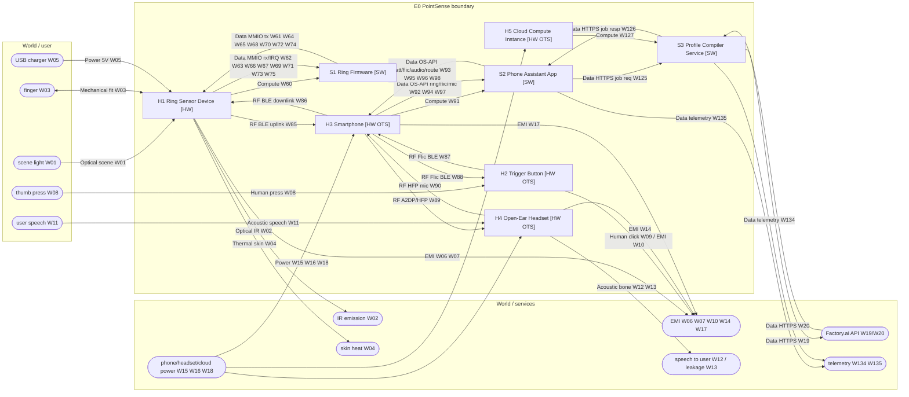
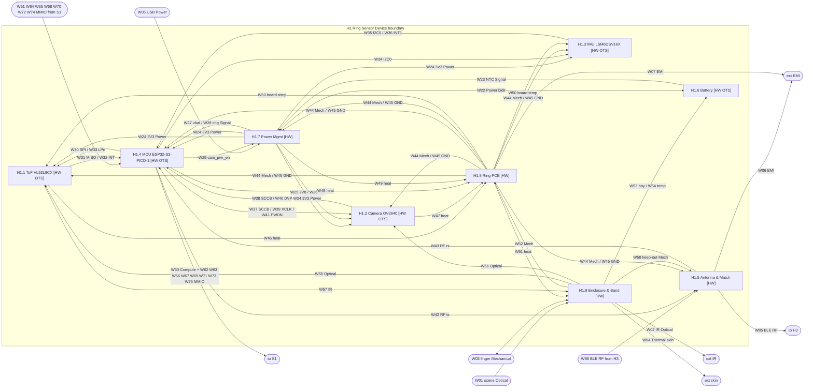
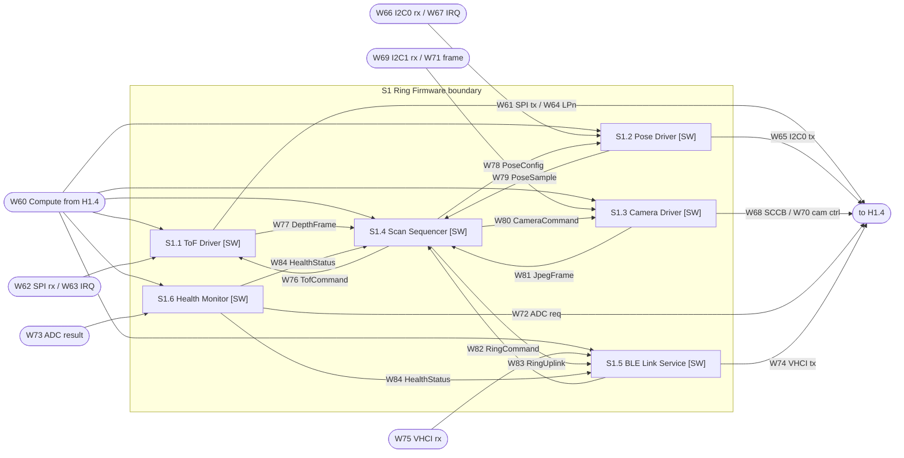
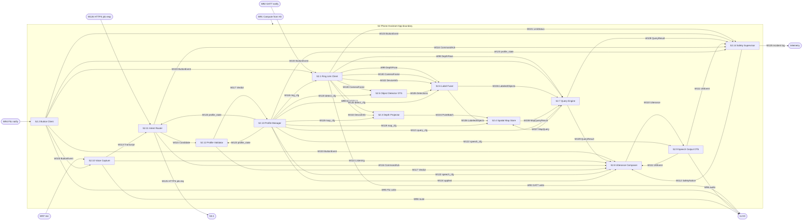
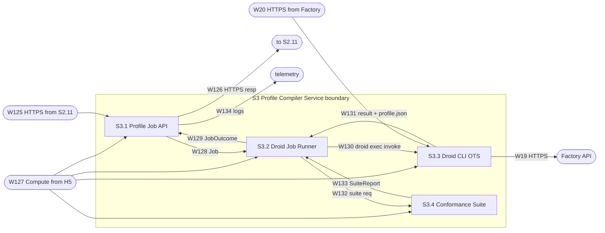

# PointSense Ring: Black-Box Systems Design

Idea (verbatim from the user):

> "A ring-sized sensor that a blind people wears, such that wherever he points, the software will give a voice description of the environment pointed by the finger wearing the ring. Maybe it is a good idea to have a button push on the other hand to activate the scan of the environment. The software must, with the data feeding by the sensor, create a suitable data structure that allows to handle the neccesary information about the 3d mapping. Upon user request, which will be spoken, Droid (from factory.ai) has to interpret the spoken language instructions and, based on its interpretation, change the data structure (or something else) to make the data handling more efficient and faster (e.g. if the user wants only distance of the nearest object instead of both distance and description, there is a lot of room for improvements in efficiency)."

This document follows the black-box paradigm in `BLACKBOX_DESIGN_PROMPT.md`. It has 11 sections, in the order that prompt sets.

**Conventions used throughout**
- Wire IDs are `W01`–`W135`. §5 holds the full parameter set for every wire, and it is the single authoritative copy. In box specs, ports quote the key parameters plus the wire ID. Both ends of a wire cite the same ID, so their parameters match by construction (R8).
- Shared schemas (`AssistProfile`, `RingConfig`, `DepthFrame`, …) are defined once, in §5.0.
- Times are wall-clock unless marked otherwise. `t_us` is the ring's monotonic microsecond clock. The phone maps it to its own clock with a per-connection offset (S2.1 contract).
- "p95" means the 95th percentile over the isolation-test corpus.

---

## 1. E0: Explanatory box

### E0 — PointSense: point-to-hear ring for blind users        [Explanatory]

**What it is.** The user wears a ring on the index finger of one hand. It holds a multizone time-of-flight (ToF) depth sensor, a small camera and an IMU. The other hand holds a Bluetooth push button.

- **Single click.** The ring takes a *point scan*: a short burst of depth frames, plus one camera frame when the profile allows it, along the direction the finger points.
- **Click and hold.** The ring takes a *sweep scan* for as long as the button is held, and the user moves the finger across the scene.
- **Processing.** The ring streams the data over BLE to the user's Android phone. The phone builds a short-lived, gravity-aligned 3D spatial map. It answers the scan with speech through open-ear (bone-conduction) headphones, so the user's ears stay free for the environment.
- **Spoken requests.** A double click lets the user speak a request such as "only tell me the distance to the nearest thing" or "just doors and stairs, ignore people".

**Where Droid sits.** Droid is Factory.ai's coding agent. It is invoked headless through `droid exec`, and one call takes seconds to minutes. That is far too slow, and it needs the network, so it is **kept out of the real-time scan path entirely**. Droid acts as an **offline "profile compiler"** that runs on a cloud host:
1. It turns an open-ended spoken request into an edited, declarative `AssistProfile` JSON document.
2. The cloud re-checks that document with a deterministic conformance suite.
3. The phone re-validates it against a non-negotiable safety floor.
4. Only then does the profile reach every box as explicit configuration `Data` wires (R3).

The profile *is* the data structure the user asked about. It changes the map representation (none / ray-only / voxel), the voxel size and lifetime, whether the label layer exists, the ring's sensor rates and resolution, whether the camera and detector run at all, the query and its fields, and how much is spoken.

Common requests ("distance only", "describe everything", "undo", "reset", "feet") skip Droid entirely. A deterministic on-phone fast path handles them in under 300 ms. Each finished Droid job also returns a named preset with trigger phrases, so the next identical request is instant and works offline. The full Droid path takes p95 ≤ 120 s, hard limit 150 s. During that time the old profile stays active, and the user hears an acknowledgement with an expected time.

**Safety principle (binding on every box).** *Silence never means "path clear".*
- Every scan request ends in exactly one spoken outcome within 1.5 s. The outcome is a result, an explicit "no return within N metres (not a guarantee of a clear path)", "no reading", or a named fault.
- Link loss, low battery, sensor fault, thermal shutdown and profile changes are always announced.
- No profile, from the fast path or from Droid, can turn off the close-obstacle warning, the response deadline or the fault announcements.
- The device is a supplement to a cane or guide dog, not a replacement.

### External ports of E0

| Port | Dir | Type | Parameters (full set in §5) | Wire |
|---|---|---|---|---|
| scene_light | in | Optical | Ambient visible light 400–700 nm plus 940 nm ambient, and 940 nm ToF return. Targets 0.02–4 m (ToF range is spec'd ≤ 5 klux ambient). Ambient 0–100 klux. | W01 |
| ir_emission | out | Optical | 940 nm VCSEL through the ring window, IEC 60825-1 Class 1 | W02 |
| finger_fit | bidir | Mechanical | Ring↔index finger. US sizes 6–12, mass ≤ 14 g, retention ≥ 5 N | W03 |
| skin_heat | out | Thermal | Ring skin-contact surface ≤ 41 °C, ≤ 0.3 W average | W04 |
| ring_charge_in | in | Power | 5 V ±5 % USB through a 2-pin magnetic pogo cable, ≤ 100 mA | W05 |
| ring_rf_emission | out | EMI | BLE 2402–2480 MHz, ≤ +6 dBm EIRP, FCC 15.247 / ETSI EN 300 328 | W06 |
| ring_unintentional_emi | out | EMI | 30 MHz–6 GHz, FCC Part 15B Class B / EN 55032 Class B | W07 |
| thumb_press | in | Human | Thumb or finger press on the button held in the other hand | W08 |
| button_click_feel | out | Human | The button's tactile click | W09 |
| button_rf_emission | out | EMI | Flic 2 BLE emission (certified OTS) | W10 |
| user_speech | in | Acoustic | Spoken commands at the headset boom mic, 55–85 dB SPL | W11 |
| speech_to_user | out | Acoustic | Bone-conduction speech and earcons | W12 |
| audio_leakage | out | Acoustic | Air-borne leakage audible to bystanders (privacy) | W13 |
| headset_rf_emission | out | EMI | Bluetooth Classic emission (certified OTS) | W14 |
| headset_charge_in | in | Power | Headset charging (OTS cable) | W15 |
| phone_power_in | in | Power | Phone charging (OTS USB-C) | W16 |
| phone_rf_emission | out | EMI | Phone BLE, BT, Wi-Fi and cellular emission (certified OTS), SAR | W17 |
| cloud_power_in | in | Power | Cloud provider facility power | W18 |
| factory_api_request | out | Data | HTTPS to Factory inference: transcript, profile JSON, schema. **Data leaves the system** (privacy) | W19 |
| factory_api_response | in | Data | HTTPS responses from Factory inference | W20 |
| telemetry | out | Data | Cloud job logs (W134) and phone incident log (W135). Marked `telemetry` | W134, W135 |

The phone↔cloud HTTPS wires (W125/W126) physically cross the public internet through the phone's modem and the cloud host's NIC. Both are OTS and outside our design responsibility. See assumption A-17.

### Goals and constraints

| Item | Target |
|---|---|
| Point-scan latency, button-down → speech at the ear | Default profile (progressive): nearest distance p95 ≤ 0.9 s, description p95 ≤ 1.5 s. Distance-only profile: p95 ≤ 0.7 s. Distance-only with tone output (no TTS): p95 ≤ 0.5 s. Hard deadline for *some* spoken outcome: 1.5 s |
| Spoken-request latency | Fast path: ≤ 0.3 s after end of speech to applied, plus spoken confirmation. Droid path: acknowledged ≤ 1 s, applied p95 ≤ 120 s, hard timeout 150 s |
| Ring size and mass | Top module ≤ 24 × 18 × 10 mm. Total ≤ 14 g with band |
| Ring battery life | ≥ 6 h with 200 point scans per hour and 20 sweeps per hour on the default profile. About 2× longer on the distance-only profile |
| Cost (BOM, ring only, 1k units) | ≤ USD 60 (assumption A-3). Phone and headset are user-owned or OTS |
| Safety | Silence ≠ clear (above). Laser Class 1. Skin surface ≤ 41 °C. Li-ion protection (IEC 62133-2) |
| Regulatory | FCC Part 15 (15.247 intentional, 15B unintentional), ETSI EN 300 328 / EN 301 489, RED, IEC 62368-1, IEC 60825-1, IEC 62133-2. Not a medical device (assumption A-1) |
| Privacy | Camera images and audio never leave the phone. Only the transcript of a spoken *settings request* and the profile JSON go to the cloud and to Factory. There is no always-on microphone (push-to-talk only). Images are kept ≤ ttl_s (≤ 120 s), RAM only |

---

## 2. Level-1 graph



Level-1 boxes: H1, S1, H2, H3, S2, H4, H5, S3. H1, S1, S2 and S3 are opened in §3/§4. H2, H3, H4 and H5 are OTS leaves.

---
## 3. Box specifications

### 3.1 Level 1 (children of E0)

```
### H1 — Ring Sensor Device                                  [HW]
Parent:        E0
Purpose:       Sense depth, image and orientation along the finger's pointing axis.
Inputs:
  - scene_light     : Optical    (see W01)  ← external (environment)
  - finger_fit      : Mechanical bidirectional (see W03) ↔ external (user's finger)
  - charge_in       : Power      (see W05)  ← external (USB charger, magnetic pogo cable)
  - ble_downlink    : RF         (see W86)  ← H3.ring_tx
  - mmio_spi2_tx    : Data MMIO  (see W61)  ← S1.1
  - mmio_tof_lpn    : Data MMIO  (see W64)  ← S1.1
  - mmio_i2c0_tx    : Data MMIO  (see W65)  ← S1.2
  - mmio_i2c1_tx    : Data MMIO  (see W68)  ← S1.3
  - mmio_cam_ctrl   : Data MMIO  (see W70)  ← S1.3
  - mmio_adc_req    : Data MMIO  (see W72)  ← S1.6
  - mmio_vhci_tx    : Data MMIO  (see W74)  ← S1.5
Outputs:
  - ir_emission     : Optical (see W02) → external
  - finger_fit      : (bidirectional, W03)
  - skin_heat       : Thermal (see W04) → external
  - rf_emission     : EMI     (see W06) → external
  - unintentional_emi: EMI    (see W07) → external
  - ble_uplink      : RF      (see W85) → H3.ring_rx
  - compute         : Compute (see W60) → S1 (fan-out to S1.1–S1.6)
  - mmio_spi2_rx    : Data MMIO (see W62) → S1.1
  - mmio_tof_irq    : Data MMIO (see W63) → S1.1
  - mmio_i2c0_rx    : Data MMIO (see W66) → S1.2
  - mmio_imu_irq    : Data MMIO (see W67) → S1.2
  - mmio_i2c1_rx    : Data MMIO (see W69) → S1.3
  - mmio_cam_frame  : Data MMIO (see W71) → S1.3
  - mmio_adc_res    : Data MMIO (see W73) → S1.6
  - mmio_vhci_rx    : Data MMIO (see W75) → S1.5
Physical:      Top module ≤ 24 × 18 × 10 mm. Total mass ≤ 14 g. Adjustable band, US sizes 6–12.
               Operating 0–40 °C ambient, storage −20–60 °C. IP54 splash resistance (assumption A-4).
Internal state:Battery charge 60–80 mAh. MCU flash (firmware image, NVS). ToF firmware is uploaded to RAM at every boot by S1.1.
Contract:      Delivers the processor resources (W60) and peripheral crossings (W61–W75) listed for H1.4.
               Depth: 4×4 or 8×8 zones over a 45°×45° FoV, 0.02–4 m (dark), boresight aligned ±2° to the band's finger axis.
               Camera: JPEG ≤ VGA, optical axis ±2° to the ToF boresight.
               Peak supply ≥ 300 mA for 1 s. Battery life per E0 goals with the S1 duty cycle.
               Skin surface ≤ 41 °C. Class 1 laser.
Failure modes: See children. Battery at UVLO (3.0 V) → all outputs cease. This is detected on the phone side as link loss (S2.14 announces it).
Isolation test:Bench fixture: a 3D-printed finger mandrel on a goniometer, flat 18 % grey and white targets at 0.25/0.5/1/2/3 m, a 940 nm power meter,
               a thermocouple on the skin face, and a Nordic PPK2 on the battery. Firmware is replaced by the HW bring-up image
               (vendor examples). Pass: every child test passes in situ, boresight error ≤ 2°, skin ≤ 41 °C after 10 min of continuous 8×8 at 15 Hz.
Owner:         HW-Ring team
Children:      H1.1–H1.9
```

```
### S1 — Ring Firmware                                       [SW]
Parent:        E0
Purpose:       Turn phone commands into timestamped, pose-tagged sensor packets on the BLE uplink.
Inputs:
  - compute        : Compute (see W60) ← H1.compute (H1.4)
  - mmio_spi2_rx   : Data (W62) ← H1      - mmio_tof_irq  : Data (W63) ← H1
  - mmio_i2c0_rx   : Data (W66) ← H1      - mmio_imu_irq  : Data (W67) ← H1
  - mmio_i2c1_rx   : Data (W69) ← H1      - mmio_cam_frame: Data (W71) ← H1
  - mmio_adc_res   : Data (W73) ← H1      - mmio_vhci_rx  : Data (W75) ← H1
Outputs:
  - mmio_spi2_tx (W61), mmio_tof_lpn (W64), mmio_i2c0_tx (W65), mmio_i2c1_tx (W68),
    mmio_cam_ctrl (W70), mmio_adc_req (W72), mmio_vhci_tx (W74)                → H1
Compute host:  H1.4.compute (W60)
Internal state:See children: RingConfig (NVS + RAM), pose FIFO, frame buffers, BLE bonding keys (NVS).
Contract:      Point scan, default config: from receipt of SCAN_POINT (HCI RX) to the last DepthFrame on the HCI TX ≤ 220 ms,
               JPEG complete ≤ 650 ms. Distance-only config (4×4 at 60 Hz, camera off): ≤ 70 ms.
               Every SCAN_* command produces exactly one SCAN_DONE or SCAN_ERR record. Health notify at 1 Hz.
               Concurrent peak load ≤ 300 mA (camera and ToF never active at the same time).
Failure modes: Any sensor fault → SCAN_ERR{code}. The other sensors keep working. Watchdog reset ≤ 2 s → reconnect ≤ 3 s.
Isolation test:Run on H1.4 dev board (ESP32-S3-DevKitC-1 + VL53L8CX-SATEL + LSM6DSV16X eval + OV2640 module), driven by a
               Python/Bleak BLE central script that replays the S2.1 command set. Pass: the S1 contract numbers over 1000 scans, no lost SCAN_DONE.
Owner:         FW-Ring team
Children:      S1.1–S1.6
```

```
### H2 — Trigger Button (other hand)                         [HW]  [OTS: Shortcut Labs Flic 2]
Parent:        E0
Purpose:       Report press gestures from the hand that does not wear the ring.
Inputs:
  - press          : Human (see W08) ← external (thumb)
  - ble_from_phone : RF    (see W88) ← H3.flic_tx
Outputs:
  - ble_to_phone   : RF    (see W87) → H3.flic_rx
  - click_feel     : Human (see W09) → external
  - rf_emission    : EMI   (see W10) → external
Physical:      Ø 30 mm × 9.7 mm puck, ~ 10 g, CR2032 user-replaceable cell, clip or lanyard. 0–40 °C.
Internal state:CR2032 charge (vendor-stated ≈ 1–3 years). Pairing keys in flash (vendor firmware).
Contract:      Down/up events delivered to the phone stack ≤ 100 ms after the physical press (assumption A-6). Click, double-click and hold classification is done by flic2lib on the phone (S2.2).
Failure modes: Battery low → reported by flic2lib battery-level API. Out of range or disconnected → no events; S2.2 reports disconnected to S2.14 (announced).
Isolation test:Pair with a stock Android phone running the flic2lib sample app. 200 presses by a test fixture (solenoid).
               Pass: 200/200 down/up events, p95 latency ≤ 100 ms (phone log vs solenoid trigger, scope-timed).
Owner:         Phone-App team (procurement + acceptance)
Children:      leaf (R9a)
```

```
### H3 — Smartphone                                          [HW]  [OTS: Android 13+ phone, reference Google Pixel 8]
Parent:        E0
Purpose:       Host the phone app while bridging its radios and audio to the OS APIs.
Inputs:
  - power_in   : Power (see W16) ← external
  - ring_rx    : RF    (see W85) ← H1.ble_uplink
  - flic_rx    : RF    (see W87) ← H2.ble_to_phone
  - audio_rx   : RF    (see W90) ← H4.bt_tx
  - gatt_ring_write : Data OS-API (see W93) ← S2.1
  - gatt_flic_write : Data OS-API (see W95) ← S2.2
  - audio_play      : Data OS-API (see W96) ← S2.9
  - audio_route     : Data OS-API (see W98) ← S2.10
Outputs:
  - compute    : Compute (see W91) → S2 (fan-out to S2.1–S2.14)
  - ring_tx    : RF (see W86) → H1.ble_downlink
  - flic_tx    : RF (see W88) → H2.ble_from_phone
  - audio_tx   : RF (see W89) → H4.bt_rx
  - gatt_ring_notify : Data OS-API (see W92) → S2.1
  - gatt_flic_notify : Data OS-API (see W94) → S2.2
  - mic_audio        : Data OS-API (see W97) → S2.10
  - rf_emission      : EMI (see W17) → external
Physical:      User-owned phone, carried in a pocket or on a lanyard.
Internal state:OS, app storage (app-private files used by S2.13 and S2.14), BT bonds for the ring, Flic and headset.
Contract:      BLE 5 with LE 2M PHY and LE Data Length Extension; ≥ 3 concurrent BT links (ring BLE, Flic BLE, headset BR/EDR).
               Android 13+ (API 33), on-device SpeechRecognizer (API 31+ createOnDeviceSpeechRecognizer), TextToSpeech engine installed,
               GPU/NNAPI delegate for TFLite. Foreground-service execution not killed while the app holds a connected-device FGS.
Failure modes: OS kills the app → all phone outputs stop. Mitigation: FGS plus the user instruction "every press gets an answer" (A-12).
               Bluetooth off → S2.1/S2.2 report disconnected.
Isolation test:Phone compatibility suite (WP4): BLE 2M PHY + DLE throughput ≥ 700 kbps to an nRF52840-DK peripheral; on-device recognizer
               available offline (airplane mode); TTS latency ≤ 200 ms for a 20-character utterance; concurrent A2DP + 2 BLE links for 1 h without drops.
Owner:         Phone-App team
Children:      leaf (R9a)
```

```
### H4 — Open-Ear Headset                                    [HW]  [OTS: Shokz OpenComm2 (bone conduction, boom mic)]
Parent:        E0
Purpose:       Deliver speech to the user's cheekbones while capturing their voice.
Inputs:
  - bt_rx      : RF       (see W89) ← H3.audio_tx
  - voice_in   : Acoustic (see W11) ← external (user speech)
  - charge_in  : Power    (see W15) ← external
Outputs:
  - bt_tx      : RF       (see W90) → H3.audio_rx
  - bone_out   : Acoustic (see W12) → external (user)
  - leakage    : Acoustic (see W13) → external (bystanders)
  - rf_emission: EMI      (see W14) → external
Physical:      Vendor headset, ~ 33 g. The user's ear canals stay open (environmental hearing preserved).
Internal state:Battery (vendor rated, ~ 16 h talk time). Pairing.
Contract:      A2DP sink (SBC) and HFP 1.7 with mSBC 16 kHz mic. Output latency (A2DP) ≤ 250 ms (assumption A-7).
               SCO setup ≤ 1.0 s (assumption A-8).
Failure modes: Disconnect → Android routes audio to the phone speaker (S2.9 contract) and S2.14 announces "headset disconnected" on the phone speaker.
Isolation test:Pair with the reference phone. Play a 1 kHz click train and record with a bone-conduction artificial mastoid (or contact mic) for latency;
               record HFP mic loopback. Pass: latency ≤ 250 ms p95, SCO setup ≤ 1.0 s p95 over 50 trials.
Owner:         Phone-App team (speech sub-team)
Children:      leaf (R9a)
```

```
### H5 — Cloud Compute Instance                              [HW]  [OTS: AWS EC2 t4g.medium (Graviton2 arm64, 2 vCPU, 4 GiB), Ubuntu 24.04]
Parent:        E0
Purpose:       Provide a sandboxable Linux host for the profile compiler.
Inputs:
  - power_in   : Power (see W18) ← external (cloud provider)
Outputs:
  - compute    : Compute (see W127) → S3 (fan-out to S3.1–S3.4)
Physical:      Virtual machine in a provider datacenter (treated as a bought physical artifact; assumption A-16).
Internal state:EBS root volume 20 GB (code, logs ≤ 7 days). No user data at rest beyond the job record TTL (24 h).
Contract:      99.5 % monthly availability (provider SLA class). Outbound HTTPS to the Factory API endpoint only (egress allow-list).
               Inbound HTTPS 443 from the internet behind an ALB with TLS 1.3.
Failure modes: Instance down → S3.1 is unreachable → S2.11 times out (5 s connect) and announces "online assistant unavailable"; the fast path still works.
Isolation test:Provision with Terraform; run `droid --version`, the S3.4 test corpus, and a 100-request load test. Pass: all succeed, p95 job-queue latency ≤ 1 s.
Owner:         Cloud team
Children:      leaf (R9a)
```

```
### S2 — Phone Assistant App                                 [SW]
Parent:        E0
Purpose:       Turn button events, ring packets and spoken requests into spoken answers under the active profile.
Inputs:
  - compute          : Compute     (see W91)  ← H3.compute
  - gatt_ring_notify : Data OS-API (see W92)  ← H3
  - gatt_flic_notify : Data OS-API (see W94)  ← H3
  - mic_audio        : Data OS-API (see W97)  ← H3
  - job_resp         : Data HTTPS  (see W126) ← S3.1
Outputs:
  - gatt_ring_write  : Data OS-API (see W93)  → H3
  - gatt_flic_write  : Data OS-API (see W95)  → H3
  - audio_play       : Data OS-API (see W96)  → H3
  - audio_route      : Data OS-API (see W98)  → H3
  - job_req          : Data HTTPS  (see W125) → S3.1
  - incident_log     : Data file   (see W135) → telemetry
Compute host:  H3.compute (W91)
Internal state:See children: active profile + 10-version history + presets (S2.13, persistent); spatial map (S2.4, RAM, ≤ 120 s);
               per-request deadlines (S2.14).
Contract:      E0 latency goals. Exactly one spoken outcome per scan request within 1.5 s of button-down.
               Profile changes apply atomically between scans (no scan is served under a mix of two profile versions).
Failure modes: See S2.14. Unrecoverable app error → process restart by the FGS; on restart it speaks "assistant restarted".
Isolation test:Run on the reference phone with (a) the ring simulator (WP4 stub: an nRF52840-DK running a GATT replay of recorded scans),
               (b) a scripted Flic (flic2lib test double injecting events), (c) the S3 stub (canned job responses with 5–120 s delays).
               Pass: 500 scripted scenarios meet the latency/outcome contract, 0 silent requests.
Owner:         Phone-App team (sub-teams per WP4–WP9)
Children:      S2.1–S2.14
```

```
### S3 — Profile Compiler Service                            [SW]
Parent:        E0
Purpose:       Compile an open-ended spoken settings request into a validated candidate AssistProfile using Droid.
Inputs:
  - compute           : Compute    (see W127) ← H5.compute
  - job_req           : Data HTTPS (see W125) ← S2.11
  - factory_response  : Data HTTPS (see W20)  ← external (Factory API)
Outputs:
  - job_resp          : Data HTTPS (see W126) → S2.11
  - factory_request   : Data HTTPS (see W19)  → external (Factory API)
  - job_log           : Data       (see W134) → telemetry
Compute host:  H5.compute (W127)
Internal state:Job records (≤ 24 h), per-job tmpfs workspace (deleted at job end), Droid session id (job lifetime only).
Contract:      Accept or reject a submit within 1 s. Terminal outcome (succeeded / failed / timed_out / rejected) for every job ≤ 150 s after submit.
               A `succeeded` outcome always carries a candidate profile that passed S3.4. Never returns code, only profile JSON (≤ 8 KB) and text.
Failure modes: Factory API down or slow → failed{reason:"agent_unavailable"} or timed_out. Droid edits invalid → up to 2 repair attempts, then failed{suite report}.
Isolation test:HTTP client test harness with 50 recorded transcripts (each with an expected-property oracle, e.g. "camera == off");
               the Factory API is either live (nightly) or replaced by a canned-response proxy (CI). Pass: ≥ 90 % oracle agreement live,
               100 % schema/safety-valid outcomes, every job terminal ≤ 150 s.
Owner:         Cloud team
Children:      S3.1–S3.4
```

### 3.2 Children of H1 (Ring Sensor Device)

```
### H1.1 — Multizone ToF Sensor                              [HW]  [OTS: ST VL53L8CX]
Parent:        H1
Purpose:       Measure distance to surfaces in a 4×4 or 8×8 grid ahead of the finger.
Inputs:
  - optical_in  : Optical { 940 nm return + ambient through window, 45°×45° FoV, 0.02–4 m } ← H1.9.tof_window (W55)
  - vdd         : Power   { 3.3 V ±3 % (AVDD and IOVDD tied), ≤ 150 mA peak }        ← H1.7.rail_3v3 (W24)
  - gnd_ref     : Power   { 0 V plane, ≤ 20 mV bounce }                               ← H1.8.gnd_ref (W45)
  - mount       : Mechanical { reflow on LGA16 land pattern, tilt ≤ 1° vs board }   ← H1.8.mount (W44)
  - board_temp  : Thermal { board 0–60 °C }                                            ← H1.8.board_temp (W50)
  - spi_in      : Signal  { SPI mode 3, 3.0 MHz SCLK, 3.3 V CMOS, SCLK/MOSI/NCS }      ← H1.4.spi2_out (W30)
  - lpn         : Signal  { GPIO 3.3 V, high = enabled, low = low-power/I/F off }     ← H1.4.gpio_tof_lpn (W33)
Outputs:
  - spi_miso    : Signal  { SPI MISO 3.3 V; frame = up to ~1.4 KB per result read }   → H1.4.spi2_in (W31)
  - int_n       : Signal  { open-drain active-low, 3.3 V pull-up 47 kΩ, data-ready pulse } → H1.4.gpio_tof_int (W32)
  - ir_emit     : Optical { 940 nm VCSEL, Class 1 }                                     → H1.9.ir_in (W57)
  - heat        : Thermal { ≤ 0.5 W peak while ranging, ≤ 5 mW in LP idle }            → H1.8.heat_tof (W46)
Physical:      LGA 6.4 × 3.0 × 1.75 mm (height: from vendor drawing, A-21), < 0.1 g, −30–85 °C.
Internal state:Vendor firmware in RAM (uploaded by the host at boot; lost at power-off). Ranging config registers. Counts as part of the OTS part.
Contract:      Ranging 0.02–4 m dark, ~2.8 m on a large reflective target at 5 klux. 8×8 at ≤ 15 Hz, 4×4 at ≤ 60 Hz. Typical current 100 mA ranging,
               peaks up to 150 mA (vendor/Pololu figures). Per-zone target_status: 5 (and 9) = valid. Class 1 laser under all host configs.
Failure modes: No target / low signal → status ≠ 5/9, so the zone is invalid (S2.7 reports "no return", never "clear").
               Glass, mirrors and black velvet → false or invalid ranges (documented limitation, A-13). No int_n within 2/hz s → sensor fault.
Isolation test:VL53L8CX-SATEL + ST ULD example on a Nucleo. Flat white (88 %) and grey (17 %) targets at 0.1/0.5/1/2/3 m, 0 and 5 klux.
               Pass: ≥ 95 % of zones valid and within ±5 % (or ±8 mm below 0.2 m) up to 2 m grey / 3 m white, frame rates as stated.
Owner:         HW-Ring (sensing)
Children:      leaf (R9a)
```

```
### H1.2 — Camera Module                                     [HW]  [OTS: OmniVision OV2640 24-pin FPC module, ~66° DFOV lens, IR-cut filter]
Parent:        H1
Purpose:       Capture a JPEG-compressed colour image along the pointing axis.
Inputs:
  - optical_in  : Optical { 400–700 nm through the window, 66° diagonal FoV, ≥ 10 lux for usable images } ← H1.9.cam_window (W56)
  - dovdd       : Power   { 3.3 V ±3 %, ≤ 10 mA }        ← H1.7.rail_3v3 (W24)
  - avdd        : Power   { 2.8 V ±5 %, ≤ 30 mA }        ← H1.7.rail_2v8 (W25)
  - dvdd        : Power   { 1.3 V ±5 %, ≤ 60 mA }        ← H1.7.rail_1v3 (W26)
  - gnd_ref     : Power   { 0 V plane }                  ← H1.8.gnd_ref (W45)
  - mount       : Mechanical { FPC hot-bar or connector, lens axis ±2° to ToF boresight } ← H1.8.mount (W44)
  - sccb_in     : Signal  { SCCB (I²C-compatible) 100 kHz, 3.3 V, addr 0x30 (7-bit) } ← H1.4.i2c1_out (W37)
  - xclk        : Signal  { 20 MHz ±1 %, 3.3 V square wave }                           ← H1.4.xclk_out (W39)
  - pwdn_reset  : Signal  { 2 GPIO, 3.3 V: PWDN active-high, RESET_N active-low }      ← H1.4.gpio_cam_ctrl (W41)
Outputs:
  - sccb_out    : Signal  { SCCB SDA read data, 3.3 V }                                → H1.4.i2c1_in (W38)
  - dvp_out     : Signal  { DVP 8-bit D2–D9, PCLK ≤ 24 MHz, VSYNC, HREF, 3.3 V; JPEG stream } → H1.4.lcd_cam_in (W40)
  - heat        : Thermal { ≤ 0.15 W active, ≤ 0.1 mW PWDN }                            → H1.8.heat_cam (W47)
Physical:      Module ~ 8.5 × 8.5 × 5 mm + FPC 20 mm, ~ 0.5 g, −30–70 °C.
Internal state:Sensor registers (volatile). AE/AWB state converges after ~ 3–8 frames (A-9).
Contract:      JPEG at QQVGA/QVGA/VGA; quality qscale 10–63; QVGA q=12 → ≤ 12 KB typical. First valid AE-settled frame ≤ 350 ms after PWDN release at QVGA.
Failure modes: Too dark (< 10 lux) → very dark JPEG; the detector returns none and S2.7 flags desc_unavailable. Missing XCLK → no VSYNC (driver timeout).
Isolation test:ESP32-S3 dev board with esp32-camera example; ISO 12233 chart + Macbeth chart at 0.5 m, 300 lux. Pass: JPEG size and settle time as contracted,
               MTF50 ≥ 0.15 cy/px at QVGA, 100/100 captures decode.
Owner:         HW-Ring (sensing)
Children:      leaf (R9a)
```

```
### H1.3 — IMU with Embedded Fusion                          [HW]  [OTS: ST LSM6DSV16X]
Parent:        H1
Purpose:       Report the ring's orientation as a gravity-referenced game rotation vector.
Inputs:
  - vdd        : Power   { 3.3 V ±3 % (VDD, VDDIO), ≤ 1 mA }         ← H1.7.rail_3v3 (W24)
  - gnd_ref    : Power   { 0 V plane }                               ← H1.8.gnd_ref (W45)
  - mount      : Mechanical { LGA-14L, axes aligned ±1° to board datum } ← H1.8.mount (W44)
  - board_temp : Thermal { 0–60 °C }                                 ← H1.8.board_temp (W50)
  - i2c_in     : Signal  { I²C fast-mode 400 kHz, 3.3 V, addr 0x6A }  ← H1.4.i2c0_out (W34)
Outputs:
  - i2c_out    : Signal  { I²C SDA read data, FIFO bursts (7 B/word) } → H1.4.i2c0_in (W35)
  - int1       : Signal  { push-pull active-high 3.3 V, FIFO watermark } → H1.4.gpio_imu_int (W36)
Physical:      LGA-14L 2.5 × 3.0 × 0.83 mm, −40–85 °C.
Internal state:SFLP fusion state (quaternion, gyro bias). Lost at power-off; reconverges ≤ 2 s.
Contract:      SFLP game rotation vector (quaternion; x, y, z in FP16, w recomputed by host) and gravity vector at 15–120 Hz via FIFO.
               No absolute heading (yaw drift, A-10). Fusion current ~ tens of µA.
Failure modes: Near-180° FP16 artifacts (vendor-known) → the host normalises and checks continuity. No INT1 for 3 watermark periods → IMU fault.
Isolation test:STEVAL board on a rate table: 0/90/180° steps and 30°/s sweeps. Pass: tilt error ≤ 1°, yaw drift ≤ 3°/min static, output rate ±2 %.
Owner:         HW-Ring (sensing)
Children:      leaf (R9a)
```

```
### H1.4 — Ring MCU + Radio SiP                              [HW]  [OTS: Espressif ESP32-S3-PICO-1-N8R2]
Parent:        H1
Purpose:       Provide the processor, peripherals and 2.4 GHz radio that host the ring firmware.
Inputs:
  - vdd            : Power  { 3.3 V ±3 % (3.0–3.6 V), ≤ 350 mA peak (Wi-Fi unused; BLE peaks ~100 mA, A-11) } ← H1.7.rail_3v3 (W24)
  - gnd_ref        : Power  { 0 V plane }                       ← H1.8.gnd_ref (W45)
  - mount          : Mechanical { LGA56 7 × 7 mm land pattern } ← H1.8.mount (W44)
  - spi2_in        : Signal (W31)  ← H1.1      - gpio_tof_int : Signal (W32) ← H1.1
  - i2c0_in        : Signal (W35)  ← H1.3      - gpio_imu_int : Signal (W36) ← H1.3
  - i2c1_in        : Signal (W38)  ← H1.2      - lcd_cam_in   : Signal (W40) ← H1.2
  - adc_in         : Signal { analog 0–1.45 V = Vbat/3 on ADC1_CH0 } (W27) ← H1.7
  - gpio_chg       : Signal { open-drain active-low CHG status } (W28) ← H1.7
  - rf_rx          : RF { 2.4 GHz from antenna, 50 Ω } (W43) ← H1.5
  - mmio_*_tx      : Data MMIO (W61, W64, W65, W68, W70, W72, W74) ← S1 children
Outputs:
  - spi2_out (W30) → H1.1     - gpio_tof_lpn (W33) → H1.1
  - i2c0_out (W34) → H1.3
  - i2c1_out (W37) → H1.2     - xclk_out (W39) → H1.2     - gpio_cam_ctrl (W41) → H1.2
  - gpio_cam_pwr_en : Signal (W29) → H1.7
  - rf_tx           : RF (W42) → H1.5
  - heat            : Thermal { ≤ 0.5 W peak, ≤ 10 mW light-sleep } (W48) → H1.8.heat_mcu
  - compute         : Compute (W60) → S1.1–S1.6
  - mmio_*_rx       : Data MMIO (W62, W63, W66, W67, W69, W71, W73, W75) → S1 children
Physical:      LGA56 7.0 × 7.0 mm SiP (crystal, flash, PSRAM and RF matching inside), N8R2: −40–85 °C.
Internal state:8 MB flash (firmware, NVS: bonding keys, RingConfig). 2 MB PSRAM, 512 KB SRAM (volatile). eFuse (MAC, secure-boot keys).
               The BT controller binary (Espressif libbtdm) and ROM count as the part's own firmware: used only through the documented VHCI interface (§1.2 OTS rule).
Contract:      Peripherals offered: GPSPI2 (≤ 80 MHz, used at 3 MHz), I²C0/I²C1, LCD_CAM DVP with GDMA, LEDC (XCLK), ADC1 12-bit, TSENS,
               GPIO with edge IRQs, BLE 5 (LE 2M PHY, DLE, ≤ +20 dBm; configured +4 dBm). Light-sleep with BLE connection retained.
               One-shot configure-then-read pairs (not loops, R5): pin mux / IO_MUX setup, LEDC XCLK timer config, ADC calibration-scheme init,
               TSENS range init, GDMA channel allocation, BT controller init. All are done once at boot by the owning S1 child.
Failure modes: Brown-out detector at 2.7 V → reset. Overtemperature (die > 105 °C) → chip limits; S1.6 throttles earlier (L7). RF detuned → reduced range (H1.5).
Isolation test:ESP32-S3-PICO-1 on a vendor dev board: run the IDF peripheral examples (SPI loopback, I²C scan, LCD_CAM with a test-pattern camera, ADC
               against a precision source, BLE throughput example). Pass: all peripherals within datasheet limits; BLE ≥ 700 kbps app throughput at 2M PHY.
Owner:         HW-Ring (electronics)
Children:      leaf (R9a)
```

```
### H1.5 — 2.4 GHz Antenna & Matching                       [HW]
Parent:        H1
Purpose:       Radiate and receive the ring's BLE signal through the enclosure.
Inputs:
  - feed_in    : RF { 2402–2480 MHz, 50 Ω, ≤ +6 dBm conducted } ← H1.4.rf_tx (W42)
  - air_rx     : RF { BLE from the phone, ≥ −90 dBm at feed for 2M PHY } ← H3.ring_tx (W86)
  - env        : Mechanical { keep-out 4 × 8 mm, PC wall 0.8 mm εr ≈ 2.9, finger ≥ 3 mm from element } ← H1.9.antenna_env (W58)
  - mount      : Mechanical (W44) ← H1.8    - gnd_ref : Power (W45) ← H1.8
Outputs:
  - feed_out   : RF { received BLE to the SiP, 50 Ω } → H1.4.rf_rx (W43)
  - air_tx     : RF (W85) → H3.ring_rx
  - radiated   : EMI (W06) → external
Physical:      Chip antenna 3.2 × 1.6 mm + 3-element pi network on H1.8, < 0.05 g.
Internal state:none
Contract:      Return loss ≤ −8 dB across 2402–2480 MHz when worn (on a finger phantom). Efficiency ≥ 25 % worn. Link to a pocketed phone ≥ 2 m body-worn
               (with H3 sensitivity).
Failure modes: Detuning from finger or water → efficiency drop. Contract: still ≥ 1 m link at −10 dB margin. Physical damage → no link (announced by S2.14).
Isolation test:VNA S11 on the assembled PCB in the enclosure on a SAM-like finger phantom; OTA TRP in a small anechoic box.
               Pass: S11 ≤ −8 dB, TRP ≥ −2 dBm at +4 dBm conducted, ≤ +6 dBm EIRP.
Owner:         HW-Ring (RF)
Candidate implementation (non-binding): Johanson 2450AT18A100E chip antenna with a pi match tuned in the enclosure.
Children:      leaf (R9b: one RF engineer, ~3 weeks)
```

```
### H1.6 — Ring Battery                                      [HW]  [OTS: 3.7 V LiPo pouch, 60–80 mAh, ≤ 4 × 12 × 20 mm, with protection PCM and 10 kΩ NTC]
Parent:        H1
Purpose:       Store the ring's energy.
Inputs:
  - mount      : Mechanical { bay with ≥ 10 % swell allowance, no sharp edges, no compression > 5 N } ← H1.9.battery_bay (W53)
  - temp       : Thermal { cell 0–45 °C charge, −10–60 °C discharge } ← H1.9.ambient_temp (W54)
Outputs:
  - ntc        : Signal { 10 kΩ @25 °C NTC, β = 3435 } → H1.7.ts (W23)
Bidirectional:
  - cell       : Power bidirectional (W22) ↔ H1.7.bat
                 cell→PMIC: 3.0–4.2 V, ≤ 350 mA pulse (1 s), ≤ 150 mA continuous;
                 PMIC→cell: CC ≤ 70 mA (≈1C) to 4.20 V ±1 %, CV termination 7 mA.
Physical:      ≤ 4 × 12 × 20 mm, ~ 2 g, wired by tabs to H1.8 pads.
Internal state:Stored charge 60–80 mAh (≈ 0.22–0.30 Wh). Ageing ≤ 20 % capacity loss at 300 cycles.
Contract:      ≥ 3C pulse discharge (≥ 210 mA) for 1 s while staying ≥ 3.3 V at 50 % SoC, 25 °C (a supplier must demonstrate it; open question Q-3).
               PCM: overcharge 4.28 V, overdischarge 2.8 V, overcurrent 1 A. IEC 62133-2 certified.
Failure modes: Over-temp → the PMIC suspends charging via NTC. PCM trip → ring off (link loss announced). Swelling → mechanical bay allowance.
Isolation test:Battery cycler: 1C charge, discharge profile = S1 duty-cycle trace (PPK2 recording). Pass: ≥ 6 h on the default-profile trace at 25 °C,
               ≥ 3.3 V under 300 mA 1 s pulses at 50 % SoC.
Owner:         HW-Ring (power)
Children:      leaf (R9a)
```

```
### H1.7 — Power Management Circuit                         [HW]
Parent:        H1
Purpose:       Convert charger and battery power into the ring's regulated rails.
Inputs:
  - vin         : Power (W05) ← external   (5 V USB through magnetic pogo pads exposed through H1.9)
  - ts          : Signal (W23) ← H1.6.ntc
  - cam_ldo_en  : Signal { GPIO 3.3 V push-pull, high = camera rails on } (W29) ← H1.4
  - mount       : Mechanical (W44) ← H1.8    - gnd_ref : Power (W45) ← H1.8
Bidirectional:
  - bat         : Power bidirectional (W22) ↔ H1.6.cell
Outputs:
  - rail_3v3    : Power { 3.30 V ±3 %, ≤ 400 mA, ripple ≤ 30 mVpp, Iq ≤ 1 µA (buck-boost) } (W24) → H1.1, H1.2, H1.3, H1.4
  - rail_2v8    : Power { 2.80 V ±5 %, ≤ 30 mA, ripple ≤ 10 mVpp, off when cam_ldo_en low } (W25) → H1.2
  - rail_1v3    : Power { 1.30 V ±5 %, ≤ 60 mA, ripple ≤ 10 mVpp, off when cam_ldo_en low } (W26) → H1.2
  - vbat_sense  : Signal { Vbat/3 via 2 MΩ/1 MΩ divider + 100 nF, 0–1.45 V, ≤ 1.5 µA } (W27) → H1.4.adc_in
  - chg_stat_n  : Signal { open-drain active-low = charging } (W28) → H1.4.gpio_chg
  - heat        : Thermal { ≤ 0.1 W charging, ≤ 0.05 W discharge } (W49) → H1.8.heat_pmic
Physical:      ≤ 6 × 6 mm PCB area, reflowed on H1.8.
Internal state:Charger state machine (precharge/CC/CV/done/fault). Volatile.
Contract:      Charge 70 mA CC/CV with NTC JEITA-style suspend outside 0–45 °C. Charge-to-full ≤ 90 min. Rails stay in regulation from Vbat 3.0–4.2 V
               under 300 mA load steps (≤ 100 mV droop). Charging with the ring worn is impossible (the pogo pads are on the finger face).
Failure modes: VIN overvoltage up to 20 V tolerated (OVP). Short on a rail → current limit, the rail falls, MCU brown-out. Thermal shutdown at 125 °C junction.
Isolation test:Bare PCB with an electronic load and a battery simulator (Keysight N6705 or equivalent). Pass: regulation, ripple, droop and charge profile as contracted,
               NTC suspend verified with a resistor decade.
Owner:         HW-Ring (power)
Candidate implementation (non-binding): TI BQ25101 charger, TI TPS63900 buck-boost (3.3 V), two TLV755P-family LDOs (2.8 V, 1.3 V).
Children:      leaf (R9b: one power engineer, ~4 weeks)
```

```
### H1.8 — Ring PCB (rigid-flex)                            [HW]
Parent:        H1
Purpose:       Mount and interconnect the ring's electronic parts.
Inputs:
  - mount_in    : Mechanical { held by bosses/adhesive in H1.9, 4 datum points } (W52) ← H1.9.pcb_mount
  - heat_tof    : Thermal (W46) ← H1.1      - heat_cam  : Thermal (W47) ← H1.2
  - heat_mcu    : Thermal (W48) ← H1.4      - heat_pmic : Thermal (W49) ← H1.7
Outputs:
  - mount       : Mechanical { solder lands, flatness ≤ 0.05 mm, part-to-part angular alignment ±1° (ToF, IMU, camera bracket) } (W44)
                  → H1.1, H1.2, H1.3, H1.4, H1.5, H1.7
  - gnd_ref     : Power { 0 V reference plane, ≤ 20 mV bounce at 300 mA steps } (W45) → H1.1, H1.2, H1.3, H1.4, H1.5, H1.7
  - board_temp  : Thermal { board temperature seen by sensors, ≤ 45 °C at 0.6 W for 60 s } (W50) → H1.1, H1.3
  - heat_out    : Thermal { all dissipated heat, ≤ 0.6 W peak, ≤ 0.3 W average } (W51) → H1.9.heat_in
  - emi         : EMI (W07) → external (aggregate unintentional emission of the ring electronics)
Physical:      4-layer rigid-flex, rigid area ≤ 20 × 15 mm, 0.8 mm. Flex tail to the camera. ~ 0.8 g.
Internal state:none
Contract:      Controlled 50 Ω RF trace to H1.5. Signal integrity for DVP 24 MHz and SPI 3 MHz. Copper pour spreads the MCU and ToF hotspot so ΔT ≤ 8 K between parts.
               Unintentional emission within W07 limits with the specified firmware clocks.
Failure modes: Flex crack after bending → camera loss (driver timeout, SCAN_ERR). Delamination at over-temperature → open circuits.
Isolation test:Bare-board electrical test (flying probe), TDR on the RF trace, thermal camera with resistor heaters emulating heat inputs, flex bend test 1000 cycles.
               Pass: impedance 50 Ω ±10 %, ΔT ≤ 8 K, no opens after bend test.
Owner:         HW-Ring (electronics)
Children:      leaf (R9b: layout engineer, ~5 weeks)
```

```
### H1.9 — Ring Enclosure, Windows & Band                   [HW]
Parent:        H1
Purpose:       Hold the electronics on the finger with the sensor axes aligned to the pointing direction.
Inputs:
  - scene_in    : Optical (W01) ← external
  - finger_fit  : Mechanical bidirectional (W03) ↔ external
  - ir_in       : Optical (W57) ← H1.1.ir_emit
  - heat_in     : Thermal (W51) ← H1.8.heat_out
Outputs:
  - tof_window  : Optical { 940 nm transmission ≥ 90 %, crosstalk within ST cover-window guidance, air gap ≤ 0.5 mm } (W55) → H1.1
  - cam_window  : Optical { visible transmission ≥ 90 %, anti-reflective, no vignetting at 66° DFOV } (W56) → H1.2
  - ir_out      : Optical (W02) → external
  - skin_heat   : Thermal (W04) → external
  - pcb_mount   : Mechanical (W52) → H1.8
  - battery_bay : Mechanical (W53) → H1.6
  - ambient_temp: Thermal { internal air/cell temperature, ≤ 45 °C } (W54) → H1.6
  - antenna_env : Mechanical (W58) → H1.5
Physical:      Top module ≤ 24 × 18 × 10 mm (PC/ABS or titanium frame with PC windows), adjustable silicone or metal band, US 6–12.
               Pointing datum: the module's long axis is parallel to the proximal phalanx ±5° when worn. Mass ≤ 6 g (excluding electronics).
               Exposed magnetic 2-pin pogo pads for W05 on the palm-facing side. Tactile orientation nub so the user can put it on correctly without sight.
Internal state:none
Contract:      Sensor boresights point within ±5° of the finger axis for the population fit range (user-calibratable offset: A-14).
               Skin surface ≤ 41 °C with ≤ 0.3 W average internal dissipation at 25 °C ambient. IP54. 1.2 m drop survivable.
Failure modes: Window scratched or fogged → ToF crosstalk, invalid zones (reported by S1.1 status). Band loosened → misalignment (pointing error).
Isolation test:3D-printed and then production enclosures on finger phantoms (sizes 6/9/12): alignment by laser on a goniometer, thermal with a 0.3 W heater,
               IP54 spray, drop test. Pass: alignment ±5°, skin ≤ 41 °C, functional after drop.
Owner:         HW-Ring (mechanical/industrial design)
Children:      leaf (R9b: mechanical engineer + ID, ~6 weeks)
```

### 3.3 Children of S1 (Ring Firmware)

All S1 children run on **H1.4.compute (W60)**: Xtensa LX7 dual-core 240 MHz, 512 KB SRAM, 2 MB PSRAM, 8 MB flash, ESP-IDF v5.3 (FreeRTOS SMP). W60 fans out to every child.
Intra-S1 Data wires use FreeRTOS queues with **copy semantics**: the sender's buffer is never shared, so there is no undeclared shared memory (R2).

```
### S1.1 — ToF Driver                                        [SW]
Parent:        S1
Purpose:       Turn ToF commands into timestamped depth frames.
Inputs:
  - compute     : Compute (W60) ← H1.4
  - spi_rx      : Data MMIO { GPSPI2 RX via GDMA, ≤ 1.5 KB per result read, trans-done IRQ, ≤ 5 ms per read at 3 MHz } (W62) ← H1.4
  - tof_irq     : Data MMIO { GPIO_INTR on tof_int falling edge, ISR latency ≤ 20 µs, ≤ 60 Hz } (W63) ← H1.4
  - command     : Data queue { TofCommand (§5.0), ≤ 10 Hz } (W76) ← S1.4
Outputs:
  - spi_tx      : Data MMIO { GPSPI2 TX via spi_master + GDMA; boot FW upload ~84 KB once; ≤ 64 B/read cmd } (W61) → H1.4
  - lpn_out     : Data MMIO { GPIO_OUT_W1TS/W1TC reg for LPn pin } (W64) → H1.4
  - frames      : Data queue { DepthFrame (§5.0) or TofStatus{fault code}, ≤ 60 Hz, ≤ 300 B } (W77) → S1.4
Compute host:  H1.4.compute (W60)
Internal state:Sensor-init done flag; current res/hz; 2 × 300 B frame buffers. RAM; reset on reboot; changed by `command`.
Contract:      Boot init ≤ 1.0 s (FW upload). start→first frame ≤ 1 frame period + 15 ms. frame emitted ≤ 6 ms after tof_irq. t_us = IRQ time − ½ integration, jitter ≤ 200 µs.
               standby → LPn low and sensor stopped (≤ 5 mW).
Failure modes: No IRQ within 2× period → TofStatus{TIMEOUT}, one re-init attempt, then FAULT (persistent until reboot). SPI CRC/protocol error → FAULT.
Isolation test:VL53L8CX-SATEL wired to an ESP32-S3 dev board; a test task sends TofCommands. Pass: rates, latency and t_us jitter as contracted (logic analyser on INT and SPI);
               fault path verified by unplugging the SATEL.
Owner:         FW-Ring (drivers)
Candidate implementation (non-binding): ST VL53L8CX ULD API ported to ESP-IDF spi_master.
Children:      leaf (R9b, ~3 weeks)
```

```
### S1.2 — Pose Driver                                       [SW]
Parent:        S1
Purpose:       Turn IMU FIFO contents into timestamped orientation samples.
Inputs:
  - compute     : Compute (W60) ← H1.4
  - i2c_rx      : Data MMIO { I²C0 master RX, FIFO burst ≤ 512 B, ≤ 12 ms at 400 kHz } (W66) ← H1.4
  - imu_irq     : Data MMIO { GPIO_INTR on INT1 rising, ≤ 20 Hz watermark events } (W67) ← H1.4
  - pose_config : Data queue { PoseConfig{odr_hz: 15|30|60|120} } (W78) ← S1.4
Outputs:
  - i2c_tx      : Data MMIO { I²C0 master TX, register writes ≤ 16 B (SFLP enable, FIFO config) } (W65) → H1.4
  - pose        : Data queue { PoseSample (§5.0), 15–120 Hz, 36 B each } (W79) → S1.4
Compute host:  H1.4.compute (W60)
Internal state:Last quaternion for continuity check; FIFO config. RAM.
Contract:      Quaternion normalised (|q| = 1 ± 1e−3), w ≥ 0 hemisphere-continuous. t_us accuracy ±1 ms (FIFO timestamp tags). Output rate = odr ±2 %.
Failure modes: No watermark IRQ in 3 periods → PoseSample.valid=false stream at odr and a fault flag. Discontinuity > 30° in one sample → flagged invalid.
Isolation test:LSM6DSV16X eval board on a rotary stage + dev board. Pass: angle error ≤ 1° vs encoder, timing as contracted, fault on unplug.
Owner:         FW-Ring (drivers)
Children:      leaf (R9b, ~2 weeks)
```

```
### S1.3 — Camera Capture Driver                             [SW]
Parent:        S1
Purpose:       Turn capture commands into timestamped JPEG frames.
Inputs:
  - compute     : Compute (W60) ← H1.4
  - i2c_rx      : Data MMIO { I²C1 RX (SCCB reads), ≤ 4 B } (W69) ← H1.4
  - cam_frame   : Data MMIO { LCD_CAM GDMA into PSRAM frame buffer ≤ 48 KB, VSYNC/EOF IRQ } (W71) ← H1.4
  - command     : Data queue { CameraCommand (§5.0) } (W80) ← S1.4
Outputs:
  - i2c_tx      : Data MMIO { I²C1 TX SCCB writes ≤ 200 register writes at init/res change } (W68) → H1.4
  - cam_ctrl    : Data MMIO { LCD_CAM_CAM_CTRL regs, LEDC timer0 ch0 for 20 MHz XCLK, GPIO PWDN/RESET_N/cam_pwr_en } (W70) → H1.4
  - jpeg        : Data queue { JpegFrame (§5.0), ≤ 1 per command, ≤ 48 KB copied } (W81) → S1.4
Compute host:  H1.4.compute (W60)
Internal state:Camera power state (off/standby/streaming), current res/quality, AE settled flag. RAM.
Contract:      capture from off → JpegFrame ≤ 400 ms (QVGA), ≤ 500 ms (VGA). From standby ≤ 150 ms. JPEG valid (SOI/EOI) or CamStatus error. After `power_off`, rails off ≤ 5 ms.
Failure modes: No VSYNC within 300 ms → CamStatus{TIMEOUT}. Oversized JPEG (> 48 KB) → retry once at q+10, else error.
Isolation test:OV2640 module + dev board, test task issuing commands. Pass: timings, 1000/1000 decodable JPEGs, rail-off verified with a scope on 2.8 V.
Owner:         FW-Ring (drivers)
Candidate implementation (non-binding): espressif/esp32-camera component.
Children:      leaf (R9b, ~2 weeks)
```

```
### S1.4 — Scan Sequencer                                    [SW]
Parent:        S1
Purpose:       Schedule sensor captures for each scan command under the active RingConfig.
Inputs:
  - compute     : Compute (W60) ← H1.4
  - ring_cmd    : Data queue { RingCommand (§5.0): SCAN_POINT/SWEEP_START/SWEEP_STOP/SET_CONFIG, ≤ 20 /s } (W82) ← S1.5
  - frames      : Data queue (W77) ← S1.1
  - pose        : Data queue (W79) ← S1.2
  - jpeg        : Data queue (W81) ← S1.3
  - health      : Data queue { HealthStatus (§5.0), 1 Hz } (W84) ← S1.6
Outputs:
  - tof_cmd     : Data queue { TofCommand } (W76) → S1.1
  - pose_config : Data queue { PoseConfig } (W78) → S1.2
  - cam_cmd     : Data queue { CameraCommand } (W80) → S1.3
  - uplink      : Data queue { RingUplink records (§5.0): DEPTH, JPEG, SCAN_DONE, SCAN_ERR, CFG_ACK; ≤ 50 KB per scan } (W83) → S1.5
Compute host:  H1.4.compute (W60)
Internal state:Active RingConfig (RAM + NVS copy, survives reboot, changed only by SET_CONFIG); pose ring buffer 1 s × odr (≤ 4.3 KB);
               current scan state machine (idle/point/sweep). Throttle flags from health (hysteresis).
Contract:      Point scan: ToF burst of point_frames frames first, then the camera (if camera=on_point), never concurrent (peak-load rule).
               Each DEPTH/JPEG record carries the pose interpolated (slerp) at its t_us from the pose buffer (|Δt| ≤ 1/odr).
               Sweep: stream ToF at tof_hz until SWEEP_STOP or sweep_max_s, then camera if camera=on_sweep_end.
               Exactly one SCAN_DONE{n_depth, n_jpeg} or SCAN_ERR per req_id. SET_CONFIG applied between scans, answered with CFG_ACK{cfg_ver, ok|reject}.
               Throttling: vbat < 3.50 V (release at 3.60 V) or die_temp > 70 °C (release at 62 °C) → camera refused (SCAN_DONE with flag CAMERA_THROTTLED);
               vbat < 3.30 V → ToF limited to 4×4 single frame (flag TOF_THROTTLED).
               Distance-only config: SCAN_POINT → first DEPTH ≤ 40 ms + 1 frame period.
Failure modes: Driver fault → SCAN_ERR{code, sensor}. A new SCAN_* while busy → the old scan ends with SCAN_DONE{partial} and the new one starts.
               Invalid SET_CONFIG (out of range) → CFG_ACK{reject}, the old config is kept.
Isolation test:Host-side unit tests (ESP-IDF Linux target) with stub drivers emitting synthetic frames/pose/JPEG on schedules, plus on-target with real drivers.
               Pass: ordering, interpolation error ≤ 0.5° on a synthetic 90°/s rotation, never-concurrent rule (trace), one terminal record per req_id over 10k random command sequences.
Owner:         FW-Ring (application)
Children:      leaf (R9b, ~4 weeks; (c) holds: one responsibility: scheduling)
```

```
### S1.5 — BLE Link Service                                  [SW]
Parent:        S1
Purpose:       Carry ring commands and uplink records across the ring's GATT server.
Inputs:
  - compute     : Compute (W60) ← H1.4
  - vhci_rx     : Data MMIO { esp_vhci_host callback: HCI events + ACL ≤ 251 B, ≤ 1000 pkt/s } (W75) ← H1.4
  - uplink      : Data queue (W83) ← S1.4
  - health      : Data queue (W84) ← S1.6
Outputs:
  - vhci_tx     : Data MMIO { esp_vhci_host_send_packet: HCI cmds + ACL ≤ 251 B } (W74) → H1.4
  - ring_cmd    : Data queue (W82) → S1.4
Compute host:  H1.4.compute (W60)
Internal state:Bonding keys (NVS, persistent, LE Secure Connections); connection state; TX fragment queue ≤ 64 KB (PSRAM); DeviceInfo (constants + fw/hw rev).
Contract:      GATT service per W85/W86 (§5). Fragments uplink records into ≤ 244 B notifications with a {type, req_id, frag_idx, frag_cnt} header.
               Health notification at 1 Hz (heartbeat). Requests 15 ms connection interval during scans, 500 ms idle (peripheral-requested).
               Command write → ring_cmd queue ≤ 2 ms. Only one bonded central at a time; pairing window only for 60 s after the charger is attached (A-15).
Failure modes: Link drop → flush queue, advertise at 100 ms for 30 s then 1 s. Queue overflow → drop the oldest JPEG fragments of the current scan and send SCAN_ERR{UPLINK_OVERFLOW}.
Isolation test:Dev board + nRF52840-DK running a Python/Bleak (or nRF Connect) central. Pass: ≥ 700 kbps notifications at 2M PHY, zero fragment loss over 10k scans,
               heartbeat jitter ≤ 50 ms, pairing window rule enforced.
Owner:         FW-Ring (connectivity)
Candidate implementation (non-binding): NimBLE host (ESP-IDF) over the VHCI controller.
Children:      leaf (R9b, ~4 weeks)
```

```
### S1.6 — Ring Health Monitor                               [SW]
Parent:        S1
Purpose:       Report battery, charging and die-temperature status at 1 Hz.
Inputs:
  - compute     : Compute (W60) ← H1.4
  - adc_res     : Data MMIO { ADC1 oneshot 12-bit raw + eFuse calibration, TSENS °C, GPIO_IN chg level; on request, ≤ 100 µs } (W73) ← H1.4
Outputs:
  - adc_req     : Data MMIO { adc_oneshot_read / temperature_sensor_get_celsius / gpio_get_level calls, 1 Hz } (W72) → H1.4
  - health      : Data queue { HealthStatus (§5.0), 1 Hz } (W84) → S1.4, S1.5
Compute host:  H1.4.compute (W60)
Internal state:16-sample moving average of vbat; OCV→SoC table (const). RAM.
Contract:      vbat accuracy ±30 mV after calibration; SoC ±10 % (16 s moving average smooths scan load sag; S1.6 has no knowledge of scan activity); die temp ±3 °C; 1 Hz ±5 %.
Failure modes: ADC read error → HealthStatus with vbat_mv = 0 and err flag (consumers treat as unknown, not as full).
Isolation test:Dev board with a precision source on the ADC pin and a heat gun near the SiP. Pass: accuracy as contracted.
Owner:         FW-Ring (drivers)
Children:      leaf (R9b, ~1 week; (c) holds)
```

### 3.4 Children of S2 (Phone Assistant App)

All S2 children run on **H3.compute (W91)**: arm64-v8a, ≥ 6 GB RAM, Android 13+ (API 33), ART, a single app process with a `connectedDevice` foreground service, plus TFLite GPU/NNAPI delegates. W91 fans out to every child.
Intra-S2 Data wires are in-process Kotlin `Channel`/`SharedFlow` messages of **immutable** objects. Senders never mutate a sent object, so passing by reference is not shared mutable memory (R2).

**Config latching rule (applies to every S2 child with a config input).** A box applies a new config section only at a request boundary. It stamps `profile_version` on its outputs.

```
### S2.1 — Ring Link Client                                  [SW]
Parent:        S2
Purpose:       Exchange commands and uplink records with the ring over BLE GATT.
Inputs:
  - compute       : Compute (W91) ← H3
  - gatt_notify   : Data OS-API { BluetoothGattCallback.onCharacteristicChanged on Data/Health chars, ≤ 1000 notif/s, ≤ 244 B } (W92) ← H3
  - button        : Data in-proc { ButtonEvent (§5.0) } (W103) ← S2.2
  - ring_cfg      : Data in-proc { RingConfig section of AssistProfile + profile_version } (W118) ← S2.13
Outputs:
  - gatt_write    : Data OS-API { BluetoothGatt.writeCharacteristic (no-response) on Command char ≤ 64 B; requestMtu(247), setPreferredPhy(2M), requestConnectionPriority(HIGH) } (W93) → H3
  - depth         : Data in-proc { DepthPose (§5.0), ≤ 60 Hz } (W99) → S2.3, S2.6, S2.7
  - camera        : Data in-proc { CameraFrame (§5.0), ≤ 1 per scan } (W100) → S2.5, S2.6
  - link_status   : Data in-proc { LinkStatus (§5.0), 1 Hz + on change } (W101) → S2.14
  - device_info   : Data in-proc { DeviceInfo (§5.0), on connect } (W102) → S2.3, S2.6
Compute host:  H3.compute (W91)
Internal state:Bond/address (persistent, SharedPreferences); clock offset ring t_us → phone elapsedRealtimeNanos (per connection, updated per Health notify);
               reassembly buffers ≤ 64 KB; last applied cfg_ver.
Contract:      button down → SCAN_POINT write issued ≤ 10 ms. hold → SWEEP_START, up → SWEEP_STOP. double_click → nothing sent (the scan of its first down still completes;
               the composer drops its speech). Sends SET_CONFIG on connect and on each ring_cfg change (if idle; else after SCAN_DONE).
               Reassembly: a complete record is emitted ≤ 2 ms after its last fragment. Clock offset error ≤ 5 ms. Auto-reconnect on loss (back-off 0.5 → 5 s).
Failure modes: Missing fragment → that record dropped, LinkStatus.errors += {req_id, FRAG_LOSS}. No Health for 3 s → LinkStatus.connected=false.
               SCAN_ERR from the ring → forwarded in LinkStatus.scan_errors.
Isolation test:Reference phone + ring simulator (nRF52840-DK, GATT replay of recorded uplink). Pass: 10k scans zero mis-assembly, latency as contracted, reconnect ≤ 3 s after simulator reset.
Owner:         Phone-App (link)
Children:      leaf (R9b, ~4 weeks)
```

```
### S2.2 — Button Client                                     [SW]
Parent:        S2
Purpose:       Turn Flic 2 radio traffic into typed button events.
Inputs:
  - compute       : Compute (W91) ← H3
  - flic_notify   : Data OS-API { Android BluetoothGatt callbacks for the Flic 2 service (used inside flic2lib) } (W94) ← H3
Outputs:
  - flic_write    : Data OS-API { BluetoothGatt writes/connect for the Flic 2 protocol } (W95) → H3
  - button        : Data in-proc { ButtonEvent (§5.0) } (W103) → S2.1, S2.7, S2.8, S2.10, S2.14
Compute host:  H3.compute (W91)
Internal state:Pairing database (flic2lib, persistent); event_id counter (monotonic, persisted).
Contract:      `down` emitted ≤ 5 ms after the flic2lib callback; `hold` at 500 ms held; `double_click` per flic2lib classification (≤ 400 ms window).
               Each physical press yields exactly one `down` and one `up` with the same event_id. Link changes emitted as button_link events. Battery ≤ 10 % → battery_low event.
Failure modes: Flic disconnected → button_link{disconnected} (S2.14 announces). Library exception → button_link{error}.
Isolation test:Robolectric/instrumented test with a flic2lib test double injecting callbacks; plus a solenoid-press bench with a real Flic. Pass: event sequence grammar holds for 1000 random press patterns.
Owner:         Phone-App (link)
Candidate implementation (non-binding): flic2lib-android (Shortcut Labs).
Children:      leaf (R9b, ~1 week)
```

```
### S2.3 — Depth Projector                                   [SW]
Parent:        S2
Purpose:       Convert pose-tagged depth zones into world-frame 3D points.
Inputs:
  - compute     : Compute (W91) ← H3
  - depth       : Data in-proc (W99) ← S2.1
  - device_info : Data in-proc (W102) ← S2.1
  - map_cfg     : Data in-proc { MapConfig section + profile_version } (W119) ← S2.13
Outputs:
  - points      : Data in-proc { PointBatch (§5.0), one per DepthPose when map.mode = voxel; none when ray_only/none } (W104) → S2.4
Compute host:  H3.compute (W91)
Internal state:Zone direction LUT per hw_rev/res (constant tables, selected by device_info). The world frame is gravity-aligned with yaw from the game rotation vector (drifts; A-10).
Contract:      ≤ 1 ms per 8×8 frame. Only valid zones (status 5/9) produce points; invalid zones produce a `no_return` ray marker with max range.
               Point error ≤ 2 % range + 1.5° angular (given H1 alignment contract).
Failure modes: Unknown hw_rev → no output and an error flag in PointBatch (S2.4 ignores). Pose invalid → frame dropped.
Isolation test:JVM unit tests with synthetic DepthPose of a known plane/box scene. Pass: reconstructed points within contract; invalid zones never produce points.
Owner:         Phone-App (spatial)
Children:      leaf (R9b, ~2 weeks)
```

```
### S2.4 — Spatial Map Store                                 [SW]
Parent:        S2
Purpose:       Keep a short-lived world-frame voxel map and answer cone queries against it.
Inputs:
  - compute     : Compute (W91) ← H3
  - points      : Data in-proc (W104) ← S2.3
  - objects     : Data in-proc (W106) ← S2.6
  - map_query   : Data in-proc { MapQuery (§5.0) } (W107) ← S2.7
  - map_cfg     : Data in-proc (W119) ← S2.13
Outputs:
  - map_result  : Data in-proc { MapQueryResult (§5.0) } (W108) → S2.7
Compute host:  H3.compute (W91)
Internal state:**SpatialMap** (the 3D data structure; RAM only, never persisted):
                 voxel hash map keyed by (ix, iy, iz) int16 at voxel_cm; per voxel {hits uint16, misses uint16, last_seen_ms uint32, label_id uint8, label_conf uint8};
                 object list ≤ 64 {label, conf, centroid, extent, last_seen}; bounded by max_voxels (≤ 20 000, ≈ 0.5 MB) and radius_m around the latest ring position.
               Lifetime: entries expire after ttl_s; the whole map is cleared on map_cfg change of mode/voxel_cm, on link loss > 10 s, and on app restart.
               Changed by `points`, `objects`, `map_cfg`.
Contract:      Insert ≤ 2 ms per PointBatch (64 points). Cone query ≤ 5 ms at 20 000 voxels. Never returns data older than ttl_s.
               mode = ray_only or none → map holds nothing, and every query returns {empty, reason: map_disabled}.
Failure modes: Capacity reached → evict the oldest voxels first (LRU by last_seen). Malformed query → error result (never a fabricated "empty").
Isolation test:JVM tests: synthetic point streams of a room (walls + a chair) with known geometry; queries vs ground truth. Pass: nearest occupied voxel within 1 voxel of truth,
               expiry exact to ±50 ms, performance as contracted on the reference phone (benchmark).
Owner:         Phone-App (spatial)
Children:      leaf (R9b, ~4 weeks)
```

```
### S2.5 — Object Detector                                   [SW]  [OTS: Google MediaPipe Tasks Object Detector, EfficientDet-Lite0 int8 (COCO 80 classes)]
Parent:        S2
Purpose:       Label objects in a camera frame with boxes and scores.
Inputs:
  - compute     : Compute (W91) ← H3
  - camera      : Data in-proc (W100) ← S2.1
  - detect_cfg  : Data in-proc { DetectConfig section: enabled, min_score, max_objects, classes_allow/deny + profile_version } (W120) ← S2.13
Outputs:
  - detections  : Data in-proc { Detections (§5.0) } (W105) → S2.6
Compute host:  H3.compute (W91)
Internal state:Loaded model (~ 4.4 MB), loaded when enabled and released after 60 s disabled.
Contract:      ≤ 60 ms per QVGA frame on the reference phone (GPU delegate) (A-19). With enabled=false, a camera frame (should none arrive) yields Detections{skipped}.
               Classes outside allow/deny are removed before output (the API's category allow/deny list).
Failure modes: Decode error → Detections{error}. Model load failure → Detections{error} for every frame (S2.7 flags desc_unavailable).
Isolation test:Run on COCO val2017 subset resized to QVGA. Pass: mAP within 10 % relative of published Lite0 figures, latency as contracted.
Owner:         Phone-App (perception)
Children:      leaf (R9a)
```

```
### S2.6 — Label Fuser                                       [SW]
Parent:        S2
Purpose:       Attach depth-derived 3D positions to camera detections.
Inputs:
  - compute     : Compute (W91) ← H3
  - depth       : Data in-proc (W99) ← S2.1
  - camera      : Data in-proc (W100) ← S2.1   (uses only the metadata: req_id, t_us, pose)
  - device_info : Data in-proc (W102) ← S2.1
  - detections  : Data in-proc (W105) ← S2.5
  - detect_cfg  : Data in-proc (W120) ← S2.13
Outputs:
  - objects     : Data in-proc { LabeledObjects (§5.0) } (W106) → S2.4, S2.7
Compute host:  H3.compute (W91)
Internal state:Last 1 s of DepthPose (≤ 60 frames) for time matching; camera↔ToF extrinsics LUT per hw_rev.
Contract:      For each detection, the distance = median valid zone range inside the box projected into the ToF grid, using the DepthPose closest in time (|Δt| ≤ 150 ms).
               No valid zone in the box → distance null with reason no_return (never a guessed distance). ≤ 3 ms per frame.
Failure modes: No DepthPose within 150 ms → objects with distance null and reason no_depth. Detections error → LabeledObjects{error}.
Isolation test:Synthetic scenes (rendered RGB+depth pairs of a box at known distances) through stub detector outputs. Pass: distance error ≤ 5 % + 3 cm; null rules respected.
Owner:         Phone-App (perception)
Children:      leaf (R9b, ~3 weeks)
```

```
### S2.7 — Query Engine                                      [SW]
Parent:        S2
Purpose:       Compute the answer to each scan request under the active query config.
Inputs:
  - compute     : Compute (W91) ← H3
  - depth       : Data in-proc (W99) ← S2.1
  - button      : Data in-proc (W103) ← S2.2
  - objects     : Data in-proc (W106) ← S2.6
  - map_result  : Data in-proc (W108) ← S2.4
  - query_cfg   : Data in-proc { QueryConfig section + safety floor copy + profile_version } (W121) ← S2.13
Outputs:
  - map_query   : Data in-proc (W107) → S2.4
  - result      : Data in-proc { QueryResult (§5.0); 1–2 per request (progressive) } (W109) → S2.8, S2.14
Compute host:  H3.compute (W91)
Internal state:Pending requests ≤ 4 {event_id, kind, deadline, collected frames}. RAM.
Contract:      **Nearest distance is always computed from this request's own fresh DepthPose frames (never from the map)** using zones within point_cone_deg of boresight.
               Point: emit `nearest` result ≤ 5 ms after the last expected depth frame (point_frames) or 300 ms after down, whichever first.
               If progressive and labels requested: a second `items` result when objects arrive, or at 1100 ms after down with flag desc_unavailable.
               Sweep: on `up`, query the map (voxel mode) for the swept volume and emit a summary result ≤ 50 ms after the last frame.
               **Safety floor:** if any valid zone in the full 45° FoV is < close_warning_m (1.0 m), the result includes it as nearest_close regardless of the report fields.
               If no zone is valid: `no_return_beyond_m` = the configured max range, with reason {no_target | invalid | low_signal}. Never an "all clear" value.
Failure modes: No depth for the request by 300 ms → result{kind: no_reading, reason}. Map query error → summary without map items, flag partial.
Isolation test:JVM tests with scripted DepthPose/objects/map responses covering 40 scenario tables (empty, close obstacle, glass-like invalid, partial labels, late data).
               Pass: every scenario's result matches its table; the safety-floor and no-"clear" properties hold under property-based testing (10k random frames).
Owner:         Phone-App (spatial)
Children:      leaf (R9b, ~4 weeks)
```

```
### S2.8 — Utterance Composer                                [SW]
Parent:        S2
Purpose:       Turn results, notices and acknowledgements into prioritised spoken text.
Inputs:
  - compute     : Compute (W91) ← H3
  - button      : Data in-proc (W103) ← S2.2
  - result      : Data in-proc (W109) ← S2.7
  - utt_events  : Data in-proc (W111) ← S2.9
  - notice      : Data in-proc { SafetyNotice (§5.0) } (W112) ← S2.14
  - listening   : Data in-proc { ListeningState{listening: bool, t} } (W114) ← S2.10
  - cmd_ack     : Data in-proc { CommandAck (§5.0) } (W116) ← S2.11
  - verdict     : Data in-proc { ValidationVerdict (§5.0) } (W117) ← S2.12
  - speech_cfg  : Data in-proc { SpeechConfig section + query units + profile_version } (W122) ← S2.13
  - applied     : Data in-proc { ProfileApplied{version, summary_text ≤ 120 chars} } (W124) ← S2.13
Outputs:
  - utterance   : Data in-proc { UtteranceRequest (§5.0) } (W110) → S2.9
Compute host:  H3.compute (W91)
Internal state:Speech queue ≤ 8 utterances with priority (P0 safety > P1 result > P2 info); held queue while listening. RAM.
Contract:      Deterministic templates per language (en-US first). Result → UtteranceRequest ≤ 5 ms. A new `down` interrupts P1/P2 speech of older requests.
               `double_click` drops pending P1 speech for that event_id. While listening=true, nothing is emitted except P0, which is held ≤ 6 s
               (or emitted at once if kind ∈ {link_lost, sensor_fault}).
               **Lexical safety rule:** never emits "clear", "safe", "nothing there", "path is free" or equivalents. A no-target result is phrased "No return within N metres".
               Units/precision per config ("1.4 metres", "4 feet 6", "2 steps").
               verbosity = tone: nearest distance → earcon tone_dNN (16 pitch steps, 0.25 m each, 0–4 m); no return → the distinct `no_return` double-low earcon
               (never silence); notices are always spoken text regardless of verbosity.
Failure modes: Unknown result kind → generic "No reading." (P1). Queue full → drop the oldest P2.
Isolation test:JVM golden tests: 300 input events → expected text/priority. Pass: 100 % golden match, plus a lexicon scan over 100k random results finding 0 forbidden phrases.
Owner:         Phone-App (speech)
Children:      leaf (R9b, ~2 weeks)
```

```
### S2.9 — Speech Output                                     [SW]  [OTS: Android android.speech.tts.TextToSpeech (Google TTS engine)]
Parent:        S2
Purpose:       Render utterance text as audible speech.
Inputs:
  - compute     : Compute (W91) ← H3
  - utterance   : Data in-proc (W110) ← S2.8
  - speech_cfg  : Data in-proc (W122) ← S2.13
Outputs:
  - audio_play  : Data OS-API { TextToSpeech.speak(QUEUE_FLUSH|QUEUE_ADD) with AudioAttributes USAGE_ASSISTANCE_ACCESSIBILITY, 24 kHz PCM via the audio HAL to the A2DP route } (W96) → H3
  - utt_events  : Data in-proc { UtteranceEvent (§5.0) from UtteranceProgressListener } (W111) → S2.8, S2.14
Compute host:  H3.compute (W91)
Internal state:Engine voice data (installed, persistent).
Contract:      First audio sample ≤ 200 ms after speak() for ≤ 40 characters (A-18). Rate 0.5–3.0×. Exactly one done or error event per utterance.
               UtteranceRequest.earcon → playEarcon() of a bundled WAV (registered with addEarcon); earcon_fallback plays a 3-beep pattern even if text synthesis fails.
Failure modes: Engine not ready → error event (S2.14 escalates to an earcon via the fallback tone in the same API, and logs it).
Isolation test:Instrumented test on the reference phone; timing via the audio loopback dongle. Pass: latency as contracted, events complete for 1000 utterances.
Owner:         Phone-App (speech)
Children:      leaf (R9a)
```

```
### S2.10 — Voice Capture & Recognition                     [SW]
Parent:        S2
Purpose:       Capture one push-to-talk utterance and return its on-device transcript.
Inputs:
  - compute     : Compute (W91) ← H3
  - mic_audio   : Data OS-API { RecognitionListener callbacks from SpeechRecognizer (on-device), audio from the SCO route, 16 kHz } (W97) ← H3
  - button      : Data in-proc (W103) ← S2.2
Outputs:
  - audio_route : Data OS-API { AudioManager.setCommunicationDevice(BT SCO)/clearCommunicationDevice; SpeechRecognizer.startListening/stopListening } (W98) → H3
  - transcript  : Data in-proc { Transcript (§5.0) } (W113) → S2.11
  - listening   : Data in-proc { ListeningState } (W114) → S2.8
Compute host:  H3.compute (W91)
Internal state:Capture state (idle/routing/listening/finishing). RAM.
Contract:      On double_click: route SCO, then listening=true with a "listening" earcon (via S2.8), capture ≤ 6 s or until end-of-speech/next `down`.
               Transcript ≤ 500 ms after end of speech. Uses only createOnDeviceSpeechRecognizer: **audio never leaves the phone**. Restores the A2DP route after.
Failure modes: No speech → Transcript{empty, reason:no_speech}. Recognizer unavailable → Transcript{error} (S2.11 acks "I didn't catch that").
Isolation test:Instrumented test with recorded command WAVs injected via a virtual BT headset (or the phone mic in test mode). Pass: WER ≤ 10 % on the 200-command corpus (quiet), timing as contracted.
Owner:         Phone-App (speech)
Children:      leaf (R9b, ~2 weeks)
```

```
### S2.11 — Intent Router                                    [SW]
Parent:        S2
Purpose:       Map each transcript to a candidate profile through the fast path or a Droid job.
Inputs:
  - compute       : Compute (W91) ← H3
  - transcript    : Data in-proc (W113) ← S2.10
  - profile_state : Data in-proc { ProfileState (§5.0): active profile, history ≤ 10, presets ≤ 50 } (W123) ← S2.13
  - job_resp      : Data HTTPS (W126) ← S3.1
Outputs:
  - candidate     : Data in-proc { CandidateProfile (§5.0) } (W115) → S2.12
  - cmd_ack       : Data in-proc { CommandAck (§5.0) } (W116) → S2.8, S2.14
  - job_req       : Data HTTPS (W125) → S3.1
Compute host:  H3.compute (W91)
Internal state:At most one outstanding Droid job {cmd_id, job_id, base_version, submitted_at}. RAM (a job in flight is abandoned on app restart).
Contract:      Fast path: a deterministic grammar (built-in intents + preset trigger phrases from profile_state) → candidate ≤ 50 ms.
               Built-in intents: distance_only, full_description, only_classes(list), ignore_classes(list), units(m|ft|steps), speech_rate(±),
               verbosity(terse|normal|detailed), undo, reset_default, status_query(mode|battery).
               Otherwise, if online: submit a job (base = active profile) and ack {sent_to_droid, eta_s: 60}; poll every 2 s; on a succeeded result → candidate
               (source: droid). A new transcript while a job is outstanding replaces it (the old job is cancelled; its later result is discarded).
               Offline/unreachable → ack {offline}. Status queries → ack {status_request, topic} with no candidate.
Failure modes: Job failed/timed_out → ack {droid_failed, reason}, no candidate. HTTP 5xx → one retry, then failed. Response for a cancelled cmd_id → ignored.
Isolation test:JVM tests with a transcript corpus (fast-path grammar coverage 200 phrasings) and a mock HTTP server for S3 (delays 1–150 s, failures).
               Pass: 100 % fast-path mapping on the corpus, correct ack sequence for every server scenario, never two outstanding jobs.
Owner:         Phone-App (profile runtime)
Children:      leaf (R9b, ~3 weeks)
```

```
### S2.12 — Profile Validator                                [SW]
Parent:        S2
Purpose:       Decide deterministically whether a candidate profile is safe and well-formed.
Inputs:
  - compute       : Compute (W91) ← H3
  - candidate     : Data in-proc (W115) ← S2.11
  - profile_state : Data in-proc (W123) ← S2.13
Outputs:
  - verdict       : Data in-proc { ValidationVerdict (§5.0) } (W117) → S2.13, S2.8
Compute host:  H3.compute (W91)
Internal state:none (the schema and safety floor are compiled-in constants of this box's release).
Contract:      Pure function of (candidate, profile_state), ≤ 10 ms. Accepts only if ALL hold:
               (1) JSON Schema assist-profile/1 valid, ≤ 8 KB; (2) safety block byte-identical to the compiled SafetyFloor;
               (3) parent_version == active version (else reject stale); (4) every numeric field within schema ranges and cross-field rules
               (tof_res 8 ⇒ tof_hz ≤ 15; camera ≠ off ⇒ jpeg_res set; detect.enabled ⇒ camera ≠ off; report fields require their producers
               (label ⇒ detect.enabled), map.mode=voxel ⇒ max_voxels ≤ 20 000); (5) resource estimate (cost model in §5.0) ≤ budget:
               p95 point latency ≤ 1.3 s, ring charge per point scan ≤ 0.03 mAh; (6) summary_text ≤ 120 chars, no forbidden lexicon;
               (7) presets: ≤ 50, phrases ≤ 60 chars, no collision with built-in intents.
               Same input → same verdict (property-tested).
Failure modes: Malformed input → reject {reason: parse_error}. Never throws to the caller.
Isolation test:JVM test suite of 500 candidate profiles (valid, each rule violated singly and in pairs, fuzzed). Pass: 100 % expected verdicts; fuzzing finds no accept of an invalid profile.
Owner:         Safety team (shared with Phone-App)
Children:      leaf (R9b, ~2 weeks)
```

```
### S2.13 — Profile Manager                                  [SW]
Parent:        S2
Purpose:       Hold the active AssistProfile and distribute its sections as configuration wires.
Inputs:
  - compute     : Compute (W91) ← H3
  - verdict     : Data in-proc (W117) ← S2.12
Outputs:
  - ring_cfg      : Data in-proc (W118) → S2.1
  - map_cfg       : Data in-proc (W119) → S2.3, S2.4
  - detect_cfg    : Data in-proc (W120) → S2.5, S2.6
  - query_cfg     : Data in-proc (W121) → S2.7
  - speech_cfg    : Data in-proc (W122) → S2.8, S2.9
  - profile_state : Data in-proc (W123) → S2.11, S2.12, S2.14
  - applied       : Data in-proc (W124) → S2.8
Compute host:  H3.compute (W91)
Internal state:Active profile + 10-version history + preset library ≤ 50, persisted to an app-private file (atomic write-rename, ≤ 100 KB), survives restarts.
               Built-in default profile (compiled-in). Changed only by accepted verdicts.
Contract:      On an accepted verdict: persist, then publish all seven outputs with the same new version ≤ 20 ms, in the order sections → profile_state → applied.
               Rejected verdicts change nothing. At startup: publish the persisted profile (or the default if the file is corrupt, with applied.summary "settings reset to default").
Failure modes: Persist failure → keep the old profile, publish nothing, applied{error} (spoken "could not save settings").
Isolation test:JVM tests: verdict sequences incl. stale/rejected/accepted; corrupt-file startup; kill during write. Pass: outputs/versions as contracted, file never half-written.
Owner:         Phone-App (profile runtime)
Children:      leaf (R9b, ~1 week; (c) holds)
```

```
### S2.14 — Safety Supervisor                                [SW]
Parent:        S2
Purpose:       Guarantee that every request and every fault produces a spoken outcome.
Inputs:
  - compute       : Compute (W91) ← H3
  - link_status   : Data in-proc (W101) ← S2.1
  - button        : Data in-proc (W103) ← S2.2
  - result        : Data in-proc (W109) ← S2.7
  - utt_events    : Data in-proc (W111) ← S2.9
  - cmd_ack       : Data in-proc (W116) ← S2.11
  - profile_state : Data in-proc (W123) ← S2.13
Outputs:
  - notice        : Data in-proc { SafetyNotice (§5.0) } (W112) → S2.8
  - incident_log  : Data file { JSON lines, app-private, ≤ 5 MB ring buffer, user-exportable; no audio/images } (W135) → telemetry
Compute host:  H3.compute (W91)
Internal state:Per-request deadline table ≤ 8 entries; last link/health snapshot; battery-warning latch (20/10/5 %); notice rate limiter. RAM, plus the incident log file.
Contract:      For each `down`: if no UtteranceEvent{started} for that event_id by 1500 ms after down (minus the TTS margin of 200 ms → trigger at 1300 ms),
               emit SafetyNotice{no_reading or timeout, event_id} at P0. Exactly one notice per event_id (idempotent).
               Link lost (ring or Flic or headset) → notice ≤ 3 s after detection, repeated every 30 s while lost; restore → notice once.
               Ring battery 20/10/5 % → notice once each (hysteresis 3 %). Ring SCAN_ERR fault codes → notice per fault type ≤ 1 per 60 s.
               Ring cfg_ver ≠ active ring_cfg version for > 5 s while connected → notice "ring settings not applied".
               status_request{battery} ack → notice with the battery level. The deadline (1500 ms) is the SafetyFloor value; a profile cannot change it.
Failure modes: If S2.9 reports an error for a P0 notice → escalate to a TTS-independent earcon pattern (via notice{kind: earcon_fallback}) and log it.
Isolation test:JVM tests with scripted event timelines (dropped results, link flaps, battery ramps, TTS errors). Pass: exactly one outcome per request in 100 % of 10k randomized timelines;
               all notices within deadlines; rate limits respected.
Owner:         Safety team
Children:      leaf (R9b, ~3 weeks)
```

### 3.5 Children of S3 (Profile Compiler Service)

All S3 children run on **H5.compute (W127)**: arm64 Graviton2 2 vCPU, 4 GiB RAM, Ubuntu 24.04, Docker 27 with gVisor runtime (runsc), Node 20, Python 3.12. W127 fans out to every child.

**Where Droid fits, and why here.** Factory's `droid exec` is a headless coding-agent CLI (verified, §10).
- It is read-only by default, and `--auto low` allows project file edits.
- `-o json` returns `{result, is_error, duration_ms, session_id}`.
- `--cwd`, `-m` and `-f` select the workspace, the model and the prompt file.
- Linux arm64 and x64 binaries exist.
- It needs a `FACTORY_API_KEY` and calls Factory-managed inference over the network. A documented single-turn example took ~5.7 s, and there is no built-in timeout flag.

So Droid is used here as a **sandboxed, time-boxed editor of one JSON file**. The data structure it edits is the declarative `AssistProfile`. It never edits or ships executable code at runtime, and it is never on the scan path.

```
### S3.1 — Profile Job API                                   [SW]
Parent:        S3
Purpose:       Accept authenticated profile-job requests while reporting each job's state.
Inputs:
  - compute     : Compute (W127) ← H5
  - job_req     : Data HTTPS (W125) ← S2.11
  - outcome     : Data in-proc/queue { JobOutcome (§5.0) } (W129) ← S3.2
Outputs:
  - job_resp    : Data HTTPS (W126) → S2.11
  - job         : Data queue { Job (§5.0) } (W128) → S3.2
  - job_log     : Data { structured JSON logs: job_id, timings, outcome class, profile diff keys; NO transcript text beyond 7 days, no device identifiers beyond a salted hash } (W134) → telemetry
Compute host:  H5.compute (W127)
Internal state:Job table (SQLite on local disk): {job_id, device_hash, state, submitted_at, outcome}; TTL 24 h. Per-device rate limiter (≤ 20 jobs/h).
Contract:      Submit → 202 {job_id} ≤ 1 s, or 4xx with reason (auth, schema, rate). Poll → current state ≤ 200 ms. Exactly one terminal state per job ≤ 150 s after submit
               (synthesises timed_out at 150 s if S3.2 has not reported). Cancel supported.
Failure modes: Queue full (> 20 waiting) → 503 retry_after. Malformed request → 400.
Isolation test:HTTP contract tests (pytest + httpx) with a stub S3.2. Pass: all status codes/timings as contracted, TTL deletion verified.
Owner:         Cloud team
Children:      leaf (R9b, ~2 weeks)
```

```
### S3.2 — Droid Job Runner                                  [SW]
Parent:        S3
Purpose:       Run one sandboxed, time-boxed Droid edit-and-verify session per job.
Inputs:
  - compute       : Compute (W127) ← H5
  - job           : Data queue (W128) ← S3.1
  - droid_result  : Data process { exit code, stdout JSON {result, is_error, duration_ms, session_id}, workspace file profile.json (≤ 8 KB) + preset.json } (W131) ← S3.3
  - suite_report  : Data process { SuiteReport (§5.0) on stdout } (W133) ← S3.4
Outputs:
  - outcome       : Data queue (W129) → S3.1
  - droid_invoke  : Data process { argv `droid exec --auto low -o json --cwd /work/<job> -m <pinned model id> -f /work/<job>/TASK.md`,
                    env FACTORY_API_KEY (scoped key), workspace tmpfs ≤ 1 MB: AGENTS.md (rules), schema/assist-profile-1.schema.json,
                    profile.json (base), REQUEST.txt (transcript), CAPABILITIES.md (what each field does + cost model), FEEDBACK.md (suite report on retry) } (W130) → S3.3
  - suite_req     : Data process { argv `python -I -m profile_suite --base base.json --candidate profile.json`, files ≤ 16 KB } (W132) → S3.4
Compute host:  H5.compute (W127)
Internal state:Per-job workspace (tmpfs, deleted at job end); attempt counter (≤ 2); session id (reused with -s for the repair attempt).
Contract:      Total wall time ≤ 140 s per job (each Droid attempt killed at 60 s via process-group SIGKILL, because no CLI timeout exists).
               After each attempt: diff the workspace. **Any change to a file other than profile.json/preset.json → the attempt is void.** Run S3.4.
               Suite pass → outcome{succeeded, candidate, preset, summary from the Droid result text (≤ 120 chars, truncated)}. Fail → write FEEDBACK.md and retry once.
               Network egress of the sandbox is limited to the Factory API host.
Failure modes: Droid exit ≠ 0 / is_error → retry once, then failed{agent_error}. Timeout → timed_out. Factory 429/5xx → failed{agent_unavailable}.
Isolation test:pytest with a fake `droid` executable (scripted: good edit, bad edit, edits another file, hangs, crashes) and a fake suite.
               Pass: every scenario yields the contracted outcome; a hang is killed at 60 s ±1 s; the sandbox blocks writes outside /work/<job> and non-allow-listed egress.
Owner:         Cloud team
Children:      leaf (R9b, ~3 weeks)
```

```
### S3.3 — Droid CLI                                         [SW]  [OTS: Factory.ai `droid` CLI, pinned version, `droid exec` headless mode]
Parent:        S3
Purpose:       Interpret the spoken settings request and edit the profile JSON accordingly.
Inputs:
  - compute       : Compute (W127) ← H5
  - invoke        : Data process (W130) ← S3.2
  - factory_resp  : Data HTTPS (W20) ← external (Factory API)
Outputs:
  - result        : Data process (W131) → S3.2
  - factory_req   : Data HTTPS (W19) → external (Factory API)
Compute host:  H5.compute (W127)
Internal state:Session state (held by Factory, referenced by session_id) for the job's lifetime; ~/.factory settings (pinned model, restricted tools).
Contract:      Vendor-documented behaviour only: autonomy `--auto low` permits file edits in the cwd and blocks installs and remote writes; `-o json` result object.
               Latency is not guaranteed by the vendor; the design budgets ≤ 60 s per attempt (A-20).
Failure modes: Per the vendor: actions above the autonomy level stop the run with a non-zero exit and no partial changes. Network loss → non-zero exit.
Isolation test:Nightly: 50 recorded transcripts against the live API in the S3.2 sandbox; record duration_ms and edits. Pass: ≥ 90 % produce suite-passing profiles
               that meet the transcript's oracle; p95 duration ≤ 60 s.
Owner:         Cloud team (vendor management)
Children:      leaf (R9a)
```

```
### S3.4 — Profile Conformance Suite                         [SW]
Parent:        S3
Purpose:       Check a candidate profile against schema, safety-floor and resource-budget rules.
Inputs:
  - compute     : Compute (W127) ← H5
  - suite_req   : Data process (W132) ← S3.2
Outputs:
  - suite_report: Data process (W133) → S3.2
Compute host:  H5.compute (W127)
Internal state:Compiled-in schema, SafetyFloor, cost model and a replay corpus of 200 recorded scans (≈ 20 MB, versioned with the phone app release).
Contract:      ≤ 10 s. Applies the same 7 rules as S2.12 (same rule IDs, generated from one shared spec, so the phone and the cloud cannot drift silently),
               plus a replay: runs the reference S2.7/S2.8 logic (JVM headless build) under the candidate on the corpus and checks that the produced result fields equal the report set,
               and that the cost-model estimate is met. Reports per-rule pass/fail with messages a Droid retry can act on.
Failure modes: Corpus missing → report{error} (S3.2 fails the job, never passes it).
Isolation test:pytest: 500 candidate profiles with expected reports (shared fixtures with S2.12's suite). Pass: 100 % agreement; runtime ≤ 10 s.
Owner:         Safety team (rules) + Cloud team (packaging)
Children:      leaf (R9b, ~3 weeks)
```

---

## 4. Decomposition graphs

### 4.1 H1 — Ring Sensor Device



### 4.2 S1 — Ring Firmware



### 4.3 S2 — Phone Assistant App



(W91 fans out to all 14 children.)

### 4.4 S3 — Profile Compiler Service



---

## 5. Wire table

### 5.0 Shared schemas (referenced by Data wires)

All binary BLE structures are little-endian and packed. In-process (S2) structures are Kotlin data classes with the same fields. Cloud structures are JSON (UTF-8). A schema version field is checked by every receiver, and an unknown version is rejected with an error, never guessed.

```text
# ---------- Ring-side (S1 queues and the BLE payloads) ----------
TofCommand    { op: START_BURST|START_STREAM|STOP|STANDBY, req_id: u16, res: 4|8, hz: 1–60 (res 8 ⇒ ≤ 15), n_frames: 1–8 (burst) }
DepthFrame    { req_id: u16, seq: u16, t_us: u64, res: u8 (4|8), range_mm: u16[res²] (20–4000; 0xFFFF = none),
                status: u8[res²] (VL53L8CX target_status; 5, 9 = valid), signal_kcps: u16[res²], cfg_ver: u16 }   # ≤ 330 B at 8×8
PoseConfig    { odr_hz: 15|30|60|120 }
PoseSample    { t_us: u64, q: f32[4] (w,x,y,z unit), grav: f32[3] (m/s²), valid: bool }                    # 36 B
CameraCommand { op: CAPTURE|STANDBY|POWER_OFF, req_id: u16, res: QQVGA(160×120)|QVGA(320×240)|VGA(640×480), qscale: 10–63 }
JpegFrame     { req_id: u16, t_us: u64 (mid-exposure), w: u16, h: u16, qscale: u8, len: u32 (≤ 49 152), jpeg: u8[len] }
CamStatus/TofStatus { code: OK|TIMEOUT|FAULT|OVERSIZE, detail: u16 }
HealthStatus  { vbat_mv: u16 (0 = unknown), soc_pct: u8, charging: bool, die_temp_c: i8, err_flags: u16 }
RingConfig    { cfg_ver: u16, tof_res: 4|8, tof_hz: 1–60, point_frames: 1–8, sweep_hz: 1–15, sweep_max_s: 1–10,
                camera: OFF|ON_POINT|ON_SWEEP_END, jpeg_res: QQVGA|QVGA|VGA, jpeg_qscale: 10–63, pose_hz: 15|30|60|120,
                idle_conn_ms: 100–1000 }                                                                       # 16 B
RingCommand   { op: u8 (0x01 SCAN_POINT, 0x02 SWEEP_START, 0x03 SWEEP_STOP, 0x10 SET_CONFIG), req_id: u16, [RingConfig if 0x10] }  # ≤ 20 B
RingUplink    record { type: DEPTH(1)|JPEG(2)|SCAN_DONE(3)|SCAN_ERR(4)|CFG_ACK(5), req_id: u16, body }
                SCAN_DONE body { n_depth: u8, n_jpeg: u8, flags: u8 (PARTIAL, CAMERA_THROTTLED, TOF_THROTTLED) }
                SCAN_ERR body  { code: u8 (TOF_FAULT, CAM_FAULT, IMU_FAULT, UPLINK_OVERFLOW, BUSY), sensor: u8 }
                CFG_ACK body   { cfg_ver: u16, ok: bool }
                DEPTH body = DepthFrame + PoseSample(at t_us);  JPEG body = JpegFrame + PoseSample(at t_us)
BLE fragment  { hdr: {type: u8, req_id: u16, frag_idx: u8, frag_cnt: u8}, payload ≤ 239 B }                   # ≤ 244 B notification
DeviceInfo    { hw_rev: u8, fw_ver: u32, serial: char[12], calib_id: u16 }                                     # GATT read on connect

# ---------- Phone-side (S2, in-process) ----------
ButtonEvent   { event_id: u64, type: down|up|hold|double_click|button_link, t_ns: i64 (elapsedRealtimeNanos),
                link?: connected|disconnected|battery_low|error }
DepthPose     { req_id, t_ns (phone clock), DepthFrame fields, pose: PoseSample, profile_version }
CameraFrame   { req_id, t_ns, pose, w, h, jpeg: ByteArray (immutable) }
LinkStatus    { connected: bool, rssi_dbm, last_rx_t_ns, health: HealthStatus, ring_cfg_ver, scan_errors: [{req_id, code}], frag_losses: u32 }
PointBatch    { req_id, t_ns, origin_w: f32[3], points_w: [f32[3]] ≤ 64, no_return_rays_w: [f32[3] unit] ≤ 64, profile_version, error? }
Detections    { req_id, t_ns, items: [{label: COCO name, score: 0–1, bbox_px: [x,y,w,h]}] ≤ 10, skipped?: bool, error? }
LabeledObjects{ req_id, t_ns, items: [{label, score, centroid_w: f32[3] | null, dist_m: f32 | null, reason?: no_return|no_depth,
                bearing_deg: −90–90 (− = left of boresight), elev_deg}] ≤ 10, error? }
MapQuery      { query_id, origin_w, dir_w (unit), half_angle_deg: 2–45, max_range_m: 0.2–4, labels_only?: [label], since_ms }
MapQueryResult{ query_id, empty: bool, reason?: map_disabled|no_data|error, nearest_occupied_m?: f32, objects: [{label, dist_m, bearing_deg, elev_deg, age_ms}] ≤ 10 }
QueryResult   { event_id, kind: nearest|items|sweep_summary|no_reading, profile_version, t_done_ns,
                nearest?: {dist_m, bearing_deg, elev_deg, n_valid_zones},
                nearest_close?: {dist_m, bearing_deg}  (safety floor, always set if < close_warning_m in full FoV),
                no_return_beyond_m?: f32, no_return_reason?: no_target|invalid|low_signal,
                items: [{label, dist_m | null, bearing_deg}] ≤ 5,
                flags: {desc_unavailable, partial, low_confidence, camera_throttled, stale_cfg} }
UtteranceRequest { utt_id: u64, event_id?: u64, priority: P0|P1|P2, text: String ≤ 300 chars, earcon?: listening|no_return|tone_d00..tone_d15|fault|earcon_fallback,
                   interrupt: bool }
UtteranceEvent   { utt_id, event_id?, state: started|done|error, t_ns }
SafetyNotice     { kind: no_reading|timeout|link_lost|link_restored|button_lost|headset_lost|low_battery|battery_status|sensor_fault|thermal|cfg_not_applied|earcon_fallback,
                   event_id?, value?: number, priority: P0|P2 }
ListeningState   { listening: bool, t_ns }
Transcript       { cmd_id: u64, text: String ≤ 300 chars, confidence: 0–1, lang: BCP-47, empty?: bool, reason?: no_speech|error }
CommandAck       { cmd_id, kind: understood_fast|sent_to_droid|droid_failed|offline|not_understood|status_request, eta_s?, reason?, topic?: mode|battery }
CandidateProfile { cmd_id, source: fastpath|droid|undo|reset, profile: AssistProfile, preset?: Preset }
ValidationVerdict{ cmd_id, accepted: bool, profile?: AssistProfile, preset?: Preset, failed_rules: [rule_id], message ≤ 120 chars }
ProfileState     { active: AssistProfile, history: [AssistProfile] ≤ 10, presets: [Preset] ≤ 50 }
Preset           { name ≤ 40 chars, phrases: [String ≤ 60] ≤ 5, profile_patch: JSON Merge Patch (RFC 7396) of AssistProfile ≤ 4 KB }
ProfileApplied   { version: u32, summary_text ≤ 120 chars, error? }

# ---------- The configurable data structure: AssistProfile (JSON, schema "assist-profile/1", ≤ 8 KB) ----------
AssistProfile {
  schema: "assist-profile/1", version: u32, parent_version: u32, created_by: builtin|fastpath|droid|undo|reset,
  summary_text: String ≤ 120,                                   # spoken on apply
  ring:   RingConfig fields (cfg_ver := version mod 65536),
  map:    { mode: none|ray_only|voxel, voxel_cm: 5–20, radius_m: 0.5–4.0, ttl_s: 0–120, keep_labels: bool, max_voxels: 1000–20000 },
  detect: { enabled: bool, min_score: 0.3–0.9, max_objects: 1–10, classes_allow: [COCO]|["*"], classes_deny: [COCO] },
  query:  { point_cone_deg: 5–30, report: subset of {nearest_distance, direction, label, count, height_class}, max_items: 1–5,
            progressive: bool, units: m|ft|steps, step_length_m: 0.5–0.9, precision_m: 0.1|0.25|0.5, max_range_m: 0.5–4.0 },
  speech: { verbosity: tone|terse|normal|detailed, rate: 0.5–3.0, earcons: bool, language: BCP-47 },
  safety: SafetyFloor (MUST equal the compiled constant):
          { close_warning_m: 1.0, response_deadline_ms: 1500, announce_no_return: true, announce_faults: true,
            nearest_from_fresh_frames: true, forbidden_lexicon_id: "en-1" }
}

# Built-in default (v1) vs. the user's example "only tell me the distance to the nearest thing"
#   default:        ring{tof_res 8, tof_hz 15, point_frames 2, camera ON_POINT, jpeg QVGA q12, pose_hz 60}
#                   map{voxel, 10 cm, 3 m, ttl 60 s, labels}, detect{enabled, 0.5, 5, *}, query{cone 10°, [nearest_distance,direction,label], progressive}
#   distance_only:  ring{tof_res 4, tof_hz 60, point_frames 1, camera OFF, pose_hz 30}   map{ray_only}   detect{enabled false}
#                   query{cone 10°, [nearest_distance]}   speech{terse}
#   Effect (cost model below): ring charge/point 0.020 → 0.003 mAh; ring-side time 0.55 s → 0.06 s; BLE bytes ~12.6 KB → ~0.2 KB;
#   phone: no JPEG decode, no detector (~60 ms GPU), no voxel inserts; first speech p95 ≈ 0.78 s → 0.65 s (0.45 s with verbosity=tone).

# ---------- Cost model (used by S2.12 rule 5 and S3.4; constants from the assumed figures A-6..A-11, A-18, A-19) ----------
t_tof  = 40 ms + point_frames × 1000/tof_hz
t_cam  = camera ≠ OFF ? {QQVGA 300, QVGA 350, VGA 450} ms : 0
bytes  = point_frames × (res=8 ? 330 : 90) + (camera ≠ OFF ? {QQVGA 4k, QVGA 12k, VGA 30k} : 0)
t_up   = bytes / 87.5 kB/s
charge_mAh = [110·t_tof + 45·t_cam + 40·(t_tof + t_cam + 30) + 100·t_up] / 3.6e6        (mA·ms → mAh)
first_speech_p95_ms = 100 (button) + 30 (cmd) + t_tof + 15 + 10 + (verbosity = tone ? 0 : 200) + 250 (A2DP)
description_p95_ms  = first_speech_p95_ms − 15 + t_cam + t_up + (detect.enabled ? 60 : 0)
Budget: first_speech_p95 ≤ 1000 ms; description_p95 ≤ 1600 ms; charge ≤ 0.03 mAh.

# ---------- Cloud (S2.11 ↔ S3, JSON over HTTPS) ----------
ProfileJobRequest  (W125) = Submit { op: "submit", cmd_id, transcript ≤ 300 chars, lang, base_profile: AssistProfile, app_version, schema: "assist-profile/1" }
                          | Poll   { op: "poll", job_id } | Cancel { op: "cancel", job_id }
ProfileJobResponse (W126) = { job_id, state: accepted|queued|running|succeeded|failed|timed_out|rejected|cancelled, cmd_id,
                              candidate?: AssistProfile, preset?: Preset, summary_text?, reason?, retry_after_s? }
Job        (W128) = { job_id, cmd_id, transcript, lang, base_profile, deadline_epoch_ms }
JobOutcome (W129) = { job_id, state, candidate?, preset?, summary_text?, reason?, attempts: 1–2, droid_ms: [u32], suite_report_digest }
SuiteReport(W133) = { pass: bool, rules: [{id: R1..R7|REPLAY, pass, message ≤ 200 chars}], est: {first_speech_p95_ms, description_p95_ms, charge_mAh} }
```

### 5.1 Wires

| Wire | From box.port | To box.port(s) | Type | Parameters |
|---|---|---|---|---|
| W01 | external (environment) | H1.9.scene_in | Optical | Visible 400–700 nm (≥ 10 lux for usable images, up to 100 klux), 940 nm ambient + ToF return; targets 0.02–4 m (dark), ≈2.8 m reflective at 5 klux; scene must be in 45°×45° (ToF) / 66° DFOV (camera) about the boresight; continuous |
| W02 | H1.9.ir_out | external | Optical | 940 nm VCSEL pulses through the window, IEC 60825-1 Class 1 under all firmware configs, emitted only while ranging (≤ 60 Hz frames) |
| W03 | external (finger) ↔ H1.9.finger_fit | — | Mechanical (bidirectional) | ring→finger: mass ≤ 14 g, contact pressure ≤ 10 kPa, no sharp edges (r ≥ 0.5 mm), US sizes 6–12; finger→ring: pointing orientation transfer (rotation slip ≤ 5° under 0.5 N·cm), pull-off retention ≥ 5 N, hand motion ≤ 10 g shock |
| W04 | H1.9.skin_heat | external (skin) | Thermal | ≤ 0.3 W average, ≤ 0.6 W 60 s peak through the skin face; surface ≤ 41 °C at 25 °C ambient (A-5) |
| W05 | external (USB charger + magnetic pogo cable) | H1.7.vin | Power | 5.0 V ±5 % USB 2.0 source, ≤ 100 mA drawn, ripple ≤ 100 mVpp, 2-pin magnetic pogo (VBUS/GND), OVP to 20 V, reverse-polarity protected |
| W06 | H1.5.radiated | external | EMI | Intentional 2402–2480 MHz BLE (GFSK 1M/2M), ≤ +6 dBm EIRP, FCC 15.247 / ETSI EN 300 328, spurious per FCC 15.209; SAR exempt at < 10 mW avg (A-2) |
| W07 | H1.8.emi | external | EMI | Unintentional 30 MHz–6 GHz; sources XCLK 20 MHz + harmonics, PCLK ≤ 24 MHz, SPI 3 MHz, buck-boost ~1–2 MHz; must meet FCC Part 15B Class B and EN 55032 Class B (≤ 40 dBµV/m @3 m 30–88 MHz QP), immunity EN 301 489-1/-17 |
| W08 | external (user's thumb) | H2.press | Human | Thumb press on the Flic 2 face, ~2–5 N, hold 50 ms–10 s, any orientation, gloved OK |
| W09 | H2.click_feel | external (user) | Human | Tactile/audible snap on press (vendor), perceivable by thumb |
| W10 | H2.rf_emission | external | EMI | BLE 2.4 GHz, vendor-certified (FCC/CE) Flic 2 |
| W11 | external (user speech) | H4.voice_in | Acoustic | Air, speech 100–7000 Hz, 55–85 dB SPL at the boom mic (~2–3 cm), ambient ≤ 70 dBA |
| W12 | H4.bone_out | external (user) | Acoustic | Bone conduction at cheekbones, 100–8000 Hz, user-adjustable level (vendor range), ears unoccluded |
| W13 | H4.leakage | external (bystanders) | Acoustic | Air leakage ≤ 50 dB SPL at 1 m at max volume (A-7) — privacy: spoken results may be overheard |
| W14 | H4.rf_emission | external | EMI | BT Classic 2.4 GHz, vendor-certified |
| W15 | external | H4.charge_in | Power | Vendor magnetic USB charging cable, 5 V |
| W16 | external | H3.power_in | Power | USB-C, 5–9 V PD, vendor |
| W17 | H3.rf_emission | external | EMI | BLE, BT, Wi-Fi, LTE/5G; vendor-certified incl. SAR |
| W18 | external (cloud provider) | H5.power_in | Power | Datacenter facility power (provider-managed) |
| W19 | S3.3.factory_req | external (Factory API) | Data | HTTPS/TLS 1.3 to the Factory inference endpoint; content: TASK.md, AGENTS.md, schema, base profile, transcript (≤ 300 chars), tool calls; ≤ 200 KB/turn; per job ≤ 2 attempts; **data leaves the system**: transcript + profile only (no audio, images, location, identity) |
| W20 | external (Factory API) | S3.3.factory_resp | Data | HTTPS responses (model output, tool directives), ≤ 1 MB per turn, latency vendor-defined (budgeted ≤ 60 s per attempt) |
| W22 | H1.6.cell ↔ H1.7.bat | — | Power (bidirectional) | cell→PMIC: 3.0–4.2 V, ≤ 150 mA cont., ≤ 350 mA 1 s pulse, PCM 1 A trip; PMIC→cell: CC 70 mA ±10 %, CV 4.20 V ±1 %, term 7 mA, precharge 7 mA below 3.0 V; solder tabs to H1.8 pads |
| W23 | H1.6.ntc | H1.7.ts | Signal | Analog, 10 kΩ @25 °C NTC β3435 to GND, biased by PMIC TS pin; charge window 0–45 °C |
| W24 | H1.7.rail_3v3 | H1.1.vdd, H1.2.dovdd, H1.3.vdd, H1.4.vdd | Power | 3.30 V ±3 %, ≤ 400 mA total (budget: H1.4 ≤ 150 mA, H1.1 ≤ 150 mA, H1.3 ≤ 1 mA, H1.2 DOVDD ≤ 10 mA, margin), ripple ≤ 30 mVpp, droop ≤ 100 mV at 300 mA step, PCB copper |
| W25 | H1.7.rail_2v8 | H1.2.avdd | Power | 2.80 V ±5 %, ≤ 30 mA, ripple ≤ 10 mVpp, switched by W29 |
| W26 | H1.7.rail_1v3 | H1.2.dvdd | Power | 1.30 V ±5 %, ≤ 60 mA, ripple ≤ 10 mVpp, switched by W29 |
| W27 | H1.7.vbat_sense | H1.4.adc_in | Signal | Analog Vbat/3 (2 MΩ/1 MΩ, 100 nF), 1.00–1.40 V for 3.0–4.2 V, source impedance 0.67 MΩ (sample slowly), ESP32-S3 ADC1_CH0 (GPIO1), atten 2.5 dB |
| W28 | H1.7.chg_stat_n | H1.4.gpio_chg | Signal | GPIO open-drain active-low = charging, 3.3 V internal pull-up, static |
| W29 | H1.4.gpio_cam_pwr_en | H1.7.cam_ldo_en | Signal | GPIO push-pull 3.3 V, high = camera LDOs on, rails valid ≤ 2 ms after rising edge |
| W30 | H1.4.spi2_out | H1.1.spi_in | Signal | SPI mode 3, SCLK 3.0 MHz (must be > 1.1 MHz), MOSI, NCS active-low, 3.3 V CMOS; pins GPIO 10–13 (A-22); SPI_I2C_N strapped high for SPI |
| W31 | H1.1.spi_miso | H1.4.spi2_in | Signal | SPI MISO 3.3 V, result read ≤ 1.5 KB per frame, ≤ 60 frames/s |
| W32 | H1.1.int_n | H1.4.gpio_tof_int | Signal | Open-drain active-low, 47 kΩ pull-up to 3.3 V, data-ready pulse ≥ 10 µs, ≤ 60 Hz |
| W33 | H1.4.gpio_tof_lpn | H1.1.lpn | Signal | GPIO push-pull 3.3 V, high = comms enabled, low = LP (state retained) |
| W34 | H1.4.i2c0_out | H1.3.i2c_in | Signal | I²C0 master SCL + SDA-out, 400 kHz fast-mode, 3.3 V, 4.7 kΩ pull-ups, 7-bit addr 0x6A |
| W35 | H1.3.i2c_out | H1.4.i2c0_in | Signal | I²C SDA read data, FIFO bursts ≤ 512 B at ≤ 20 Hz |
| W36 | H1.3.int1 | H1.4.gpio_imu_int | Signal | Push-pull active-high 3.3 V, FIFO watermark pulse, ≤ 20 Hz |
| W37 | H1.4.i2c1_out | H1.2.sccb_in | Signal | I²C1 as SCCB, 100 kHz, 3.3 V, pull-ups 4.7 kΩ, 7-bit addr 0x30 |
| W38 | H1.2.sccb_out | H1.4.i2c1_in | Signal | SCCB SDA read data, ≤ 4 B per read |
| W39 | H1.4.xclk_out | H1.2.xclk | Signal | 20 MHz ±1 % square wave, 3.3 V, LEDC, only while camera powered |
| W40 | H1.2.dvp_out | H1.4.lcd_cam_in | Signal | DVP 8-bit (D2–D9), PCLK ≤ 24 MHz, VSYNC, HREF, 3.3 V, JPEG stream ≤ 48 KB/frame |
| W41 | H1.4.gpio_cam_ctrl | H1.2.pwdn_reset | Signal | 2 × GPIO 3.3 V push-pull: PWDN active-high, RESET_N active-low (≥ 1 ms pulse) |
| W42 | H1.4.rf_tx | H1.5.feed_in | RF | BLE 5 LE 1M/2M PHY TX, 2402–2480 MHz, +4 dBm conducted (max configured +6), 50 Ω microstrip (same physical pin as W43, TDD) |
| W43 | H1.5.feed_out | H1.4.rf_rx | RF | BLE RX to SiP, 50 Ω, sensitivity budget ≥ −90 dBm at 2M PHY (SiP spec −93 typ) |
| W44 | H1.8.mount | H1.1, H1.2, H1.3, H1.4, H1.5, H1.7 | Mechanical | SMT solder lands per vendor footprints; flatness ≤ 0.05 mm; angular alignment ToF/IMU/camera bracket ±1° to board datum; camera FPC bend radius ≥ 1 mm |
| W45 | H1.8.gnd_ref | H1.1, H1.2, H1.3, H1.4, H1.5, H1.7 | Power | 0 V reference plane (L2), ≤ 20 mV bounce at 300 mA steps, RF ground for the antenna |
| W46 | H1.1.heat | H1.8.heat_tof | Thermal | ≤ 0.5 W while ranging, ≤ 5 mW LP; Tj ≤ 85 °C |
| W47 | H1.2.heat | H1.8.heat_cam | Thermal | ≤ 0.15 W active, ≤ 0.1 mW PWDN; ≤ 70 °C |
| W48 | H1.4.heat | H1.8.heat_mcu | Thermal | ≤ 0.5 W peak (radio + 240 MHz), ≤ 10 mW light-sleep; ≤ 85 °C ambient at package |
| W49 | H1.7.heat | H1.8.heat_pmic | Thermal | ≤ 0.1 W charging (linear), ≤ 0.05 W in discharge |
| W50 | H1.8.board_temp | H1.1.board_temp, H1.3.board_temp | Thermal | Board temperature 0–60 °C (≤ 45 °C in contract use), gradient ≤ 8 K across parts; affects ToF offset (vendor temp comp) and IMU bias |
| W51 | H1.8.heat_out | H1.9.heat_in | Thermal | Total dissipation ≤ 0.6 W peak 60 s, ≤ 0.3 W average |
| W52 | H1.9.pcb_mount | H1.8.mount_in | Mechanical | 4 datum bosses + PSA, PCB held ±0.1 mm / ±1° to enclosure datum, survives 1.2 m drop |
| W53 | H1.9.battery_bay | H1.6.mount | Mechanical | Bay 4.4 × 12.5 × 20.5 mm, ≥ 10 % swell allowance, compression ≤ 5 N, no puncture risk |
| W54 | H1.9.ambient_temp | H1.6.temp | Thermal | Cell environment ≤ 45 °C in use (0–45 °C charge) |
| W55 | H1.9.tof_window | H1.1.optical_in | Optical | 940 nm transmission ≥ 90 %, window ≤ 0.5 mm air gap, crosstalk within ST cover-glass guidance (crosstalk calibration done once by S1.1 at production, A-14), 45°×45° unobstructed |
| W56 | H1.9.cam_window | H1.2.optical_in | Optical | 400–700 nm transmission ≥ 90 %, AR coated, 66° DFOV unvignetted, optical axis ±2° to ToF boresight |
| W57 | H1.1.ir_emit | H1.9.ir_in | Optical | 940 nm VCSEL emission, Class 1 at the sensor; window must not change classification |
| W58 | H1.9.antenna_env | H1.5.env | Mechanical | Antenna keep-out 4 × 8 mm free of metal, PC wall 0.8 mm (εr ≈ 2.9), finger ≥ 3 mm from element; no metal band within 5 mm (titanium frame option needs RF re-tune) |
| W60 | H1.4.compute | S1.1–S1.6 | Compute | Xtensa LX7 dual-core 240 MHz (light-sleep between scans), 512 KB SRAM + 2 MB QSPI PSRAM, 8 MB flash (OTA dual partition 2 × 3 MB), ESP-IDF v5.3 FreeRTOS SMP, NimBLE; CPU budget: S1 total ≤ 40 % of one core during scans |
| W61 | S1.1.spi_tx | H1.4 (GPSPI2) | Data | MMIO: GPSPI2 via spi_master with GDMA; TX buffer ≤ 64 B per command, boot FW upload ~84 KB once; trans-done IRQ; ≤ 60 transactions/s; access latency ≤ 50 µs setup |
| W62 | H1.4 (GPSPI2) | S1.1.spi_rx | Data | MMIO: GDMA RX buffer ≤ 1.5 KB (internal SRAM, DMA-capable), trans-done IRQ (SPI2 intr), ≤ 5 ms per read at 3 MHz, ≤ 60 Hz |
| W63 | H1.4 (GPIO) | S1.1.tof_irq | Data | MMIO: GPIO_STATUS on tof_int falling edge, GPIO ISR → task notify ≤ 20 µs, ≤ 60 Hz |
| W64 | S1.1.lpn_out | H1.4 (GPIO) | Data | MMIO: GPIO_OUT_W1TS/W1TC for LPn, on change only, ≤ 1 µs |
| W65 | S1.2.i2c_tx | H1.4 (I²C0) | Data | MMIO: I²C0 master cmd list (i2c_master driver), writes ≤ 16 B, read requests ≤ 512 B, ≤ 20 Hz, I²C0 IRQ |
| W66 | H1.4 (I²C0) | S1.2.i2c_rx | Data | MMIO: I²C0 RX FIFO → driver buffer ≤ 512 B per burst, completion IRQ, ≤ 12 ms per burst at 400 kHz |
| W67 | H1.4 (GPIO) | S1.2.imu_irq | Data | MMIO: GPIO_STATUS rising edge INT1, ISR → task notify ≤ 20 µs, ≤ 20 Hz |
| W68 | S1.3.i2c_tx | H1.4 (I²C1) | Data | MMIO: I²C1 master writes (SCCB register table ≤ 200 writes at init/res change, ≤ 50 ms total) |
| W69 | H1.4 (I²C1) | S1.3.i2c_rx | Data | MMIO: I²C1 read results ≤ 4 B, completion IRQ |
| W70 | S1.3.cam_ctrl | H1.4 (LCD_CAM, LEDC, GPIO) | Data | MMIO: LCD_CAM_CAM_CTRL/CTRL1 regs (8-bit, VSYNC/HREF mode), LEDC timer0/ch0 config for 20 MHz XCLK, GPIO_OUT for PWDN, RESET_N, cam_pwr_en; per capture start/stop |
| W71 | H1.4 (LCD_CAM GDMA) | S1.3.cam_frame | Data | MMIO: GDMA linked list into PSRAM frame buffer ≤ 48 KB, LCD_CAM VSYNC/EOF IRQ, ≤ 1 frame per capture (+ AE warm-up frames discarded) |
| W72 | S1.6.adc_req | H1.4 (ADC1, TSENS, GPIO) | Data | MMIO: adc_oneshot_read ADC1_CH0, temperature_sensor_get_celsius, gpio_get_level(chg); 1 Hz |
| W73 | H1.4 (ADC1, TSENS, GPIO) | S1.6.adc_res | Data | MMIO: 12-bit raw + eFuse cal (adc_cali curve fitting), TSENS °C (float), chg level; ≤ 100 µs per call |
| W74 | S1.5.vhci_tx | H1.4 (BT controller) | Data | MMIO-equivalent vendor VHCI: esp_vhci_host_send_packet(), HCI command/ACL packets ≤ 251 B, ≤ 1000 pkt/s, ≤ 100 µs per call |
| W75 | H1.4 (BT controller) | S1.5.vhci_rx | Data | Vendor VHCI callback (notify_host_recv): HCI event/ACL ≤ 251 B, ≤ 1000 pkt/s, callback in controller task context |
| W76 | S1.4.tof_cmd | S1.1.command | Data | FreeRTOS queue, depth 4, TofCommand (8 B), ≤ 10 Hz, ≤ 1 ms delivery |
| W77 | S1.1.frames | S1.4.frames | Data | FreeRTOS queue, depth 4, DepthFrame ≤ 330 B copied (or TofStatus), ≤ 60 Hz, ≤ 1 ms delivery |
| W78 | S1.4.pose_config | S1.2.pose_config | Data | FreeRTOS queue, depth 2, PoseConfig (1 B), on change |
| W79 | S1.2.pose | S1.4.pose | Data | FreeRTOS queue, depth 32, PoseSample 36 B, 15–120 Hz (batched per watermark), ≤ 2 ms delivery |
| W80 | S1.4.cam_cmd | S1.3.command | Data | FreeRTOS queue, depth 2, CameraCommand (6 B), ≤ 2 /s |
| W81 | S1.3.jpeg | S1.4.jpeg | Data | FreeRTOS queue, depth 1, JpegFrame ≤ 48 KB copied into a PSRAM buffer owned by the queue item (freed by the receiver), or CamStatus; ≤ 2 /s |
| W82 | S1.5.ring_cmd | S1.4.ring_cmd | Data | FreeRTOS queue, depth 4, RingCommand ≤ 20 B, ≤ 20 /s, ≤ 2 ms after GATT write |
| W83 | S1.4.uplink | S1.5.uplink | Data | FreeRTOS queue (PSRAM), depth 64 records, RingUplink records ≤ 50 KB per scan total, ≤ 60 records/s |
| W84 | S1.6.health | S1.4.health, S1.5.health | Data | FreeRTOS queue (one per receiver, same message), HealthStatus 7 B, 1 Hz |
| W85 | H1.5.air_tx | H3.ring_rx | RF | BLE 5, LE 2M PHY (1M fallback), DLE 251 B, ATT MTU 247; custom GATT service PointSense Ring `7b1e0001-5c6d-4f1a-9e2b-0a5e5e5e0001` (A-23): Data char `…0002` (notify, RingUplink fragments), Health char `…0003` (notify 1 Hz), DeviceInfo char `…0004` (read); LE Secure Connections bonded; app throughput ≥ 700 kbps; range ≥ 2 m body-worn to a pocketed phone; conn interval 15 ms during scans, 500 ms idle |
| W86 | H3.ring_tx | H1.5.air_rx | RF | BLE 5 same link: Command char `…0005` (write without response, ≤ 20 B), CCCD writes; ≤ 20 writes/s |
| W87 | H2.air_tx | H3.flic_rx | RF | BLE (Flic 2 proprietary GATT protocol, vendor), button events, ≤ 50 m open-air (vendor), body-worn ≥ 2 m |
| W88 | H3.flic_tx | H2.air_rx | RF | BLE writes per the Flic 2 protocol (connect, session, acks) |
| W89 | H3.audio_tx | H4.bt_rx | RF | Bluetooth Classic: A2DP SBC 44.1/48 kHz (speech output) and HFP 1.7 mSBC 16 kHz downlink during voice capture; ≥ 2 m body-worn |
| W90 | H4.bt_tx | H3.audio_rx | RF | Bluetooth Classic HFP 1.7 SCO mSBC 16 kHz mic uplink (only while S2.10 holds the SCO route); AVRCP |
| W91 | H3.compute | S2.1–S2.14 | Compute | arm64-v8a ≥ 8 cores (ref Tensor G3), ≥ 6 GB RAM (app budget ≤ 300 MB), ≥ 100 MB app storage, Android 13+ (API 33), ART, TFLite GPU/NNAPI delegate, connectedDevice FGS |
| W92 | H3 (Android BLE stack) | S2.1.gatt_notify | Data | OS-API: BluetoothGattCallback.onCharacteristicChanged / onCharacteristicRead / onConnectionStateChange; ≤ 1000 callbacks/s, payload ≤ 244 B; callback-to-handler ≤ 5 ms |
| W93 | S2.1.gatt_write | H3 (Android BLE stack) | Data | OS-API: BluetoothGatt.writeCharacteristic(WRITE_TYPE_NO_RESPONSE) ≤ 20 B; requestMtu(247); setPreferredPhy(LE_2M); requestConnectionPriority(HIGH/BALANCED); connectGatt(autoConnect) |
| W94 | H3 (Android BLE stack) | S2.2.flic_notify | Data | OS-API: BluetoothGatt callbacks for the Flic 2 service, consumed inside flic2lib; ≤ 50 events/s |
| W95 | S2.2.flic_write | H3 (Android BLE stack) | Data | OS-API: BluetoothGatt connect/writes issued by flic2lib per the Flic 2 protocol |
| W96 | S2.9.audio_play | H3 (audio HAL) | Data | OS-API: TextToSpeech.speak/playEarcon with AudioAttributes(USAGE_ASSISTANCE_ACCESSIBILITY, CONTENT_TYPE_SPEECH) → AudioTrack 24 kHz 16-bit PCM → A2DP route (phone speaker fallback); ≤ 10 utterances/s |
| W97 | H3 (audio HAL + on-device recognizer) | S2.10.mic_audio | Data | OS-API: SpeechRecognizer (createOnDeviceSpeechRecognizer) RecognitionListener: onReadyForSpeech, onEndOfSpeech, onResults (text + confidence) ≤ 300 chars; source = BT SCO 16 kHz mono |
| W98 | S2.10.audio_route | H3 (AudioManager, SpeechRecognizer) | Data | OS-API: AudioManager.setCommunicationDevice(TYPE_BLUETOOTH_SCO)/clearCommunicationDevice(); SpeechRecognizer.startListening(EXTRA_LANGUAGE, EXTRA_PREFER_OFFLINE)/stopListening; ≤ 1 /s |
| W99 | S2.1.depth | S2.3.depth, S2.6.depth, S2.7.depth | Data | In-proc SharedFlow, DepthPose (immutable, ≤ 1 KB), ≤ 60 Hz, ≤ 2 ms after the last fragment |
| W100 | S2.1.camera | S2.5.camera, S2.6.camera | Data | In-proc SharedFlow, CameraFrame (immutable, JPEG ≤ 48 KB), ≤ 1 per scan, ≤ 2 ms after the last fragment |
| W101 | S2.1.link_status | S2.14.link_status | Data | In-proc StateFlow, LinkStatus (≤ 512 B), 1 Hz + on change |
| W102 | S2.1.device_info | S2.3.device_info, S2.6.device_info | Data | In-proc StateFlow, DeviceInfo (22 B), on connect |
| W103 | S2.2.button | S2.1, S2.7, S2.8, S2.10, S2.14 (.button) | Data | In-proc SharedFlow, ButtonEvent (≤ 64 B), ≤ 20 events/s, ≤ 5 ms after flic2lib callback |
| W104 | S2.3.points | S2.4.points | Data | In-proc Channel, PointBatch ≤ 2 KB, ≤ 60 Hz, ≤ 1 ms per frame |
| W105 | S2.5.detections | S2.6.detections | Data | In-proc Channel, Detections ≤ 1 KB, ≤ 1 per scan, ≤ 60 ms after the CameraFrame |
| W106 | S2.6.objects | S2.4.objects, S2.7.objects | Data | In-proc SharedFlow, LabeledObjects ≤ 1 KB, ≤ 1 per scan, ≤ 3 ms after Detections |
| W107 | S2.7.map_query | S2.4.map_query | Data | In-proc suspend call (request), MapQuery ≤ 256 B, ≤ 10 /s |
| W108 | S2.4.map_result | S2.7.map_result | Data | In-proc suspend return (response), MapQueryResult ≤ 1 KB, ≤ 5 ms after the query |
| W109 | S2.7.result | S2.8.result, S2.14.result | Data | In-proc SharedFlow, QueryResult ≤ 1 KB, 1–2 per request, ≤ 5 ms after inputs complete |
| W110 | S2.8.utterance | S2.9.utterance | Data | In-proc Channel, UtteranceRequest ≤ 1 KB, ≤ 10 /s, ≤ 5 ms |
| W111 | S2.9.utt_events | S2.8.utt_events, S2.14.utt_events | Data | In-proc SharedFlow, UtteranceEvent ≤ 64 B, ≤ 30 /s, ≤ 10 ms after the TTS callback |
| W112 | S2.14.notice | S2.8.notice | Data | In-proc Channel, SafetyNotice ≤ 128 B, ≤ 2 /s (rate-limited), ≤ 5 ms |
| W113 | S2.10.transcript | S2.11.transcript | Data | In-proc Channel, Transcript ≤ 1 KB, ≤ 1 per capture, ≤ 500 ms after end of speech |
| W114 | S2.10.listening | S2.8.listening | Data | In-proc StateFlow, ListeningState 16 B, on change |
| W115 | S2.11.candidate | S2.12.candidate | Data | In-proc Channel, CandidateProfile ≤ 12 KB, ≤ 1 /s |
| W116 | S2.11.cmd_ack | S2.8.cmd_ack, S2.14.cmd_ack | Data | In-proc SharedFlow, CommandAck ≤ 256 B, ≤ 50 ms after the transcript (fast path) / ≤ 1 s (Droid submit) |
| W117 | S2.12.verdict | S2.13.verdict, S2.8.verdict | Data | In-proc SharedFlow, ValidationVerdict ≤ 12 KB, ≤ 10 ms after the candidate |
| W118 | S2.13.ring_cfg | S2.1.ring_cfg | Data | In-proc StateFlow, RingConfig + profile_version (≤ 64 B), on profile change |
| W119 | S2.13.map_cfg | S2.3.map_cfg, S2.4.map_cfg | Data | In-proc StateFlow, AssistProfile.map + version (≤ 128 B), on change |
| W120 | S2.13.detect_cfg | S2.5.detect_cfg, S2.6.detect_cfg | Data | In-proc StateFlow, AssistProfile.detect + version (≤ 2 KB), on change |
| W121 | S2.13.query_cfg | S2.7.query_cfg | Data | In-proc StateFlow, AssistProfile.query + safety + version (≤ 512 B), on change |
| W122 | S2.13.speech_cfg | S2.8.speech_cfg, S2.9.speech_cfg | Data | In-proc StateFlow, AssistProfile.speech + query.units/precision/step_length + version (≤ 256 B), on change |
| W123 | S2.13.profile_state | S2.11, S2.12, S2.14 (.profile_state) | Data | In-proc StateFlow, ProfileState ≤ 100 KB, on change |
| W124 | S2.13.applied | S2.8.applied | Data | In-proc SharedFlow, ProfileApplied ≤ 256 B, once per accepted verdict, after W118–W123 |
| W125 | S2.11.job_req | S3.1.job_req | Data | HTTPS/TLS 1.3 POST `/v1/profile-jobs` (submit), GET `/v1/profile-jobs/{id}` (poll every 2 s), DELETE (cancel); JSON ProfileJobRequest ≤ 16 KB; per-device bearer token (rotated, A-24); connect timeout 5 s; physical path: H3 modem → internet → ALB → H5 |
| W126 | S3.1.job_resp | S2.11.job_resp | Data | HTTPS responses: 202/200 JSON ProfileJobResponse ≤ 16 KB, 4xx/5xx with reason; ≤ 1 s submit, ≤ 200 ms poll |
| W127 | H5.compute | S3.1–S3.4 | Compute | arm64 Graviton2 2 vCPU, 4 GiB, 20 GB EBS, Ubuntu 24.04, Docker 27 + gVisor, Node 20 (droid), Python 3.12, JVM 21 (replay); ≤ 2 concurrent jobs |
| W128 | S3.1.job | S3.2.job | Data | Local queue (SQLite-backed, same host), Job ≤ 16 KB, ≤ 20 queued, dequeue ≤ 100 ms |
| W129 | S3.2.outcome | S3.1.outcome | Data | Local queue, JobOutcome ≤ 16 KB, one per job, ≤ 140 s after dequeue |
| W130 | S3.2.droid_invoke | S3.3.invoke | Data | Process spawn in a gVisor container: argv per S3.2 spec, env FACTORY_API_KEY, cwd tmpfs ≤ 1 MB with the files listed; ≤ 2 per job; killed at 60 s |
| W131 | S3.3.result | S3.2.droid_result | Data | Process exit code + stdout JSON {result, is_error, duration_ms, session_id} ≤ 64 KB + workspace files profile.json ≤ 8 KB, preset.json ≤ 4 KB; on exit |
| W132 | S3.2.suite_req | S3.4.suite_req | Data | Process spawn `python -I -m profile_suite`, files base.json + profile.json ≤ 16 KB; per attempt |
| W133 | S3.4.suite_report | S3.2.suite_report | Data | stdout JSON SuiteReport ≤ 16 KB, exit 0 pass / 1 fail / 2 error; ≤ 10 s |
| W134 | S3.1.job_log | telemetry | Data | JSON lines to the cloud log service: job_id, device hash, timings, outcome, rule IDs; transcripts retained ≤ 7 days for quality review (A-25); ≤ 5 KB per job |
| W135 | S2.14.incident_log | telemetry | Data | App-private JSON-lines file ≤ 5 MB ring buffer: request timings, notices, faults; no audio/images/transcripts; exported only by explicit user action |

(Wire IDs W21 and W59 are unused; they were removed during the design and are kept vacant so IDs cited elsewhere stay stable.)

---

## 6. Hardware↔software crossings

These are the riskiest integration interfaces. Each gets a joint HW+SW bring-up test in §9.

| Wire | HW box | SW box | Kind | Main integration risk |
|---|---|---|---|---|
| W60 | H1.4 | S1.1–S1.6 | Compute | CPU/RAM budget, light-sleep vs BLE timing, PSRAM bandwidth contention with the camera DMA |
| W61 / W62 | H1.4 GPSPI2 | S1.1 | MMIO (SPI + GDMA) | VL53L8CX SPI init problems below 1.1 MHz; 84 KB firmware upload time; DMA-capable buffer placement |
| W63 / W64 | H1.4 GPIO | S1.1 | MMIO (IRQ / output) | Missed data-ready edges in light-sleep (needs a GPIO wake source) |
| W65 / W66 / W67 | H1.4 I²C0, GPIO | S1.2 | MMIO | SFLP FIFO tag parsing, FP16 quaternion artifacts near 180° |
| W68 / W69 / W70 / W71 | H1.4 I²C1, LCD_CAM, LEDC, GPIO | S1.3 | MMIO (SCCB, DVP + GDMA) | OV2640 register tables, PCLK timing on the flex, JPEG frame-size overrun, AE settling time |
| W72 / W73 | H1.4 ADC1, TSENS, GPIO | S1.6 | MMIO | High-impedance divider vs ADC sampling (needs the 100 nF cap and slow sampling) |
| W74 / W75 | H1.4 BT controller (vendor blob) | S1.5 | Vendor VHCI | Controller/host version coupling; coexistence with light-sleep |
| W91 | H3 | S2.1–S2.14 | Compute | OEM background-kill policies; thermal throttling of the GPU delegate |
| W92 / W93 | H3 BLE stack | S2.1 | OS-API (GATT) | Android GATT queueing/ordering quirks, 2M PHY and connection-priority support per OEM |
| W94 / W95 | H3 BLE stack | S2.2 | OS-API (via flic2lib) | Three concurrent BT links; BLUETOOTH_CONNECT permission |
| W96 | H3 audio HAL | S2.9 | OS-API (TTS → AudioTrack) | A2DP latency variance; audio focus vs other apps (e.g. TalkBack) |
| W97 / W98 | H3 audio HAL + recognizer | S2.10 | OS-API (SCO route, SpeechRecognizer) | SCO setup time; whether the on-device recognizer accepts SCO input on every OEM |
| W127 | H5 | S3.1–S3.4 | Compute | gVisor + Node/droid compatibility; egress allow-list |

Purely HW↔HW and SW↔SW wires are not listed. W125/W126 (phone↔cloud) are SW↔SW at the application level, but they physically depend on OTS networks (A-17).

---

## 7. State and loop register

### 7.1 Declared state (R4)

| Box | State | Size | Lifetime | Changed by |
|---|---|---|---|---|
| H1.1 | Vendor ToF firmware + ranging config | ~84 KB (in sensor) | until power-off | W61 (upload/config) |
| H1.2 | Sensor registers, AE/AWB state | < 1 KB | until PWDN/power-off | W37, W40 frames |
| H1.3 | SFLP fusion state, gyro bias | < 1 KB | until power-off | motion, W34 config |
| H1.4 | Flash (firmware, NVS: bonds, RingConfig), eFuse | 8 MB / 4 Kbit | persistent | OTA (out of scope, A-26), S1.4/S1.5 NVS writes |
| H1.6 | Stored charge | 60–80 mAh | persistent, ages | W22 |
| H1.7 | Charger state machine | — | volatile | W05, W22, W23 |
| H2 / H3 / H4 / H5 | Vendor state (bonds, battery, OS, disk) | — | persistent | vendor |
| S1.1 | Init flag, res/hz, 2 frame buffers | ~1 KB | RAM | W76 |
| S1.2 | Last quaternion, FIFO config | < 100 B | RAM | W78, W66 |
| S1.3 | Camera power state, res/q, AE flag | < 100 B (+ 48 KB DMA buffer) | RAM | W80 |
| S1.4 | Active RingConfig (RAM + NVS), pose buffer, scan state machine, throttle flags | ≤ 5 KB | RingConfig persistent; the rest RAM | W82 (SET_CONFIG, scans), W84 |
| S1.5 | Bonding keys (NVS), connection state, TX fragment queue | ≤ 64 KB | keys persistent | W75, W83 |
| S1.6 | vbat moving average | 32 B | RAM | W73 |
| S2.1 | Bond address, clock offset, reassembly buffers, last cfg_ver | ≤ 64 KB | bond persistent; the rest per connection | W92, W118 |
| S2.2 | Flic pairing DB, event counter | < 10 KB | persistent | W94 |
| S2.3 | Zone direction LUTs | < 10 KB const | release | — (constants) |
| S2.4 | **SpatialMap** (voxel hash + object list) | ≤ 0.5 MB | ≤ ttl_s per entry; cleared on mode change, link loss > 10 s, restart | W104, W106, W119 |
| S2.5 | Loaded model | ~4.4 MB | released 60 s after disable | W120 |
| S2.6 | 1 s DepthPose history, extrinsics LUT | ≤ 60 KB | RAM | W99, W102 |
| S2.7 | Pending requests ≤ 4 | ≤ 300 KB | per request (≤ 2 s) | W103, W99, W106, W108 |
| S2.8 | Speech queue ≤ 8, hold queue | < 10 KB | RAM | W103, W109, W111, W112, W114, W116, W117, W124 |
| S2.10 | Capture state | — | RAM | W103, W97 |
| S2.11 | One outstanding job | < 20 KB | RAM | W113, W126 |
| S2.12 | none (constants only) | — | — | — |
| S2.13 | Active profile, history ≤ 10, presets ≤ 50 | ≤ 100 KB | **persistent** (app-private file) | W117 (accepted only) |
| S2.14 | Deadline table, last health, battery latches, rate limiter, incident log | ≤ 5 MB | RAM + log file | W101, W103, W109, W111, W116, W123 |
| S3.1 | Job table, rate limiter | ≤ 10 MB | 24 h TTL | W125, W129 |
| S3.2 | Per-job workspace, attempt counter, session id | ≤ 1 MB | per job | W128, W131, W133 |
| S3.3 | Vendor session (Factory side) | — | per job | W130, W20 |
| S3.4 | Schema, floor, cost model, replay corpus | ~20 MB const | release | — |

### 7.2 Feedback loops (R5)

| Loop | Cycle (wires) | Purpose | Rate | Why it cannot oscillate or deadlock |
|---|---|---|---|---|
| L1 Driver↔peripheral transactions | S1.1→W61→H1.4→W30→H1.1→W31→H1.4→W62→S1.1 (and W63/W64/W32/W33); likewise S1.2↔H1.4↔H1.3 (W65/W34/W35/W66/W67/W36), S1.3↔H1.4↔H1.2 (W68/W70/W37/W39/W41/W38/W40/W69/W71), S1.6↔H1.4 (W72/W73), S1.5↔H1.4 (W74/W75) | Command/response with the peripherals | ≤ 60 Hz (ToF), ≤ 20 Hz (IMU), per capture (camera), 1 Hz (ADC), ≤ 1000 pkt/s (HCI) | Strictly request-response with per-transaction timeouts (S1 failure modes); there is no data-dependent gain. One-shot init pairs are excluded (listed under H1.4). |
| L2 Sequencer↔drivers | S1.4→W76→S1.1→W77→S1.4; S1.4→W78→S1.2→W79→S1.4; S1.4→W80→S1.3→W81→S1.4 | Schedule captures, collect frames | per scan | Bounded queues; every command has a terminal reply or timeout; the sequencer never waits on two drivers at once (ToF then camera). |
| L3 Ring↔phone command link | S2.1→W93→H3→W86→H1.5→W43→H1.4→W75→S1.5→W82→S1.4→W83→S1.5→W74→H1.4→W42→H1.5→W85→H3→W92→S2.1 | Scan commands → uplink records; SET_CONFIG → CFG_ACK | ≤ 20 cmd/s; records ≤ 60/s | Exactly one terminal record per req_id; a new command supersedes the old; reconnect back-off 0.5→5 s; SET_CONFIG only between scans. |
| L4 Flic link | S2.2→W95→H3→W88→H2→W87→H3→W94→S2.2 | Flic protocol session | event-driven | Vendor protocol (session-level acks, reconnect handled by flic2lib). |
| L5 Headset audio/route | S2.10→W98→H3→W89→H4→W90→H3→W97→S2.10 | Open SCO, capture, close | ≤ 1 per command | Capture is time-boxed (≤ 6 s); the route is always cleared at the end (finally-block contract). |
| L6 Battery sag / brown-out | S1.4→W76/W80→H1.1/H1.2 load→W24→H1.7→W22→H1.6 (voltage sag)→H1.7→W27→H1.4→W73→S1.6→W84→S1.4 | Prevent brown-out under peak load | 1 Hz sampling, per-scan decisions | Hysteresis (3.50/3.60 V camera, 3.30 V ToF limit) + 16 s averaging; the action only lowers load (monotone), so it cannot oscillate faster than the hysteresis band. |
| L7 Thermal | S1.4→load→W46/W48→H1.8→(H1.4 die temp)→W73→S1.6→W84→S1.4; passive: H1.1→W46→H1.8→W50→H1.1 | Skin ≤ 41 °C, sensor drift | 1 Hz; thermal time constant ~ tens of s | Hysteresis 70/62 °C; the passive path is a stable first-order thermal RC. |
| L8 Charging thermal | H1.7→W22→H1.6→W23→H1.7 | Suspend charging outside 0–45 °C | continuous | PMIC JEITA thresholds with hysteresis (vendor). |
| L9 Map query | S2.7→W107→S2.4→W108→S2.7 | Sweep summary / labelled context | ≤ 10 /s | Synchronous call with bounded cost (≤ 5 ms); no recursion. |
| L10 Speech output events | S2.8→W110→S2.9→W111→S2.8 | Queue progression | ≤ 10 /s | One event per utterance; queue bounded at 8. |
| L11 Safety deadline | S2.14→W112→S2.8→W110→S2.9→W111→S2.14 | Ensure an outcome for each request | per request | At most one notice per event_id (idempotent); a notice's own UtteranceEvent never creates a new deadline. |
| L12 Acoustic echo via world | S2.9→W96→H3→W89→H4→W12/W13 (bone/air)→W11→H4→W90→H3→W97→S2.10→W113→… | Unwanted: the device hearing itself | — | Half-duplex: S2.10 listens only after a double-click and sets listening=true (W114); S2.8 holds non-P0 speech while listening. |
| L13 Profile reconfiguration (internal) | S2.13→W123→S2.11→W115→S2.12→W117→S2.13 | Apply spoken settings changes | ≤ 1 per voice command (≥ seconds apart) | Version check (parent_version must equal active) rejects stale candidates; one outstanding Droid job; manager applies only accepted verdicts; no automatic re-trigger. |
| L14 Cloud job | S2.11→W125→S3.1→W126→S2.11 | Submit/poll | poll 2 s, ≤ 150 s | Server-side terminal state guaranteed ≤ 150 s; the client stops polling on a terminal state or at 160 s. |
| L15 Job queue | S3.1→W128→S3.2→W129→S3.1 | Dispatch/report | per job | Exactly one outcome per job; S3.1 synthesises timed_out at 150 s. |
| L16 Droid repair | S3.2→W130→S3.3→W131→S3.2→W132→S3.4→W133→S3.2 | Edit, verify, retry with feedback | ≤ 2 Droid attempts per job | Hard attempt cap (2), per-attempt kill at 60 s, job cap 140 s. |
| L17 Droid↔Factory | S3.3→W19→ext→W20→S3.3 | Agent inference turns | vendor | Bounded externally by the S3.2 kill timer. |
| L18 User pointing (via world) | user moves finger (W03) → scene/pose (W01, H1.3) → … → speech (W12) → user | Explore the scene | ≤ 2 scans/s (human) | The human closes the loop; the system never auto-retriggers scans. |
| L19 User voice command (via world) | W11 → … → S2.13 → W124 → S2.8 → … → W12 → user | Change settings, hear confirmation | ≤ 1 per 5 s | The human closes the loop; "undo"/"reset" fast-path intents always available; confirmation spoken on each apply. |

---

## 8. Work packages

Interface documents shared by several packages, each with one owner:
- **IF-1** BLE GATT + RingUplink/RingCommand spec (§5.0, W85/W86). Owner WP3.
- **IF-2** AssistProfile schema + SafetyFloor + cost model + rule IDs. Owner WP9, with WP8/WP10 as reviewers.
- **IF-3** S2 in-process message types (§5.0). Owner WP8.
- **IF-4** Profile job HTTP API (W125/W126). Owner WP10.

All four are frozen at milestone M0 and versioned after it.

| WP | Boxes | Depends on (interfaces) | Stubs needed to start now | Definition of done |
|---|---|---|---|---|
| WP1 Ring electronics | H1.4 (integration), H1.5, H1.7, H1.8; select/qualify H1.1, H1.2, H1.3, H1.6 | W22–W58 (internal), W05, W06, W07, W85/W86 RF, IF-1 (pin map) | Vendor eval boards (VL53L8CX-SATEL, OV2640 module, LSM6DSV16X STEVAL, ESP32-S3-PICO dev board); battery simulator; electronic loads | Rev-A boards pass every H1.x isolation test; pre-scan EMI (W07) and TRP (W06) within limits; power budget measured with PPK2 matches the cost-model constants ±20 % |
| WP2 Ring mechanics & optics | H1.9 | W01–W04, W44, W52–W58 | 3D-printed dummy PCB with heaters; finger phantoms | Alignment ±5°, skin ≤ 41 °C at 0.3 W, IP54, drop, optical windows measured; fit trial with ≥ 10 blind users (orientation nub, donning without sight) |
| WP3 Ring firmware: sequencer & link | S1.4, S1.5 | W74/W75 (VHCI), W76–W84, IF-1 | Stub drivers (synthetic frames/pose/JPEG), ESP-IDF Linux target, Bleak central script | S1 isolation test passes on dev boards; IF-1 published; 10k-scan soak without lost terminal records |
| WP4 Ring firmware: drivers | S1.1, S1.2, S1.3, S1.6 | W61–W73, W76–W81, W84 | Eval boards on ESP32-S3 dev kit | Each driver's isolation test passes; timings logged with a logic analyser |
| WP5 Phone link & input | S2.1, S2.2; acceptance of H2, H3 | W92–W95, W99–W103, W118, IF-1, IF-3 | Ring simulator (nRF52840-DK GATT replay of recorded uplink, built in week 1 from IF-1), flic2lib test double | 10k simulated scans with no mis-assembly; phone compatibility suite (H3 test) passes on ≥ 3 phone models |
| WP6 Spatial mapping & perception | S2.3, S2.4, S2.5, S2.6 | W99, W100, W102, W104–W108, W119, W120, IF-3 | Recorded/synthetic DepthPose + CameraFrame datasets; rendered RGB-D scenes | All four isolation tests pass; map benchmark on the reference phone within contract |
| WP7 Query & speech | S2.7, S2.8, S2.9, S2.10; acceptance of H4 | W96–W98, W103, W106–W114, W116, W117, W121, W122, W124, IF-3 | Scripted inputs (scenario tables), recorded command WAV corpus | Golden/scenario tests pass; end-to-end latency budget measured with the audio loopback; lexicon scan clean |
| WP8 Profile runtime | S2.11, S2.13 | W113, W115–W118–W124, W125/W126, IF-2, IF-4 | Mock S3 HTTP server (delays/failures), fake transcripts | Fast-path grammar coverage 100 % on the corpus; persistence crash tests pass |
| WP9 Safety | S2.12, S2.14; owns IF-2 | W101, W103, W109, W111, W112, W115, W116, W117, W123, W135 | Event-timeline generator, fuzzed profiles | Validator and supervisor isolation tests pass; hazard analysis (ISO 14971-style, used as guidance) reviewed; "silence ≠ clear" properties proven by property tests |
| WP10 Profile compiler service | S3.1, S3.2, S3.3 (vendor mgmt), S3.4; H5 provisioning | W19, W20, W125–W134, IF-2, IF-4 | Fake `droid` executable, canned Factory proxy, S3.4 fixtures shared with WP9 | S3 isolation test (≥ 90 % oracle agreement live, 100 % valid outcomes, ≤ 150 s) passes nightly for 2 weeks |

---

## 9. Integration order

| Step | Replace stub with real | Milestone (pass criteria) |
|---|---|---|
| 0 | — | **M0 Interfaces frozen**: IF-1..IF-4 reviewed and signed by every WP owner; the ring simulator and S3 mock exist |
| 1 | S1.1–S1.3, S1.6 on dev-kit hardware (WP4) under real S1.4 (WP3) | **M1 Ring firmware on dev kits**: S1 isolation test passes against the Bleak central |
| 2 | S2.1 + S2.2 against the dev-kit ring (replacing the ring simulator) and a real Flic | **M2 Link**: 1000 presses → 1000 complete scans on the phone; latency press → last DepthPose ≤ 350 ms p95 |
| 3 | S2.7 + S2.8 + S2.9 + S2.14 with real link data; S2.13 with the built-in default profile; distance-only first | **M3 Distance by voice**: the distance-only profile meets 0.7 s p95 end-to-end with H4; 0 silent requests in 1000 trials incl. pulled-battery and out-of-range tests |
| 4 | S2.3 + S2.4 + S2.5 + S2.6 | **M4 Description**: default profile meets 0.9 s / 1.5 s; sweep summary works in a mock room |
| 5 | S2.10 + S2.11 (fast path) + S2.12 | **M5 Voice settings offline**: all built-in intents apply in ≤ 0.3 s, with spoken confirmation; undo/reset |
| 6 | S2.11 ↔ real S3 (S3.1–S3.4 with the live Droid) | **M6 Droid compiler**: 50 recorded requests spoken live → ≥ 90 % correct, all ≤ 150 s, the old profile active throughout, a preset created and reused instantly |
| 7 | Rev-A ring hardware (WP1 + WP2) replaces the dev kits | **M7 Ring Rev-A**: all H1 tests in situ; battery ≥ 6 h on the default trace; skin ≤ 41 °C; EMI/TRP pre-scan pass |
| 8 | Full system, field | **M8 User trial**: supervised trials with blind participants (with cane), indoor/outdoor; usability + "never silent" audit of logs; regulatory pre-compliance |

---

## 10. Assumptions and open questions

### 10.1 Verified facts (web, 2026-10-17)
- **Factory `droid exec`** (docs.factory.com):
  - Headless: `droid exec [options] [prompt]`, read-only by default.
  - `--auto low|medium|high` autonomy. Low = project file edits; actions above the level stop with a non-zero exit and no partial changes.
  - `-o/--output-format text|json|stream-json|stream-jsonrpc`. The JSON fields include `result, is_error, duration_ms, session_id`.
  - `--cwd`, `-m/--model`, `-r/--reasoning-effort`, `-f/--file`, `-s/--session-id`, `--restrict-tools/--disabled-tools`.
  - Requires `FACTORY_API_KEY`, and inference is Factory-managed (network needed).
  - Binaries for Linux/macOS/Windows on x64 and arm64.
  - The documented example took `duration_ms: 5657`.
  - **No timeout flag is documented**, so S3.2 kills the process itself.
- **VL53L8CX** (ST product page, Pololu #3419):
  - 8×8 or 4×4 zones, 45°×45° (65° diagonal) FoV, 2 cm–4 m, ~2.8 m at 5 klux on a reflective target.
  - Up to 60 Hz.
  - I²C ≤ 1 MHz or SPI ≤ 3 MHz (SPI needs > 1.1 MHz at init).
  - 940 nm Class 1 VCSEL.
  - Typical 100 mA ranging, up to 150 mA peaks.
  - LGA 6.4 × 3.0 mm footprint.
- **LSM6DSV16X** (ST): embedded SFLP outputs a game rotation vector quaternion (FP16 x/y/z, host computes w), a gravity vector and gyro bias via the FIFO. There is no magnetometer, so yaw drifts. Low current (~15 µA quoted for SFLP use cases). Artifacts near 180° are known.
- **ESP32-S3-PICO-1** (Espressif): 7 × 7 mm LGA56 SiP, crystal, flash/PSRAM and RF matching inside. N8R2 = 8 MB flash + 2 MB PSRAM, −40–85 °C.
- **Flic 2**: official `flic2lib-android` (Shortcut Labs) with a Flic2Manager/Flic2Button API, needing the BLUETOOTH_CONNECT permission on API 31+. Note the non-SPDX licence (check before shipping).

### 10.2 Assumptions (not verified; each is a number a team must confirm)
- **A-1** The device is marketed as a general assistive gadget, not a medical device. If it were a medical device, IEC 60601/62304 processes would apply and change the WPs' rigour, not the box graph.
- **A-2** The BLE TX average is ≤ 10 mW, so it is SAR-exempt.
- **A-3** Ring BOM ≤ USD 60 at 1k units.
- **A-4** IP54 is sufficient.
- **A-5** The 41 °C skin limit is chosen conservatively below IEC 62368-1 touch-temperature limits for prolonged contact.
- **A-6** Flic 2 down-event latency to the app is ≤ 100 ms p95.
- **A-7** Bone-conduction A2DP latency is ≤ 250 ms p95, and leakage is ≤ 50 dB SPL at 1 m.
- **A-8** SCO setup is ≤ 1 s.
- **A-9** OV2640 AE settles in ≤ 350 ms at QVGA from PWDN. OV2640 module rail requirements (2.8 V AVDD, 1.3 V DVDD) depend on the specific module; some modules include LDOs.
- **A-10** Game-rotation-vector yaw drift is ≤ 3°/min, acceptable for a map with TTL ≤ 120 s.
- **A-11** ESP32-S3 BLE radio peaks are ~100 mA. Light-sleep with a BLE connection averages ≤ 3 mA at a 500 ms interval. This is the biggest battery-life risk (see Q-2).
- **A-12** Users are trained that every press yields sound within 1.5 s. Absence of sound is a fault, never "clear".
- **A-13** ToF limitations (glass, mirrors, very dark surfaces, sun > 5 klux, drop-offs and overhangs outside the cone) are stated in the user training. The device supplements a cane or guide dog.
- **A-14** No per-unit calibration in v1 beyond the ToF cover-window crosstalk calibration at production, which runs via a factory-mode firmware image outside the runtime graph. The user-specific pointing offset (finger vs boresight) is a v2 feature.
- **A-15** Pairing is allowed only for 60 s after the charger is attached (anti-hijack), giving an accessible pairing ritual.
- **A-16** A cloud VM is treated as a bought `HW` box (it is the compute artifact the SW runs on).
- **A-17** The phone↔cloud path is modelled as an application-level HTTPS Data wire (W125/W126). The physical carriers (phone modem, internet, load balancer) are OTS and declared via H3's EMI and E0's constraints.
- **A-18** TTS first sample ≤ 200 ms.
- **A-19** EfficientDet-Lite0 ≤ 60 ms at QVGA on the reference phone.
- **A-20** A Droid attempt on this small single-file task completes in ≤ 60 s p95. Only a ~5.7 s trivial example is documented.
- **A-21** VL53L8CX package height ≈ 1.75 mm, to be confirmed from the vendor mechanical drawing.
- **A-22** The pin assignments are placeholders until WP1 does the pin-mux.
- **A-23** The GATT UUIDs are project-generated placeholders.
- **A-24** Device auth uses a per-install bearer token issued at onboarding (onboarding is out of scope).
- **A-25** Transcript retention of 7 days is allowed for quality review. This needs user consent (see Q-6).
- **A-26** Firmware OTA is out of scope for v1. Adding it adds a DFU path to S1.5/S2.1 but no new top-level box.
- **A-27** Droid's development-time use (proposing code changes that add new profile fields or query types through normal PR/CI/release) is a separate engineering workflow, **not part of the runtime graph**. Runtime Droid output is only profile JSON plus presets.

### 10.3 Open questions (decisions for the human)
- **Q-1 (changes the graph)** Should the ring have its own haptic motor? It would allow ring-side "no link" or "fault" buzzes independent of the phone and headset, which is safer if the phone app dies. It adds an HW box (LRA + driver), an SW driver box and wires.
- **Q-2** MCU choice: ESP32-S3 (has a DVP camera interface, higher radio current) or a dual-chip nRF5340 + camera bridge. The second option has lower BLE power but needs another camera path. It would change H1's children.
- **Q-3** Battery: a 60–80 mAh cell with ≥ 3C pulse capability in ≤ 4 × 12 × 20 mm must be sourced. If none exists, the options are reducing peaks or accepting a larger top module.
- **Q-4** Should the close-obstacle safety floor (always announce < 1.0 m) be user-overridable at all? The current answer is no.
- **Q-5** Should Droid-produced profiles be auto-applied after validation (current design), or confirmed by voice ("say yes to apply")?
- **Q-6** Privacy consent: is sending settings-request transcripts to Factory (a third party) acceptable? Is a local or enterprise inference endpoint (droid custom models) required?
- **Q-7** Is the camera wanted in v1 at all? A ToF-only v1 removes H1.2, S1.3, S2.5 and S2.6, halves risk, and supports only distance and shape descriptions.
- **Q-8** Should a cloud VLM (rich scene descriptions beyond COCO labels) be a later addition? That adds an S2→cloud image path and a privacy decision.

---

## 11. Validation report

| # | Check | Result | Notes / fixes made |
|---|---|---|---|
| 1 | Exactly one explanatory box; every other box is a system box | PASS | E0 only; 41 system boxes (8 level-1, 33 children) |
| 2 | Every system box is HW or SW; no mixing; children match the parent's category | PASS | H1 children all HW; S1/S2/S3 children all SW. Vendor BT controller blob put inside H1.4 per the OTS rule (documented) |
| 3 | Every SW box has exactly one Compute input from a HW box | PASS | S1.x ← W60 (H1.4); S2.x ← W91 (H3); S3.x ← W127 (H5); parents S1/S2/S3 take the same wires |
| 4 | Bought parts with firmware tagged per §1.2; shared media are boxes with wires | PASS | VL53L8CX, OV2640, LSM6DSV16X, ESP32-S3-PICO-1, Flic 2, phone, headset, VM tagged `HW [OTS]`; ToF firmware uploaded by S1.1 is unmodified vendor firmware (counted as part of H1.1). H1.8 PCB and H1.9 enclosure are boxes with mount/thermal/ground/optical wires (W44–W58) |
| 5 | Firmware↔chip crossings are MMIO / OS-API Data wires; two-way physical links are single bidirectional wires | PASS | W61–W75 MMIO (VHCI listed as the vendor's documented MMIO-equivalent API); W92–W98 OS-API. Bidirectional: W03 (finger), W22 (battery). RF antenna feed split into W42/W43 because RF is an information type (one-directional rule) |
| 6 | Every wire has one type with all parameters | PASS (after fix) | Fixed during writing: added units/rates to W27, W45, W50; added the AE settle-time assumption for W40. W21 and W59 are vacant IDs |
| 7 | No dangling ports (R7); types match (R8) | PASS (after fix) | Fixes: (a) ToF and IMU originally shared one I²C bus, which gave i2c0_in two sources. The ToF was moved to SPI (W30/W31) and the camera SCCB to I²C1. (b) Droid originally also ran the suite itself, which gave S3.4 two invocation sources. Now only S3.2 invokes S3.4 (repair loop L16). (c) The Flic disconnect status had no consumer. It is now a `button_link` ButtonEvent consumed by S2.14. (d) Router responses originally went straight to the validator. They now arrive at S2.11 (HTTP response semantics) and are forwarded as candidates (single source for W115) |
| 8 | Opened boxes keep their parent's ports (R6) | PASS | H1: W01–W07, W05, W85/W86, W60–W75 map to H1.9/H1.7/H1.5/H1.8/H1.4. S1: W60–W75 map to S1.1–S1.6. S2: W91–W98, W125, W126, W135 map to S2.1/2/9/10/11/14. S3: W19, W20, W125–W127, W134 map to S3.1/S3.3. No ports added or removed |
| 9 | No coupling outside wires (R2); every configuration path is a wire (R3) | PASS (after fix) | The profile is distributed only via W118–W124 (and to the ring via W93→W86→W82 SET_CONFIG). Fixes: (a) S1 frame passing was changed to copy semantics (no undeclared shared PSRAM). (b) S2 messages are declared immutable. (c) The Droid workspace is passed as a declared file-transport wire (W130/W131), and edits outside profile.json/preset.json void the attempt. (d) S1.6's dependence on "scan active" was removed (it had no wire for it) |
| 10 | All state and loops declared (R4, R5) | PASS | §7.1 (30 entries), §7.2 (19 loops incl. via-world loops L12, L18, L19 and the passive thermal loop). One-shot init pairs listed under H1.4 |
| 11 | Every leaf meets a stop condition (R9) and has an isolation test (R10) | PASS | 13 OTS leaves (R9a). 24 custom leaves (R9b), each with an effort estimate of 1–6 weeks and an isolation test. S2.13 and S1.6 are small (1 week) but kept separate because each is independently testable and has a distinct owner (R9c) |
| 12 | Every user-facing and environment-facing effect is a declared output (R12) | PASS | IR (W02), skin heat (W04), RF/EMI (W06, W07, W10, W14, W17), speech (W12), leakage/privacy (W13), click feel (W09), data leaving the system (W19, W134, W135) |

**Safety properties traced to boxes:**
- "Silence ≠ clear" is enforced by S2.14 (deadline, faults, link), S2.7 (no-return reporting, safety floor from fresh frames) and S2.8 (lexicon, tone-mode no-return earcon).
- The unremovable SafetyFloor is enforced by S2.12 rule 2 and S3.4.
- Droid can never act on the scan path. It is reachable only through S2.11 → S3, and its outputs pass through S3.4 and then S2.12.
